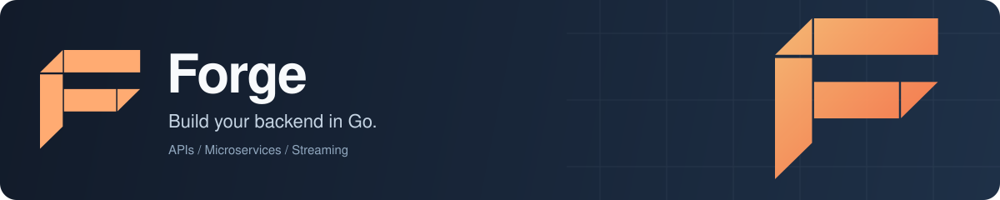
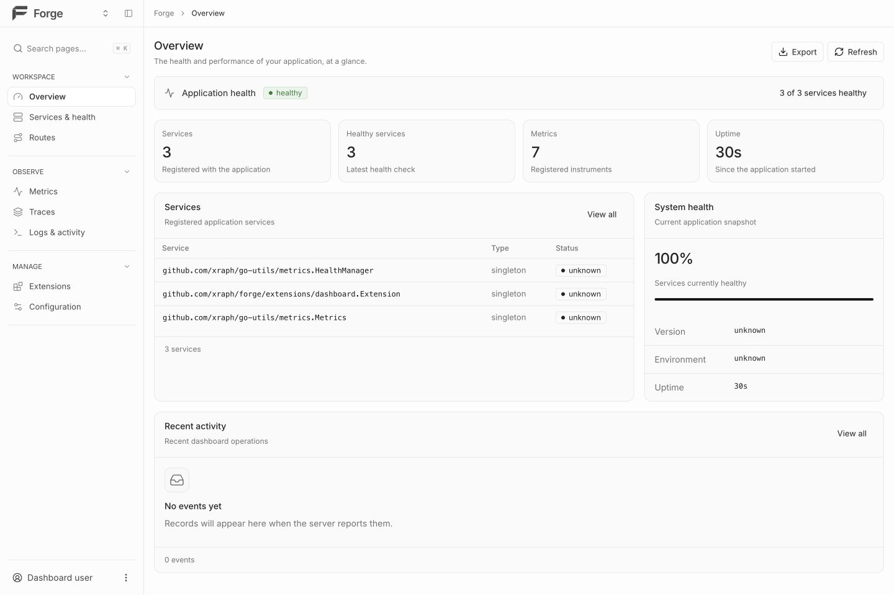
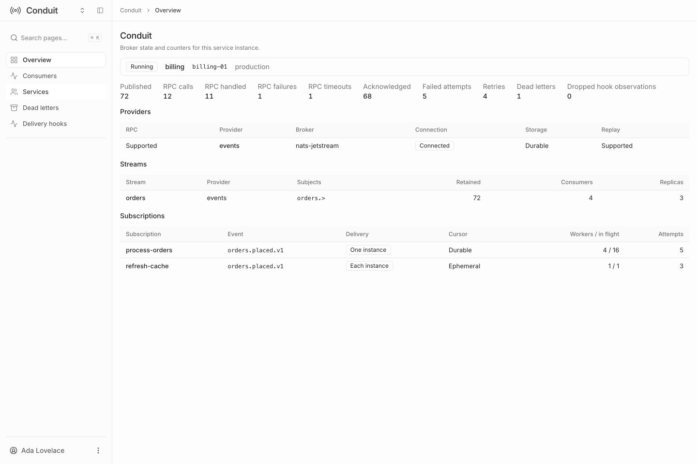
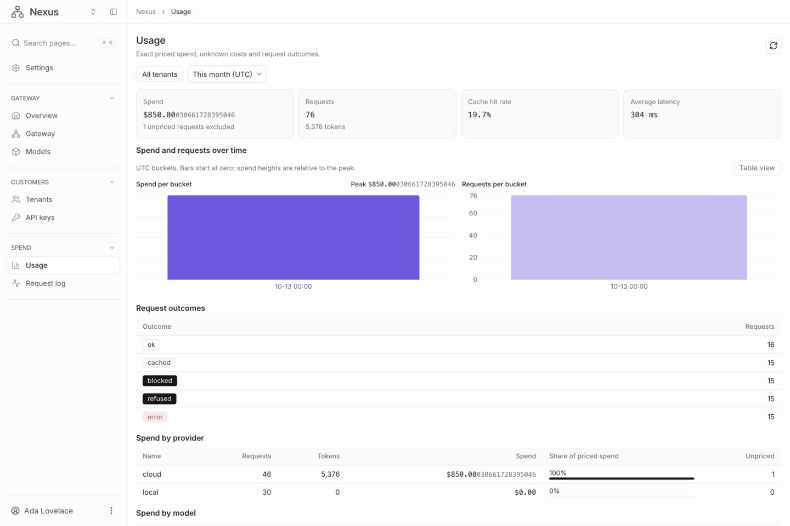

<p align="center">
  
</p>

# Forge: Go backend framework for APIs and microservices

Forge is an open-source Go framework for building REST APIs, microservices and real-time backends. You get HTTP routing, dependency injection, configuration, health checks, Prometheus metrics, OpenAPI and AsyncAPI specs, and generated TypeScript, Dart and Go clients, all running inside one application lifecycle. When you need more, you add extensions: gRPC, GraphQL, Kafka, MQTT, WebRTC, Raft consensus, MCP, or any of the eighteen [forgery libraries](#the-forgery-stack) for auth, billing, audit trails, webhooks, background jobs and AI.

[](https://go.dev/dl/) [](https://github.com/xraph/forge/actions/workflows/go.yml) [](https://pkg.go.dev/github.com/xraph/forge) [](https://github.com/xraph/forge/releases) [](https://github.com/xraph/forge/stargazers) [](LICENSE)

[Documentation](https://www.xraph.com/docs/forge) · [Quick start](#quick-start) · [CLI](#develop-with-the-forge-cli) · [Client SDKs](#generate-typescript-dart-and-go-clients) · [Dashboard](#forge-dashboard) · [Extensions](#extensions) · [Forgery stack](#the-forgery-stack) · [Examples](#examples) · [FAQ](#faq)

## Quick start

You need [Go 1.26 or later](https://go.dev/dl/). Start with a plain Go module:

```bash
mkdir hello-forge
cd hello-forge
go mod init example.com/hello-forge
go get github.com/xraph/forge@latest
```

Save this as `main.go`:

```go
package main

import (
	"log"
	"net/http"

	"github.com/xraph/forge"
)

func main() {
	app := forge.NewApp(forge.AppConfig{
		Name:          "hello-forge",
		HTTPAddress:   ":8080",
		HealthConfig:  forge.DefaultHealthConfig(),
		MetricsConfig: forge.DefaultMetricsConfig(),
	})

	err := app.Router().GET("/hello", func(ctx forge.Context) error {
		return ctx.JSON(http.StatusOK, map[string]string{
			"message": "Hello, Forge!",
		})
	})
	if err != nil {
		log.Fatal(err)
	}

	if err := app.Run(); err != nil {
		log.Fatal(err)
	}
}
```

Run it:

```bash
go mod tidy
go run .
```

Then, from another terminal:

```bash
curl http://localhost:8080/hello
# {"message":"Hello, Forge!"}

curl http://localhost:8080/_/health
```

That's a running service. You also get application metadata at `/_/info`, Prometheus metrics at `/_/metrics`, and liveness and readiness probes at `/_/health/live` and `/_/health/ready`, so a Kubernetes deployment can point its probes straight at them. Press Ctrl+C and the app shuts down gracefully, stopping extensions in reverse dependency order.

From here, follow the [first application guide](docs/content/docs/forge/first-app.mdx), or let the [CLI](#develop-with-the-forge-cli) scaffold a project for you.

## Why Forge?

Most Go routers stop at routing. Forge is for when you also want configuration, background components, observability and shutdown to follow the same conventions across every service you run. You can start with one endpoint and keep the same application model as you add a database, a queue, a second service and a mobile client.

| You need | Forge gives you |
| --- | --- |
| REST APIs with real contracts | HTTP routing, request binding and validation, middleware, and OpenAPI 3.1 schemas generated from your Go types |
| Services with dependencies | Generic registration and resolution through [Vessel](https://github.com/xraph/vessel), constructor injection, and managed service lifetimes |
| Predictable startup and shutdown | Extension dependency ordering, lifecycle hooks, health checks, and graceful shutdown |
| Configuration across environments | [Confy](https://github.com/xraph/confy), with YAML, JSON, TOML, environment variables, and app-scoped configuration |
| Visibility into a running service | Structured logs, Prometheus metrics, and OpenTelemetry tracing |
| Web, mobile and service clients | TypeScript, Dart and Go client generation from OpenAPI and AsyncAPI |
| Real-time and distributed services | WebSocket, SSE and WebTransport in the core, plus extensions for gRPC, GraphQL, brokers and service discovery |
| A path to production | `forge deploy` with a local workbench, Docker Compose and Kubernetes targets |

The [architecture guide](docs/content/docs/forge/architecture.mdx) explains how the router, the container and the extension lifecycle fit together. Already have an HTTP stack you like? Look at the [Chi, BunRouter and HttpRouter adapters](extras/README.md).

## Develop with the Forge CLI

The CLI installs separately from the framework:

```bash
go install github.com/xraph/forge/cmd/forge@latest
forge --version
```

If your shell can't find `forge`, add your Go binary directory to `PATH` (usually `$(go env GOPATH)/bin`, or your `GOBIN`). Prebuilt binaries are on [GitHub Releases](https://github.com/xraph/forge/releases), and you can install through Homebrew or Scoop too.

Create a project in its own directory:

```bash
mkdir my-service
cd my-service
forge init --name my-service --module example.com/my-service --layout single-module
forge generate app --name api
go mod tidy
forge dev
```

`forge init` configures the current directory and asks you to confirm the settings. `forge generate app` creates the runnable application, and `go mod tidy` resolves its imports. The dev server watches your files and reloads on change. Use `forge dev --port 8080` if you want another port.

| Task | Command |
| --- | --- |
| Generate a service | `forge generate service --name orders` |
| Generate a controller | `forge generate controller --name orders --app api` |
| Check your environment | `forge doctor` |
| Build your application | `forge build` |
| Inspect deployment configuration | `forge deploy inspect` |
| Open the deployment workbench | `forge deploy start` |

`forge --help` and `<command> --help` list every option. The [CLI guide](docs/content/docs/forge/%28cli%29/cli.mdx) and [deployment workbench guide](docs/content/docs/forge/%28cli%29/deployment-workbench.mdx) cover the full workflows and which providers are supported.

## Generate TypeScript, Dart and Go clients

Describe request and response types on your routes, turn on [OpenAPI](docs/content/docs/forge/openapi.mdx) or [AsyncAPI](docs/content/docs/forge/asyncapi.mdx), then generate a typed client from the exported spec:

```bash
forge client generate \
  --from-spec ./openapi.json \
  --language typescript \
  --output ./clients/web \
  --package "@acme/api-client" \
  --hooks
```

Swap in `--language dart` for a Dart package or `--language go` for a Go client. If your API has both HTTP and streaming endpoints, pass the OpenAPI and AsyncAPI files together. `--hooks` adds an operation manifest and typed hook facades over the client runtime, which the React, Vue, Angular, Flutter and Riverpod adapters build on.

| Client stack | Start here |
| --- | --- |
| TypeScript, React, Vue or Angular | [Web client guide](docs/content/docs/web-client/getting-started.mdx), [`@forge-go/client-core`](packages/client-core/), [framework adapters](docs/content/docs/web-client/adapters.mdx) |
| Dart, Flutter or Riverpod | [Dart client guide](docs/content/docs/dart-client/getting-started.mdx), [Flutter adapter](dart-packages/forge_client_flutter/), [Riverpod adapter](dart-packages/forge_client_riverpod/), [offline support](dart-packages/forge_client_offline/) |
| Go | [Client generator usage](internal/client/README.md#usage) |
| VS Code | the [Forge DevTools extension](vscode-forge/) |

`forge client watch` regenerates clients while you work, and `forge client check` fails CI when a committed client drifts from its spec. The [client CLI reference](docs/content/docs/web-client/cli.mdx) documents shared flags, configuration and exit codes. The [web](docs/content/docs/web-client/not-yet-shipped.mdx) and [Dart](docs/content/docs/dart-client/not-yet-shipped.mdx) notes list what isn't shipped yet.

## Forge Dashboard

Give your Forge application and its extensions a shared admin UI. [Forge Dashboard](https://github.com/xraph/forge-dashboard) combines an application overview, services and health, metrics, traces and extension pages in a React shell with scope switching, search, light and dark themes, and responsive navigation.



The Go dashboard extension serves the contract API. The React shell renders it, and each extension supplies its own scoped pages, navigation and actions. Installed plugins share the shell while keeping their queries and commands tied to their Go contributor and server-side permissions.

| In the dashboard | What you can do |
| --- | --- |
| Application operations | Inspect registered services, health checks, metrics and request traces |
| Extension workspaces | Switch to an extension's own navigation, settings, tables and detail pages |
| Capability-aware setup | See setup instructions and version mismatches before loading a plugin |
| Custom extensions | Register a Go contract contributor and a React plugin with `definePlugin` |
| Distributed services | Connect remote contributors explicitly or through service discovery |

<details>
<summary>More dashboard screenshots: Conduit and Nexus</summary>

### Conduit: messaging and service communication



### Nexus: AI gateway usage



These screenshots show the current React plugins using development fixture data. The application overview above connects to a running Go application. Demo counters and accounts are illustrative.

</details>

To enable the data API, import `github.com/xraph/forge/extensions/dashboard` and add `dashboard.NewExtension()` to your application's `Extensions` list. With the default base path, the contract endpoint is `/dashboard/api/dashboard/v1`.

Scaffold the UI with the CLI:

```bash
forge dashboard new my-dashboard
# Use --target next to scaffold a Next.js integration.
```

Follow the scaffold's instructions to install the dashboard packages, add your extension plugins and connect the UI to your Forge server. See the [dashboard integration guide](extensions/dashboard/README.md), [dashboard documentation](https://www.xraph.com/docs/forge/extensions/dashboard/features) and [React dashboard repository](https://github.com/xraph/forge-dashboard) for setup and plugin development.

## Extensions

You add capabilities to a Forge app through extensions. Each one registers its services in the container, reads its settings from `extensions.<name>` in your config, and joins the app's start, health and stop lifecycle. To add caching, for example:

```bash
go get github.com/xraph/forge/extensions/cache@latest
```

```go
import "github.com/xraph/forge/extensions/cache"

app := forge.NewApp(forge.AppConfig{
	Name: "orders",
	Extensions: []forge.Extension{
		cache.NewExtension(cache.WithDriver("inmemory")),
	},
})
```

Forge registers every extension before starting any of them, and stops them in reverse dependency order. These live in this repository:

| Extension and docs | What you get |
| --- | --- |
| [auth](extensions/auth/) · [Docs](https://www.xraph.com/docs/forge/extensions/auth/features) | API key, Bearer/JWT, Basic, OAuth 2.0, OpenID Connect and LDAP providers, with scope and role checks |
| [cache](extensions/cache/) · [Docs](https://www.xraph.com/docs/forge/extensions/cache/features) | In-memory key-value caching with TTLs (the Redis and Memcached drivers aren't implemented yet) |
| [conduit](extensions/conduit/) · [Docs](https://www.xraph.com/docs/forge/extensions/conduit/configuration) | Typed events, durable streams and HTTP/gRPC service clients over NATS, Redis, PostgreSQL or Kafka |
| [consensus](extensions/consensus/) · [Docs](https://www.xraph.com/docs/forge/extensions/consensus/features) | A Raft implementation with storage, transports and discovery (the extension doesn't wire them together yet) |
| [dashboard](extensions/dashboard/) · [Docs](https://www.xraph.com/docs/forge/extensions/dashboard/features) | Dashboard contract API, included in the root module |
| [discovery](extensions/discovery/) · [Docs](https://www.xraph.com/docs/forge/extensions/discovery/features) | Service registration and discovery over Consul, etcd, mDNS or a static seed list |
| [events](extensions/events/) · [Docs](https://www.xraph.com/docs/forge/extensions/events/features) | An event bus, an event store for event sourcing, and NATS or Redis brokers |
| [features](extensions/features/) · [Docs](https://www.xraph.com/docs/forge/extensions/features/features) | Feature flags with user targeting and percentage rollouts, evaluated in process |
| [graphql](extensions/graphql/) · [Docs](https://www.xraph.com/docs/forge/extensions/graphql/features) | A gqlgen GraphQL server (it serves its built-in schema only, for now) |
| [grpc](extensions/grpc/) · [Docs](https://www.xraph.com/docs/forge/extensions/grpc/features) | A gRPC server with health checks, reflection and TLS (registering your own services isn't reliable yet) |
| [hls](extensions/hls/) · [Docs](https://www.xraph.com/docs/forge/extensions/hls/features) | HTTP Live Streaming for live streams (segment delivery and VOD are unfinished) |
| [kafka](extensions/kafka/) · [Docs](https://www.xraph.com/docs/forge/extensions/kafka/features) | Apache Kafka producers, consumers and topic admin, built on Sarama |
| [mcp](extensions/mcp/) · [Docs](https://www.xraph.com/docs/forge/extensions/mcp/features) | Your routes as Model Context Protocol tools, plus resources and prompts (tool calls don't run your handler yet) |
| [mqtt](extensions/mqtt/) · [Docs](https://www.xraph.com/docs/forge/extensions/mqtt/features) | MQTT publish and subscribe, built on Eclipse Paho |
| [orpc](extensions/orpc/) · [Docs](https://www.xraph.com/docs/forge/extensions/orpc/features) | JSON-RPC 2.0 and an OpenRPC schema over the routes you already have |
| [queue](extensions/queue/) · [Docs](https://www.xraph.com/docs/forge/extensions/queue/features) | Message queues and background jobs over memory, Redis Streams, RabbitMQ or NATS JetStream |
| [search](extensions/search/) · [Docs](https://www.xraph.com/docs/forge/extensions/search/features) | Full-text search with an in-memory backend (the Elasticsearch, Meilisearch and Typesense drivers are placeholders) |
| [security](extensions/security/) · [Docs](https://www.xraph.com/docs/forge/extensions/security/features) | Security headers, rate limiting, CORS, CSRF, JWT, sessions and password hashing |
| [streaming](extensions/streaming/) · [Docs](https://www.xraph.com/docs/forge/extensions/streaming/features) | WebSocket and SSE with rooms, presence and replay after a reconnect |
| [webrtc](extensions/webrtc/) · [Docs](https://www.xraph.com/docs/forge/extensions/webrtc/features) | WebRTC rooms and peer connections on Pion (signaling and SFU forwarding are unfinished) |

Apart from the dashboard, each of these is its own Go module, so importing the root framework doesn't pull them in. Some are further along than others. Each extension's README has a status note where a part isn't finished, so read it before you build on one. To write your own, start with the [extension system guide](docs/content/docs/forge/extensions-system.mdx) and the [simple extension example](examples/simple-extension/).

## The forgery stack

Forgery is the family of Go libraries built on Forge. Each one is a library rather than a hosted service: you import it, bring your own database, and it runs inside your process. Many work standalone, and they ship Forge integration packages (`extension`, or `forgeext` in Fabriq) that wire config, DI registration and health checks into your app.

| Library and docs | What it does |
| --- | --- |
| [Grove](https://github.com/xraph/grove) · [Docs](https://www.xraph.com/docs/grove) | Polyglot ORM that writes each database's native query syntax, with migrations and CRDT sync |
| [Fabriq](https://github.com/xraph/fabriq) · [Docs](https://www.xraph.com/docs/fabriq) | Data fabric: one transactional write that fans out to relational, time-series, vector, graph and search engines |
| [Trove](https://github.com/xraph/trove) · [Docs](https://www.xraph.com/docs/trove) | Object storage over local disk, S3, GCS, Azure and SFTP, with middleware for encryption, compression and scanning |
| [Authsome](https://github.com/xraph/authsome) · [Docs](https://www.xraph.com/docs/authsome) | Plugin-driven authentication and identity: sign-in, sessions, organizations, OAuth |
| [Warden](https://github.com/xraph/warden) · [Docs](https://www.xraph.com/docs/warden) | Authorization engine with RBAC, ABAC and ReBAC behind one check API |
| [Keysmith](https://github.com/xraph/keysmith) · [Docs](https://www.xraph.com/docs/keysmith) | API key lifecycle: generation, hashed storage, rotation, revocation and usage analytics |
| [Vault](https://github.com/xraph/vault) · [Docs](https://www.xraph.com/docs/vault) | Encrypted secrets, rule-based feature flags and hot-reloadable runtime config |
| [Chronicle](https://github.com/xraph/chronicle) · [Docs](https://www.xraph.com/docs/chronicle) | Tamper-evident audit trail on a SHA-256 hash chain, for SOC 2, HIPAA and GDPR work |
| [Ledger](https://github.com/xraph/ledger) · [Docs](https://www.xraph.com/docs/ledger) | Usage-based billing: metering, entitlements, plans, subscriptions and invoices |
| [Relay](https://github.com/xraph/relay) · [Docs](https://www.xraph.com/docs/relay) | Webhook delivery with tenant-scoped endpoints, signatures, retries and replay |
| [Herald](https://github.com/xraph/herald) · [Docs](https://www.xraph.com/docs/herald) | Notifications over email, SMS, push and in-app, with templates and i18n |
| [Dispatch](https://github.com/xraph/dispatch) · [Docs](https://www.xraph.com/docs/dispatch) | Durable execution: background jobs, workflows, cron schedules and distributed workers |
| [Bastion](https://github.com/xraph/bastion) · [Docs](https://www.xraph.com/docs/bastion) | API gateway that turns a Forge app into a reverse proxy for HTTP, WebSocket, SSE and gRPC |
| [Nexus](https://github.com/xraph/nexus) · [Docs](https://www.xraph.com/docs/nexus) | AI gateway that routes, caches, guards and observes LLM traffic |
| [Weave](https://github.com/xraph/weave) · [Docs](https://www.xraph.com/docs/weave) | RAG pipeline: ingestion, chunking, embeddings, vector storage, retrieval and prompt assembly |
| [Cortex](https://github.com/xraph/cortex) · [Docs](https://www.xraph.com/docs/cortex) | Agent orchestration with skills, traits, behaviors and personas |
| [Sentinel](https://github.com/xraph/sentinel) · [Docs](https://www.xraph.com/docs/sentinel) | LLM evaluation with scoring, baseline regression detection and red-team tests |
| [Shield](https://github.com/xraph/shield) · [Docs](https://www.xraph.com/docs/shield) | Safety policies and guardrail configuration for prompts and outputs (the scanning layers aren't implemented yet) |

Putting several of them in one app looks like this. Each extension finds its settings under `extensions.<name>` in your config file and resolves its dependencies (Grove's database, usually) from the container:

```go
import (
	authsome "github.com/xraph/authsome/extension"
	chronicle "github.com/xraph/chronicle/extension"
	dispatch "github.com/xraph/dispatch/extension"
	grove "github.com/xraph/grove/extension"
	warden "github.com/xraph/warden/extension"
)

app := forge.NewApp(forge.AppConfig{
	Name: "billing-api",
	Extensions: []forge.Extension{
		grove.New(),     // database access, configured under extensions.grove
		authsome.New(),  // users, sessions and organizations
		warden.New(),    // permission checks
		chronicle.New(), // audit trail for every change
		dispatch.New(),  // background jobs and scheduled work
	},
})
```

Read each library's README for its options and storage backends. After every Forge release the forgery repos re-pin to it in dependency order, Grove first and Cortex last.

### Building blocks

These libraries support Forge and the wider ecosystem, and you can also use them on their own:

| Library | What it provides |
| --- | --- |
| [Vessel](https://github.com/xraph/vessel) | The dependency injection container, with constructor injection and typed service keys |
| [Confy](https://github.com/xraph/confy) | Configuration loading from files, environment variables and remote sources |
| [go-utils](https://github.com/xraph/go-utils) | Structured errors, the logger and metrics primitives |
| [FARP](https://github.com/xraph/farp) | The service manifest and schema discovery protocol gateways read |
| [ForgeUI](https://github.com/xraph/forgeui) | Server-rendered UI components in Go, built on templ |
| [AI SDK](https://github.com/xraph/ai-sdk) | LLM SDK for Go, and the replacement for the old `ai` extension |

The old `ai`, `cron`, `database`, `gateway` and `storage` directories under `extensions/` only hold a README now. Each one points at its replacement (AI SDK, Dispatch, Grove plus [`models`](models/), Bastion and Trove). Follow those notes if you're upgrading an app that still imports them.

## Documentation

Browse [Forge documentation on xraph.com](https://www.xraph.com/docs/forge), or read the versioned guides in this repository:

| What you want to do | Guide |
| --- | --- |
| Install Forge and build your first service | [Installation](docs/content/docs/forge/installation.mdx), [first app](docs/content/docs/forge/first-app.mdx) |
| Register dependencies and manage startup | [Dependency injection](docs/content/docs/forge/dependency-injection.mdx), [application lifecycle](docs/content/docs/forge/lifecycle.mdx) |
| Define routes, middleware and errors | [Routing](docs/content/docs/forge/%28router%29/router.mdx), [middleware](docs/content/docs/forge/%28router%29/middleware.mdx), [error handling](docs/content/docs/forge/error-handling.mdx) |
| Configure a service per environment | [Configuration](docs/content/docs/forge/configuration.mdx), [`.forge.yaml`](docs/content/docs/forge/forge-yaml.mdx) |
| Document and stream your API | [OpenAPI](docs/content/docs/forge/openapi.mdx), [AsyncAPI](docs/content/docs/forge/asyncapi.mdx), [streaming](docs/content/docs/forge/%28streaming%29/streaming.mdx) |
| Add operational checks | [Health checks](docs/content/docs/forge/health.mdx), [metrics](docs/content/docs/forge/metrics.mdx), [observability](docs/content/docs/forge/observability.mdx) |

The exported Go API is on [pkg.go.dev](https://pkg.go.dev/github.com/xraph/forge). If you work with a coding agent, point it at [AGENTS.md](AGENTS.md) for repository conventions and [llm.txt](llm.txt) for a map of the framework packages. Many packages carry their own `llm.txt` as well.

## Examples

Read the code before you pick a pattern:

| Example | What you'll learn |
| --- | --- |
| [DI patterns](examples/di-patterns/) | Container registration and dependency resolution |
| [Lifecycle hooks](examples/lifecycle-hooks/) | Startup and shutdown hooks |
| [Config autodiscovery](examples/config-autodiscovery/) | How an app finds its config files |
| [Observability](examples/observability/) | Logs, metrics and tracing |
| [OpenAPI](examples/openapi-demo/) | API schema generation from Go types |
| [File upload](examples/file_upload/) | Multipart uploads with typed binding |
| [SSE streaming](examples/sse-streaming/) | Server-sent events |
| [WebTransport](examples/webtransport/) | Streams and datagrams over HTTP/3 |
| [FARP discovery](examples/farp-discovery-example/) | Publishing a service manifest for gateways |
| [Runnable extension](examples/runnable-extension/) | A background component the app manages |

Many examples have their own `go.mod`. Run them from their directory with `GOWORK=off`, and check their README for the services they expect. There are [more examples](examples/), and most extensions keep their own under `extensions/<name>/examples/`.

## FAQ

### How is Forge different from Gin, Echo, Fiber or Chi?

Forge combines an HTTP router with a DI container, configuration, lifecycle management, health and metrics endpoints, spec generation and client generation. If you already use Chi's router, you can keep it through the [adapters](extras/README.md).

### Is Forge production-ready?

Forge is on its 1.x line and runs the eighteen forgery libraries above, which re-pin to each release. Check [GitHub Releases](https://github.com/xraph/forge/releases) for the current version and [CHANGELOG.md](CHANGELOG.md) for what changed.

### Do I have to use every part of it?

No. An app with one route and no extensions is a valid Forge app. Extensions and forgery libraries are separate Go modules, so you only download what you import.

### Can my frontend or mobile app call a Forge API with types?

Yes. Generate a TypeScript or Dart client from the OpenAPI spec, and use the React, Vue, Angular, Flutter or Riverpod adapters on top of it.

## Contributing

Bug reports, doc fixes and focused pull requests are welcome. Open an [issue](https://github.com/xraph/forge/issues) with a reproduction, or start a [discussion](https://github.com/xraph/forge/discussions) for questions and design ideas.

To work on the root module:

```bash
git clone https://github.com/xraph/forge.git
cd forge
GOWORK=off go test -race ./...
make install-lint
GOWORK=off make f
GOWORK=off make l
```

Root tests stop at Go module boundaries, so test a changed extension from its own directory. The CLI needs a temporary workspace to test against your local root module. [AGENTS.md](AGENTS.md) has the exact commands, toolchain versions and integration-test prerequisites, and [CONTRIBUTING.md](CONTRIBUTING.md) has the contribution guidelines. Commits follow [Conventional Commits](https://www.conventionalcommits.org/).

Releases go out through the [Release workflow](https://github.com/xraph/forge/actions/workflows/release.yml), never a hand-pushed tag. [AGENTS.md](AGENTS.md#releasing) explains module tags and the dry-run step.

## License and credits

Forge is available under the [Apache License 2.0](LICENSE). Forge™ and Forge Cloud™ are trademarks of XRAPH™. See [TRADEMARKS](TRADEMARKS).

Built by [Rex Raphael](https://github.com/juicycleff) and [contributors](https://github.com/xraph/forge/graphs/contributors). Thanks to [Chi](https://github.com/go-chi/chi) for its influence on the router, and to [Bun](https://github.com/uptrace/bun) and [Uptrace](https://github.com/uptrace/uptrace).
