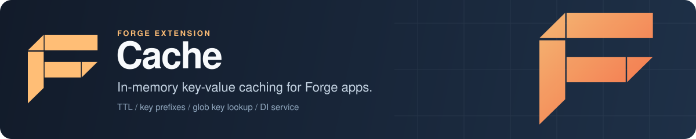

<p align="center">
  
</p>

# Forge Cache: in-memory caching for Go services

Forge Cache is the caching extension for [Forge](https://github.com/xraph/forge), the Go backend framework. You add it to your app and get a key-value cache with per-key TTLs, a default expiry, key prefixes for namespacing, glob-style key lookup and size limits, registered in the dependency injection container so any service can ask for it. Today the in-memory driver is the one that works. The config also accepts `redis` and `memcached`, but those drivers aren't implemented yet, so read [Drivers](#drivers) before you plan around them.

[](https://go.dev/dl/) [](https://github.com/xraph/forge/actions/workflows/go.yml) [](https://pkg.go.dev/github.com/xraph/forge/extensions/cache) [](../../LICENSE)

[Documentation](https://www.xraph.com/docs/forge/extensions/cache/features) · [Quick start](#quick-start) · [Features](#features) · [Using the cache](#using-the-cache) · [Drivers](#drivers) · [Configuration](#configuration) · [FAQ](#faq)

## Quick start

You need [Go 1.26 or later](https://go.dev/dl/) and a Forge app. Add the extension module:

```bash
go get github.com/xraph/forge@latest
go get github.com/xraph/forge/extensions/cache@latest
```

Save this as `main.go`:

```go
package main

import (
	"errors"
	"log"
	"net/http"
	"time"

	"github.com/xraph/forge"
	"github.com/xraph/forge/extensions/cache"
)

func main() {
	app := forge.NewApp(forge.AppConfig{
		Name:        "cache-demo",
		HTTPAddress: ":8080",
		Extensions: []forge.Extension{
			cache.NewExtension(
				cache.WithDefaultTTL(10*time.Minute),
				cache.WithPrefix("demo:"),
			),
		},
	})

	err := app.Router().GET("/greeting", func(ctx forge.Context) error {
		c, err := cache.GetCache(app.Container())
		if err != nil {
			return err
		}

		value, err := c.Get(ctx.Context(), "greeting")
		if errors.Is(err, cache.ErrNotFound) {
			value = []byte("Hello from the cache")
			if err := c.Set(ctx.Context(), "greeting", value, 30*time.Second); err != nil {
				return err
			}

			return ctx.JSON(http.StatusOK, map[string]string{"source": "miss", "value": string(value)})
		}
		if err != nil {
			return err
		}

		return ctx.JSON(http.StatusOK, map[string]string{"source": "hit", "value": string(value)})
	})
	if err != nil {
		log.Fatal(err)
	}

	if err := app.Run(); err != nil {
		log.Fatal(err)
	}
}
```

Run it and call the route twice:

```bash
go mod tidy
go run .

curl http://localhost:8080/greeting
# {"source":"miss","value":"Hello from the cache"}
curl http://localhost:8080/greeting
# {"source":"hit","value":"Hello from the cache"}
```

The second call comes from memory. Wait thirty seconds and you get a miss again, because the handler wrote that key with its own 30-second TTL and that wins over the ten-minute default you set on the extension. When you stop the app with Ctrl+C, Forge stops the cache service along with everything else, and the in-memory store is emptied.

## Features

| You need | Forge Cache gives you |
| --- | --- |
| A cache any service can inject | A `cache.Cache` interface and a `*cache.CacheService` registered in the Vessel container, also under the name `"cache"` |
| Entries that expire on their own | A TTL per `Set`, a `DefaultTTL` for `Set` calls that pass `0`, plus `TTL` and `Expire` to read and change it later |
| Several apps or tenants sharing a key space | A `Prefix` added to every key on write and removed again from `Keys` results |
| Bounded memory use | `MaxSize` (entries), `MaxKeySize` and `MaxValueSize` (bytes), checked on every `Set` |
| Finding keys by pattern | `Keys(ctx, "user:*")` with `*` wildcards |
| Strings and structs without hand-written encoding | `StringCache` and `JSONCache` helpers on the in-memory backend |
| To know it's working | Hit, miss, set, delete, clear and eviction counters through Forge metrics, and a `Health` method on the service that pings the backend |

## Using the cache

### Inject it into your own services

The extension registers a constructor, so you can take `cache.Cache` as a parameter like any other dependency:

```go
type UserService struct {
	cache cache.Cache
}

func NewUserService(c cache.Cache) *UserService {
	return &UserService{cache: c}
}

// In your setup code, after forge.NewApp:
err := forge.Provide(app.Container(), NewUserService)
```

If you'd rather pull it out yourself, `cache.GetCache(container)`, `cache.GetCacheFromApp(app)` and `forge.Inject[cache.Cache](container)` all return the same singleton. `MustGetCache` and `MustGetCacheFromApp` panic when it isn't registered.

### The Cache interface

Every value is a `[]byte`. These methods are on `cache.Cache`:

| Method | What it does |
| --- | --- |
| `Get(ctx, key)` | Returns the value, or `cache.ErrNotFound` when the key is missing or expired |
| `Set(ctx, key, value, ttl)` | Stores a copy of `value`. A `ttl` of `0` uses `DefaultTTL` |
| `Delete(ctx, key)` | Removes a key. Deleting a missing key is not an error |
| `Exists(ctx, key)` | Reports whether a live entry exists |
| `Keys(ctx, pattern)` | Lists live keys matching a glob such as `*`, `user:*`, `*:draft` or `user:*:profile` |
| `TTL(ctx, key)` | Returns the time left, or `0` for an entry that never expires |
| `Expire(ctx, key, ttl)` | Sets a new TTL. A `ttl` of `0` or less makes the entry permanent |
| `Clear(ctx)` | Empties the whole cache |
| `Ping(ctx)` | Returns `cache.ErrNotConnected` until the service has started |

`Connect` and `Disconnect` are on the interface too. You don't call them: the extension does that for you during start and stop.

Two things to know about `Keys`. It supports one `*` per pattern, and a pattern with two wildcards matches nothing. It also walks every entry while holding the read lock, so if your cache is large you should keep it off hot request paths. A typical cleanup looks like this:

```go
keys, err := c.Keys(ctx, "session:*")
if err != nil {
	return err
}

for _, k := range keys {
	if err := c.Delete(ctx, k); err != nil {
		return err
	}
}
```

### Strings and JSON

The in-memory backend also implements `cache.StringCache` (`GetString`, `SetString`) and `cache.JSONCache` (`GetJSON`, `SetJSON`). The `cache.Cache` you get from the container doesn't expose them directly, so ask for the service and type-assert its backend:

```go
svc, err := forge.Inject[*cache.CacheService](app.Container())
if err != nil {
	return err
}

jc, ok := svc.Cache().(cache.JSONCache)
if !ok {
	return errors.New("backend does not support JSON helpers")
}

if err := jc.SetJSON(ctx, "user:42", User{ID: "42", Name: "Ada"}, time.Hour); err != nil {
	return err
}

var u User
err = jc.GetJSON(ctx, "user:42", &u)
```

`cache.CounterCache` (`Incr`, `DecrBy` and friends) and `cache.MultiCache` (`MGet`, `MSet`, `MDelete`) are declared in the package, but no backend implements them yet.

### Errors

| Error | When you'll see it |
| --- | --- |
| `cache.ErrNotFound` | `Get`, `TTL` or `Expire` on a key that is missing or expired |
| `cache.ErrNotConnected` | Any call before the app has started the cache, or after it stopped |
| `cache.ErrKeyTooLarge` | A key longer than `MaxKeySize` bytes |
| `cache.ErrValueTooLarge` | A value larger than `MaxValueSize` bytes |
| `cache.ErrInvalidTTL` | A negative `DefaultTTL` in the config |

Compare them with `errors.Is`. An empty key on `Set` returns a plain error.

## Drivers

| Driver | Status |
| --- | --- |
| `inmemory` | Works. A map guarded by a read-write mutex, with a background sweep every `CleanupInterval` that removes expired entries |
| `redis` | Accepted by config validation (it needs a `URL`), but service construction fails with "redis driver not yet implemented" |
| `memcached` | Same as `redis`: validated, then construction fails with "memcached driver not yet implemented" |

So for now the cache lives in one process. If you run two replicas of your service, each has its own copy, and a restart empties it.

When the in-memory cache holds `MaxSize` entries, the next `Set` removes one entry first. It picks an expired entry if it finds one, and otherwise an arbitrary entry in Go map order. That is not LRU. If you need hot keys to survive, size `MaxSize` so you rarely reach it.

## Configuration

You can configure the extension in code with options, or in YAML under `extensions.cache` (the extension also reads a top-level `cache` key).

### Options

| Option | Sets |
| --- | --- |
| `WithDriver(string)` | `Driver`: `inmemory`, `redis` or `memcached` |
| `WithURL(string)` | `URL`, required for `redis` and `memcached` |
| `WithDefaultTTL(time.Duration)` | `DefaultTTL` |
| `WithMaxSize(int)` | `MaxSize` |
| `WithPrefix(string)` | `Prefix` |
| `WithConnectionPoolSize(int)` | `ConnectionPoolSize` |
| `WithRequireConfig(bool)` | `RequireConfig`: fail at startup if no YAML config is found |
| `WithConfig(cache.Config)` | Replaces the whole config |

`NewExtensionWithConfig(cfg)` is the same as `NewExtension(WithConfig(cfg))`.

### Fields and defaults

| Field | Default (`DefaultConfig()`) | Notes |
| --- | --- | --- |
| `Driver` | `inmemory` | |
| `URL` | empty | |
| `DefaultTTL` | `5m` | Used when `Set` gets a TTL of `0` |
| `MaxSize` | `10000` | Entries. `0` means no limit |
| `CleanupInterval` | `1m` | How often expired entries are swept |
| `MaxKeySize` | `250` | Bytes. `0` means no limit |
| `MaxValueSize` | `1048576` | Bytes (1 MiB). `0` means no limit |
| `Prefix` | empty | |
| `ConnectionPoolSize` | `10` | Reserved for network drivers |
| `ConnectionTimeout`, `ReadTimeout`, `WriteTimeout` | `5s`, `3s`, `3s` | Reserved for network drivers |
| `RequireConfig` | `false` | |

### YAML

`Config` has no YAML tags, so the keys are the Go field names, spelled exactly as above. `MaxSize` works and `max_size` or `maxsize` is silently ignored:

```yaml
extensions:
  cache:
    Driver: inmemory
    DefaultTTL: 10m
    MaxSize: 50000
    Prefix: "orders:"
```

A plain `cache.NewExtension()` picks up every key in that block. YAML overrides `DefaultConfig()` and options you set in code override YAML, and fields you leave out of the file keep their defaults.

Forge reads `config.yaml` only when `EnableConfigAutoDiscovery` is on. `forge.DefaultAppConfig()` turns it on, but an `AppConfig` literal like the one in the quick start leaves it off, so set it yourself or pass your own `ConfigManager`.

## Documentation

| Topic | Where |
| --- | --- |
| Features and usage | [Cache features](https://www.xraph.com/docs/forge/extensions/cache/features) |
| Configuration reference | [Cache configuration](https://www.xraph.com/docs/forge/extensions/cache/configuration) |
| Function reference | [Cache functions](https://www.xraph.com/docs/forge/extensions/cache/functions) |
| Go API | [pkg.go.dev](https://pkg.go.dev/github.com/xraph/forge/extensions/cache) |
| How extensions load config and register services | [Forge extension system](../../docs/content/docs/forge/extensions-system.mdx) |

The docs pages were written before this README, so where they disagree about drivers or config keys, the tables above match the code.

## FAQ

### How do I add caching to a Go web app built on Forge?

Add `cache.NewExtension()` to `Extensions` in `forge.AppConfig`, then inject `cache.Cache` wherever you need it. The [quick start](#quick-start) is a complete program.

### Does Forge Cache support Redis or Memcached?

Not yet. Both driver names pass config validation, but the service returns a "not yet implemented" error when it's constructed, so the app fails to start. Use `inmemory` until a network driver lands.

### Is the in-memory cache safe for concurrent use?

Yes. All reads and writes go through a `sync.RWMutex`, and the extension's tests run concurrent goroutines against it.

### What happens when the cache is full?

When it holds `MaxSize` entries, the next `Set` removes one expired entry, or an arbitrary entry if none has expired, and then stores the new one. Set `MaxSize` to `0` for no limit.

### Can I store structs in the cache?

Yes, through `JSONCache.SetJSON` and `GetJSON` on the backend, as shown in [Strings and JSON](#strings-and-json). Otherwise you encode to `[]byte` yourself.

## Contributing

The cache is its own Go module inside the [Forge repository](https://github.com/xraph/forge). Build, vet and test it from its directory the way CI does:

```bash
cd extensions/cache
GOWORK=off go build ./...
GOWORK=off go vet ./...
GOWORK=off go test -short -count=1 ./...
golangci-lint run ./...
```

Forge's [AGENTS.md](../../AGENTS.md) has the pinned lint version and the rest of the repository conventions. Commits follow [Conventional Commits](https://www.conventionalcommits.org/), for example `fix(cache): ...`.

## License

Forge Cache is part of Forge and is available under the [Apache License 2.0](../../LICENSE).
