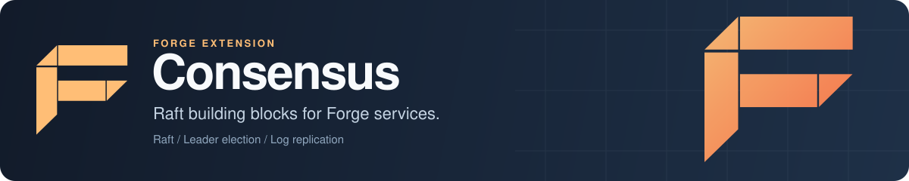

<p align="center">
  
</p>

# Forge Consensus: Raft consensus building blocks for Go

Forge Consensus is the Raft consensus module for [Forge](https://github.com/xraph/forge), the Go backend framework. It holds a Raft implementation in Go with leader election, pre-vote, log replication and snapshots, plus the pieces a node is built from: log storage on BadgerDB, BoltDB or memory, TCP, HTTP, gRPC and in-process transports, peer discovery through static lists, DNS, Consul, etcd or Kubernetes, and in-memory and persistent state machines. A Forge extension sits on top and runs a node from configuration. Read the [status](#status) before you pick it for a distributed system.

[](https://go.dev/dl/) [](https://github.com/xraph/forge/actions/workflows/go.yml) [](https://pkg.go.dev/github.com/xraph/forge/extensions/consensus) [](../../LICENSE)

[Documentation](https://www.xraph.com/docs/forge/extensions/consensus) · [Quick start](#quick-start) · [Status](#status) · [Packages](#packages) · [The Forge extension](#the-forge-extension) · [Configuration](#configuration) · [FAQ](#faq)

## Quick start

You need [Go 1.26 or later](https://go.dev/dl/). Add Forge and the module:

```bash
go get github.com/xraph/forge@latest
go get github.com/xraph/forge/extensions/consensus@latest
```

This program builds a three-node Raft cluster in one process, using the in-process transport the module's own cluster tests run on. It waits for a leader, writes a key through it, and checks that every node has committed the entry:

```go
package main

import (
	"context"
	"encoding/json"
	"fmt"
	"log"
	"time"

	"github.com/xraph/forge"
	"github.com/xraph/forge/extensions/consensus"
	"github.com/xraph/forge/extensions/consensus/raft"
	"github.com/xraph/forge/extensions/consensus/statemachine"
	"github.com/xraph/forge/extensions/consensus/storage"
	"github.com/xraph/forge/extensions/consensus/transport"
)

func main() {
	ctx := context.Background()
	logger := forge.NewNoopLogger()
	ids := []string{"node-1", "node-2", "node-3"}

	transports := map[string]*transport.LocalTransport{}
	nodes := map[string]*raft.Node{}
	machines := map[string]*statemachine.MemoryStateMachine{}

	// Build three nodes, each with its own log storage and state machine.
	for _, id := range ids {
		tr := transport.NewLocalTransport(transport.LocalTransportConfig{NodeID: id}, logger)
		st := storage.NewMemoryStorage(storage.MemoryStorageConfig{}, logger)
		sm := statemachine.NewMemoryStateMachine(statemachine.MemoryStateMachineConfig{}, logger)

		node, err := raft.NewNode(raft.Config{
			NodeID:             id,
			HeartbeatInterval:  100 * time.Millisecond,
			ElectionTimeoutMin: 300 * time.Millisecond,
			ElectionTimeoutMax: 600 * time.Millisecond,
		}, logger, sm, tr, st)
		if err != nil {
			log.Fatal(err)
		}

		if err := st.Start(ctx); err != nil {
			log.Fatal(err)
		}

		transports[id], nodes[id], machines[id] = tr, node, sm
	}

	// Connect every node to every other node, then start them.
	for _, id := range ids {
		for _, peer := range ids {
			if peer != id {
				transports[id].Connect(transports[peer])
				nodes[id].AddPeer(peer)
			}
		}
	}

	for _, id := range ids {
		if err := transports[id].Start(ctx); err != nil {
			log.Fatal(err)
		}

		if err := nodes[id].Start(ctx); err != nil {
			log.Fatal(err)
		}
	}

	// Wait for an election.
	leader := ""
	for leader == "" {
		time.Sleep(100 * time.Millisecond)

		for id, node := range nodes {
			if node.IsLeader() {
				leader = id
			}
		}
	}

	fmt.Println("leader:", leader)

	// Writes go to the leader and return once a majority has the entry.
	cmd, err := json.Marshal(consensus.Command{
		Type:    "set",
		Payload: map[string]any{"key": "greeting", "value": "hello"},
	})
	if err != nil {
		log.Fatal(err)
	}

	if err := nodes[leader].Propose(ctx, cmd); err != nil {
		log.Fatal(err)
	}

	value, err := machines[leader].Query(map[string]any{"type": "get", "key": "greeting"})
	fmt.Println("greeting:", value, err)

	// Followers learn the new commit index on the next heartbeat.
	time.Sleep(300 * time.Millisecond)

	for _, id := range ids {
		fmt.Println(id, "commit index:", nodes[id].GetCommitIndex())
	}
}
```

Run it with `go mod tidy && go run .`:

```text
leader: node-2
greeting: hello <nil>
node-1 commit index: 2
node-2 commit index: 2
node-3 commit index: 2
```

Entry 1 is the no-op every new leader writes, and entry 2 is your `set`. Calling `Propose` on a follower returns a not-leader error that names the current leader, which you can check with `consensus.IsNotLeaderError`.

## Status

This module has not run a production cluster yet. Here's what is covered by tests in this repository:

| Piece | State |
| --- | --- |
| Leader election, log replication and applying entries in `raft` | Three node clusters elect a leader and replicate commands to every state machine over the in-process, TCP, HTTP and gRPC transports |
| Durability | The log, term and vote are reloaded from storage on restart; a node only acknowledges entries and votes it has persisted |
| Snapshots | Nodes compact their log into snapshots, and a follower that falls behind the snapshot catches up through InstallSnapshot, sent in chunks |
| `consensus.NewExtension` | Builds storage, transport, state machine and Raft node from config and replicates over TCP, HTTP or gRPC, with TLS and mTLS. See [the Forge extension](#the-forge-extension) |
| Membership and leadership transfer | Servers are added (as a learner first, then promoted) and removed one at a time through the log, the leader included. `TransferLeadership` hands over to a chosen voter and gives up after an election timeout. Membership survives restarts and snapshots |
| Not implemented | Linearizable reads, encryption at rest, and dynamic discovery in the extension (the initial members come from the static list) |

## Packages

You assemble a node from these packages yourself, the way the quick start does. Each one has a constructor that takes a config struct and a `forge.Logger`:

| Package | What's in it |
| --- | --- |
| [`raft`](raft/) | `raft.NewNode(config, logger, stateMachine, transport, storage)`, elections, replication, snapshots, `Propose`, `AddPeer` |
| [`storage`](storage/) | `NewMemoryStorage`, `NewBadgerStorage`, `NewBoltDBStorage`, and a write-ahead log (`NewWAL`) |
| [`transport`](transport/) | `NewLocalTransport` (in process), `NewTCPTransport`, `NewHTTPTransport`, `NewGRPCTransport`, TLS helpers and serializers |
| [`statemachine`](statemachine/) | `NewMemoryStateMachine` (a key-value map with `set`, `delete` and `increment`) and `NewPersistentStateMachine` |
| [`discovery`](discovery/) | `NewStaticDiscovery`, `NewDNSDiscovery`, `NewConsulDiscovery`, `NewEtcdDiscovery`, `NewKubernetesDiscovery` |
| [`cluster`](cluster/) | Membership, quorum and topology tracking with `cluster.NewManager` |
| [`middleware`](middleware/) | Wrappers for Forge handlers that require leadership or quorum, enforce a read consistency level, or redirect writes to the leader |
| [`testing`](testing/) | An in-process cluster harness and the cluster tests |

From the root package you get the shared types (`RaftNode`, `StateMachine`, `Storage`, `Transport`, `Command`, `LogEntry`), the role and event constants, and the errors (`ErrNotLeader`, `ErrNoQuorum` and the rest, with `IsNotLeaderError`, `IsNoQuorumError` and `IsRetryable`). To plug in your own state machine, implement `Apply`, `Snapshot`, `Restore` and `Query` from `consensus.StateMachine`.

## The Forge extension

```go
app := forge.NewApp(forge.AppConfig{
	Name: "orders",
	Extensions: []forge.Extension{
		consensus.NewExtension(
			consensus.WithNodeID("node-1"),
			consensus.WithClusterID("orders"),
			consensus.WithBindAddress("0.0.0.0", 7000),
			consensus.WithPeers([]consensus.PeerConfig{
				{ID: "node-2", Address: "10.0.0.2", Port: 7000},
				{ID: "node-3", Address: "10.0.0.3", Port: 7000},
			}),
		),
	},
})
```

`Start` builds the node from config: storage (`badger` or `boltdb` under `storage.path`, or `memory`), the `tcp`, `http` or `grpc` transport on `bind_addr:bind_port` with `transport.max_message_size`, a memory state machine, and a Raft node whose peers are the `peers` list. With `security.enable_tls` the transport serves and dials over TLS; with `enable_mtls` it also requires client certificates and refuses messages whose sender is not named in the certificate (each node's certificate must carry its node ID as a DNS subject alternative name).

All three network transports carry the same versioned JSON envelope. The gRPC transport sends each message as one unary call to `forge.consensus.raft.v1.Transport/Send` with a raw bytes codec, so no protoc step or generated code is involved. It keeps one connection per peer, applies `transport.max_message_size` as the gRPC send and receive limit, caps inbound connections at `transport.max_connections`, and pings idle connections every `transport.keep_alive_interval`. A peer on another protocol version, an oversized message or a sender that does not match its client certificate is refused with a gRPC status, which `Send` returns as `ErrProtocolVersion`, `ErrMessageTooLarge` or a permission error.

| Call | Result |
| --- | --- |
| `Apply` | On the leader, appends the command and returns once it is committed and applied. Elsewhere `ErrNotLeader` |
| `Read` | Queries the local state machine, which may lag the leader on a follower |
| `Snapshot` | Snapshots the state machine and compacts the log |
| `StepDown` | The leader returns to follower |
| `AddNode` | On the leader, adds a running server that was started with `join: true`. It joins as a learner and becomes a voter once it has caught up. Only one change runs at a time (`raft.ErrConfigChangeInProgress`) |
| `RemoveNode` | On the leader, removes a server. Removing the leader is allowed; it steps down once the change commits |
| `TransferLeadership` | On the leader, hands leadership to a voter. Writes are refused while it runs, and it fails with `raft.ErrLeadershipTransferFailed` if the target has not taken over within an election timeout |

`GetClusterManager` lists the members of the current configuration, learners included, and changes membership through the same log entries. Servers that are not voters, including removed ones that never learned of their removal, cannot disrupt the cluster: their vote requests are ignored, as are any that arrive while a leader is known to be alive.

Settings the service cannot honour fail when it is created: storage `pebble` or `postgres`, any discovery type other than `static`, and `security.enable_encryption`. The container entries for `RaftNode` and `StateMachine` are resolved from the service, so resolve them after the app has started. With `admin_api.enabled` (off by default) the admin routes are registered on the app router under `admin_api.path_prefix`; set `admin_api.enable_auth` and `api_key` whenever that router is reachable by anyone else.

## Configuration

The extension reads `extensions.consensus` from your config, falling back to `consensus`. Options you pass in code override the file.

```yaml
extensions:
  consensus:
    node_id: node-1
    cluster_id: orders
    bind_addr: 0.0.0.0
    bind_port: 7000
    peers:
      - {id: node-2, address: 10.0.0.2, port: 7000}
      - {id: node-3, address: 10.0.0.3, port: 7000}
    raft:
      heartbeat_interval: 1s
      election_timeout_min: 5s
      election_timeout_max: 10s
    transport:
      type: tcp           # tcp, http or grpc
    storage:
      type: badger        # badger, boltdb, pebble or postgres
      path: ./data/consensus
    discovery:
      type: static        # static, dns, consul, etcd or kubernetes
    advanced:
      enable_auto_snapshot: false
```

Validation runs when the extension registers. If any of these rules fail, your app won't start:

| Rule | Default |
| --- | --- |
| `node_id` is set | empty, so you must set it |
| `cluster_id` is set | `default` |
| `bind_port` is between 1 and 65535 | `7000` |
| `raft.heartbeat_interval` < `raft.election_timeout_min` < `raft.election_timeout_max` | `1s`, `5s`, `10s` |
| `bind_addr` is the listen address; set it explicitly to accept other hosts | `127.0.0.1` |
| `transport.type` is `tcp`, `http` or `grpc` | `tcp` |
| `transport.max_message_size` is positive | 4MB |
| `discovery.type` is `static`, `dns`, `consul`, `etcd` or `kubernetes` | `static` |
| `storage.type` is `badger`, `boltdb` or `memory` (`pebble` and `postgres` are not implemented), and `storage.path` is set | `badger`, `./data/consensus` |
| `security.cert_file` and `key_file` are set when `enable_tls` is on, and `ca_file` when `enable_mtls` is on | TLS off |
| `security.enable_encryption` is off (encryption at rest is not implemented) | off |
| `admin_api.api_key` is set when `admin_api.enable_auth` is on | auth off |

When you assemble a node yourself, pass `TLSConfig` (from `transport.NewTLSManager`) and `RequirePeerIdentity` to `transport.NewTCPTransport`, `transport.NewHTTPTransport` or `transport.NewGRPCTransport` to get the same protection. The admin API takes `admin.WithAPIKey` or `admin.NewAPIFromConfig` to require an API key on every route.

The options are `WithNodeID`, `WithClusterID`, `WithBindAddress`, `WithPeers`, `WithJoin`, `WithTransportType`, `WithDiscoveryType`, `WithStorageType`, `WithStoragePath`, `WithTLS`, `WithMTLS`, `WithConfig` and `WithRequireConfig`. The config also has `election`, `health`, `observability`, `resilience`, `admin_api`, `events` and `advanced` sections. Their full key list and defaults are in [`internal/config.go`](internal/config.go) and on the [configuration page](https://www.xraph.com/docs/forge/extensions/consensus/configuration). Today the extension acts on a handful of them: `health.enabled` and `health.check_interval` drive its health loop, `observability.metrics.enabled` and `collection_interval` drive metrics collection, and `advanced.enable_auto_snapshot` with `raft.snapshot_interval` drives the snapshot loop. `events.enabled` is on by default. It adds `events` to the extension's dependencies and publishes start and stop events when an event bus is in the container.

## Documentation

| Topic | Where |
| --- | --- |
| What the module covers | [Features](https://www.xraph.com/docs/forge/extensions/consensus/features) |
| Every config key | [Configuration](https://www.xraph.com/docs/forge/extensions/consensus/configuration) |
| Exported functions and types | [Functions](https://www.xraph.com/docs/forge/extensions/consensus/functions), [pkg.go.dev](https://pkg.go.dev/github.com/xraph/forge/extensions/consensus) |
| The Raft algorithm | [In Search of an Understandable Consensus Algorithm](https://raft.github.io/raft.pdf) |
| Extensions in general | [Forge extension system](../../docs/content/docs/forge/extensions-system.mdx) |

## FAQ

### Is there a Raft implementation in Go I can embed in a Forge service?

There is one in [`raft`](raft/), and the quick start shows a three-node cluster electing a leader and committing an entry. Check the [status](#status) table first for what is not implemented.

### How does leader election work?

Nodes start as followers with a randomised election timeout between `election_timeout_min` and `election_timeout_max`. A follower that hears no heartbeat in that window becomes a candidate, runs a pre-vote if it's on, then asks its peers for votes, and the node with a majority becomes leader and sends heartbeats every `heartbeat_interval`.

### Can I use this for distributed locks or leader-only jobs?

Not through the extension yet, because `IsLeader` stays false. With your own `raft.Node`, `IsLeader()` and `GetLeader()` tell you which node should run a leader-only job.

### Which storage backends are there?

In memory, BadgerDB and BoltDB, plus a write-ahead log. The config validator also accepts `pebble` and `postgres`, but there's no implementation for either in this module.

## Contributing

The module is its own Go module inside the Forge repository. Test it from its directory, without `-short` if you want the cluster tests:

```bash
cd extensions/consensus
GOWORK=off go test -race ./...
GOWORK=off go test -count=1 -run TestLogReplication -v ./testing/
GOWORK=off golangci-lint run ./...
```

[AGENTS.md](../../AGENTS.md) has the full build, lint and release rules for the repository, and [CONTRIBUTING.md](../../CONTRIBUTING.md) has the contribution guidelines.

## License

Forge Consensus is part of Forge and is available under the [Apache License 2.0](../../LICENSE).
