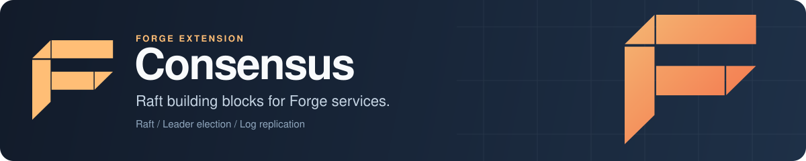

<p align="center">
  
</p>

# Forge Consensus: Raft consensus building blocks for Go

Forge Consensus is the Raft consensus module for [Forge](https://github.com/xraph/forge), the Go backend framework. It holds a Raft implementation in Go with leader election, pre-vote, log replication and snapshots, plus the pieces a node is built from: log storage on BadgerDB, BoltDB or memory, gRPC, TCP, HTTP and in-process transports, peer discovery through static lists, DNS, Consul, etcd or Kubernetes, and in-memory and persistent state machines. A Forge extension sits on top, but it doesn't wire those pieces together yet, so read the [status](#status) before you pick it for a distributed system.

[](https://go.dev/dl/) [](https://github.com/xraph/forge/actions/workflows/go.yml) [](https://pkg.go.dev/github.com/xraph/forge/extensions/consensus) [](../../LICENSE)

[Documentation](https://www.xraph.com/docs/forge/extensions/consensus) · [Quick start](#quick-start) · [Status](#status) · [Packages](#packages) · [The Forge extension](#the-forge-extension) · [Configuration](#configuration) · [FAQ](#faq)

## Quick start

You need [Go 1.26 or later](https://go.dev/dl/). Add Forge and the module:

```bash
go get github.com/xraph/forge@latest
go get github.com/xraph/forge/extensions/consensus@latest
```

This program builds a three-node Raft cluster in one process, using the in-process transport the module's own cluster tests run on. It waits for a leader, writes a key through it, and checks that every node has committed the entry:

```go
package main

import (
	"context"
	"encoding/json"
	"fmt"
	"log"
	"time"

	"github.com/xraph/forge"
	"github.com/xraph/forge/extensions/consensus"
	"github.com/xraph/forge/extensions/consensus/raft"
	"github.com/xraph/forge/extensions/consensus/statemachine"
	"github.com/xraph/forge/extensions/consensus/storage"
	"github.com/xraph/forge/extensions/consensus/transport"
)

func main() {
	ctx := context.Background()
	logger := forge.NewNoopLogger()
	ids := []string{"node-1", "node-2", "node-3"}

	transports := map[string]*transport.LocalTransport{}
	nodes := map[string]*raft.Node{}
	machines := map[string]*statemachine.MemoryStateMachine{}

	// Build three nodes, each with its own log storage and state machine.
	for _, id := range ids {
		tr := transport.NewLocalTransport(transport.LocalTransportConfig{NodeID: id}, logger)
		st := storage.NewMemoryStorage(storage.MemoryStorageConfig{}, logger)
		sm := statemachine.NewMemoryStateMachine(statemachine.MemoryStateMachineConfig{}, logger)

		node, err := raft.NewNode(raft.Config{
			NodeID:             id,
			HeartbeatInterval:  100 * time.Millisecond,
			ElectionTimeoutMin: 300 * time.Millisecond,
			ElectionTimeoutMax: 600 * time.Millisecond,
		}, logger, sm, tr, st)
		if err != nil {
			log.Fatal(err)
		}

		if err := st.Start(ctx); err != nil {
			log.Fatal(err)
		}

		transports[id], nodes[id], machines[id] = tr, node, sm
	}

	// Connect every node to every other node, then start them.
	for _, id := range ids {
		for _, peer := range ids {
			if peer != id {
				transports[id].Connect(transports[peer])
				nodes[id].AddPeer(peer)
			}
		}
	}

	for _, id := range ids {
		if err := transports[id].Start(ctx); err != nil {
			log.Fatal(err)
		}

		if err := nodes[id].Start(ctx); err != nil {
			log.Fatal(err)
		}
	}

	// Wait for an election.
	leader := ""
	for leader == "" {
		time.Sleep(100 * time.Millisecond)

		for id, node := range nodes {
			if node.IsLeader() {
				leader = id
			}
		}
	}

	fmt.Println("leader:", leader)

	// Writes go to the leader and return once a majority has the entry.
	cmd, err := json.Marshal(consensus.Command{
		Type:    "set",
		Payload: map[string]any{"key": "greeting", "value": "hello"},
	})
	if err != nil {
		log.Fatal(err)
	}

	if err := nodes[leader].Propose(ctx, cmd); err != nil {
		log.Fatal(err)
	}

	value, err := machines[leader].Query(map[string]any{"type": "get", "key": "greeting"})
	fmt.Println("greeting:", value, err)

	// Followers learn the new commit index on the next heartbeat.
	time.Sleep(300 * time.Millisecond)

	for _, id := range ids {
		fmt.Println(id, "commit index:", nodes[id].GetCommitIndex())
	}
}
```

Run it with `go mod tidy && go run .`:

```text
leader: node-2
greeting: hello <nil>
node-1 commit index: 2
node-2 commit index: 2
node-3 commit index: 2
```

Entry 1 is the no-op every new leader writes, and entry 2 is your `set`. Calling `Propose` on a follower returns a not-leader error that names the current leader, which you can check with `consensus.IsNotLeaderError`.

## Status

This module isn't ready to run a production cluster. Here's what we checked against the code as it is today, piece by piece, so you can decide which parts are worth building on:

| Piece | State |
| --- | --- |
| Leader election and log replication in `raft` | Works on the in-process transport. Three nodes elect a leader, and a proposed entry commits on a majority |
| Applying entries on followers | Followers advance their commit index but don't apply committed entries to their state machine, so reads from a follower stay empty. Read from the leader |
| `consensus.NewExtension` | Validates config and registers services, but its storage, transport, discovery, state machine and Raft node are never created. See [the Forge extension](#the-forge-extension) |
| Network transports, BadgerDB and BoltDB storage, discovery backends | The code is here and compiles, but nothing in this repository runs a networked cluster on them yet |
| Cluster tests | `testing/` runs in-process clusters. `TestLogReplication` is skipped under `-short`, which is how CI runs it |

## Packages

You assemble a node from these packages yourself, the way the quick start does. Each one has a constructor that takes a config struct and a `forge.Logger`:

| Package | What's in it |
| --- | --- |
| [`raft`](raft/) | `raft.NewNode(config, logger, stateMachine, transport, storage)`, elections, replication, snapshots, `Propose`, `AddPeer` |
| [`storage`](storage/) | `NewMemoryStorage`, `NewBadgerStorage`, `NewBoltDBStorage`, and a write-ahead log (`NewWAL`) |
| [`transport`](transport/) | `NewLocalTransport` (in process), `NewGRPCTransport`, `NewTCPTransport`, `NewHTTPTransport`, TLS helpers and serializers |
| [`statemachine`](statemachine/) | `NewMemoryStateMachine` (a key-value map with `set`, `delete` and `increment`) and `NewPersistentStateMachine` |
| [`discovery`](discovery/) | `NewStaticDiscovery`, `NewDNSDiscovery`, `NewConsulDiscovery`, `NewEtcdDiscovery`, `NewKubernetesDiscovery` |
| [`cluster`](cluster/) | Membership, quorum and topology tracking with `cluster.NewManager` |
| [`middleware`](middleware/) | Wrappers for Forge handlers that require leadership or quorum, enforce a read consistency level, or redirect writes to the leader |
| [`testing`](testing/) | An in-process cluster harness and the cluster tests |

From the root package you get the shared types (`RaftNode`, `StateMachine`, `Storage`, `Transport`, `Command`, `LogEntry`), the role and event constants, and the errors (`ErrNotLeader`, `ErrNoQuorum` and the rest, with `IsNotLeaderError`, `IsNoQuorumError` and `IsRetryable`). To plug in your own state machine, implement `Apply`, `Snapshot`, `Restore` and `Query` from `consensus.StateMachine`.

## The Forge extension

```go
app := forge.NewApp(forge.AppConfig{
	Name: "orders",
	Extensions: []forge.Extension{
		consensus.NewExtension(
			consensus.WithNodeID("node-1"),
			consensus.WithClusterID("orders"),
			consensus.WithBindAddress("0.0.0.0", 7000),
			consensus.WithPeers([]consensus.PeerConfig{
				{ID: "node-2", Address: "10.0.0.2", Port: 7000},
				{ID: "node-3", Address: "10.0.0.3", Port: 7000},
			}),
		),
	},
})
```

That compiles and starts, and here's what you get today. The extension loads and validates your config, then puts `*consensus.Service` (also named `consensus` and `consensus:service`), `ClusterManager`, `RaftNode`, `StateMachine` and a `*consensus.LeadershipChecker` in the container. Starting it only logs each component it would initialise. Nothing listens on the bind port, the node stays a follower, and so:

| Call | Result |
| --- | --- |
| `Apply` | Always `ErrNotLeader` |
| `Read` | Panics, because the state machine is nil |
| `Health` | Returns `storage not initialized`, and the service's health loop logs that warning every `health.check_interval` |
| `GetRaftNode`, `GetStateMachine`, `GetStorage`, `GetTransport` | `nil`, and so are the matching container entries |
| `TransferLeadership`, `StepDown` | "not yet implemented" errors |

One more thing to watch: with `advanced.enable_auto_snapshot` on (the default), the service takes a snapshot every `raft.snapshot_interval` (30 minutes by default) and that call panics on the nil state machine, which takes the process down. If you add the extension anyway, set `advanced.enable_auto_snapshot: false`. The admin API under `admin_api` isn't implemented either; turning it on only writes a log line.

## Configuration

The extension reads `extensions.consensus` from your config, falling back to `consensus`. Options you pass in code override the file.

```yaml
extensions:
  consensus:
    node_id: node-1
    cluster_id: orders
    bind_addr: 0.0.0.0
    bind_port: 7000
    peers:
      - {id: node-2, address: 10.0.0.2, port: 7000}
      - {id: node-3, address: 10.0.0.3, port: 7000}
    raft:
      heartbeat_interval: 1s
      election_timeout_min: 5s
      election_timeout_max: 10s
    transport:
      type: grpc          # grpc or tcp
    storage:
      type: badger        # badger, boltdb, pebble or postgres
      path: ./data/consensus
    discovery:
      type: static        # static, dns, consul, etcd or kubernetes
    advanced:
      enable_auto_snapshot: false
```

Validation runs when the extension registers. If any of these rules fail, your app won't start:

| Rule | Default |
| --- | --- |
| `node_id` is set | empty, so you must set it |
| `cluster_id` is set | `default` |
| `bind_port` is between 1 and 65535 | `7000` |
| `raft.heartbeat_interval` < `raft.election_timeout_min` < `raft.election_timeout_max` | `1s`, `5s`, `10s` |
| `transport.type` is `grpc` or `tcp` | `grpc` |
| `transport.max_message_size` is positive | 4MB |
| `discovery.type` is `static`, `dns`, `consul`, `etcd` or `kubernetes` | `static` |
| `storage.type` is `badger`, `boltdb`, `pebble` or `postgres`, and `storage.path` is set | `badger`, `./data/consensus` |
| `security.cert_file` and `key_file` are set when `enable_tls` is on, and `ca_file` when `enable_mtls` is on | TLS off |

The options are `WithNodeID`, `WithClusterID`, `WithBindAddress`, `WithPeers`, `WithTransportType`, `WithDiscoveryType`, `WithStorageType`, `WithStoragePath`, `WithTLS`, `WithMTLS`, `WithConfig` and `WithRequireConfig`. The config also has `election`, `health`, `observability`, `resilience`, `admin_api`, `events` and `advanced` sections. Their full key list and defaults are in [`internal/config.go`](internal/config.go) and on the [configuration page](https://www.xraph.com/docs/forge/extensions/consensus/configuration). Today the extension acts on a handful of them: `health.enabled` and `health.check_interval` drive its health loop, `observability.metrics.enabled` and `collection_interval` drive metrics collection, and `advanced.enable_auto_snapshot` with `raft.snapshot_interval` drives the snapshot loop. `events.enabled` is on by default. It adds `events` to the extension's dependencies and publishes start and stop events when an event bus is in the container.

## Documentation

| Topic | Where |
| --- | --- |
| What the module covers | [Features](https://www.xraph.com/docs/forge/extensions/consensus/features) |
| Every config key | [Configuration](https://www.xraph.com/docs/forge/extensions/consensus/configuration) |
| Exported functions and types | [Functions](https://www.xraph.com/docs/forge/extensions/consensus/functions), [pkg.go.dev](https://pkg.go.dev/github.com/xraph/forge/extensions/consensus) |
| The Raft algorithm | [In Search of an Understandable Consensus Algorithm](https://raft.github.io/raft.pdf) |
| Extensions in general | [Forge extension system](../../docs/content/docs/forge/extensions-system.mdx) |

## FAQ

### Is there a Raft implementation in Go I can embed in a Forge service?

There is one in [`raft`](raft/), and the quick start shows a three-node cluster electing a leader and committing an entry. Check the [status](#status) table first: follower state machines don't apply entries yet, and the networked transports haven't been run as a cluster here.

### How does leader election work?

Nodes start as followers with a randomised election timeout between `election_timeout_min` and `election_timeout_max`. A follower that hears no heartbeat in that window becomes a candidate, runs a pre-vote if it's on, then asks its peers for votes, and the node with a majority becomes leader and sends heartbeats every `heartbeat_interval`.

### Can I use this for distributed locks or leader-only jobs?

Not through the extension yet, because `IsLeader` stays false. With your own `raft.Node`, `IsLeader()` and `GetLeader()` tell you which node should run a leader-only job.

### Which storage backends are there?

In memory, BadgerDB and BoltDB, plus a write-ahead log. The config validator also accepts `pebble` and `postgres`, but there's no implementation for either in this module.

## Contributing

The module is its own Go module inside the Forge repository. Test it from its directory, without `-short` if you want the cluster tests:

```bash
cd extensions/consensus
GOWORK=off go test -race ./...
GOWORK=off go test -count=1 -run TestLogReplication -v ./testing/
GOWORK=off golangci-lint run ./...
```

[AGENTS.md](../../AGENTS.md) has the full build, lint and release rules for the repository, and [CONTRIBUTING.md](../../CONTRIBUTING.md) has the contribution guidelines.

## License

Forge Consensus is part of Forge and is available under the [Apache License 2.0](../../LICENSE).
