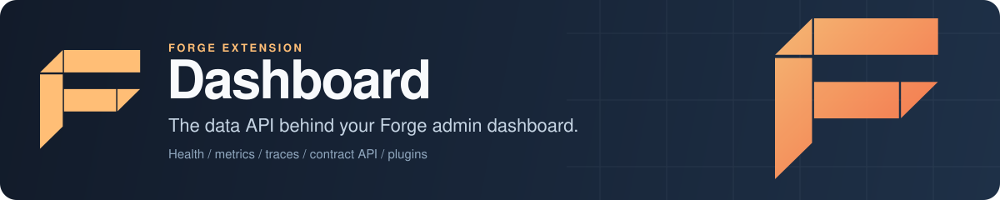

<p align="center">
  
</p>

# Forge Dashboard: admin dashboard API for Go services

Forge Dashboard is the extension that feeds the admin dashboard for a [Forge](https://github.com/xraph/forge) application. It collects health checks, metrics, registered services and request traces from your running Go service and serves them, along with whatever your own extensions contribute, through one typed contract endpoint at `{BasePath}/api/dashboard/v1`. The UI is the [React dashboard](https://github.com/xraph/forge-dashboard), which you build and host yourself. This package serves data, never pages.

[](https://go.dev/dl/) [](https://github.com/xraph/forge/actions/workflows/go.yml) [](https://pkg.go.dev/github.com/xraph/forge/extensions/dashboard) [](../../LICENSE)

[Documentation](https://www.xraph.com/docs/forge/extensions/dashboard/features) · [Quick start](#quick-start) · [Features](#features) · [Endpoints](#http-endpoints) · [Contributing intents](#contributing-from-an-extension) · [Command replay](#generic-command-replay) · [Authentication](#authentication) · [Configuration](#configuration) · [FAQ](#faq)

## Quick start

You need [Go 1.26 or later](https://go.dev/dl/). The dashboard ships inside the root Forge module, so there's nothing extra to fetch:

```bash
go get github.com/xraph/forge@latest
```

Save this as `main.go`:

```go
package main

import (
	"log"

	"github.com/xraph/forge"
	"github.com/xraph/forge/extensions/dashboard"
)

func main() {
	app := forge.NewApp(forge.AppConfig{
		Name:        "dashboard-demo",
		HTTPAddress: ":8080",
		Extensions: []forge.Extension{
			dashboard.NewExtension(dashboard.WithBasePath("/dashboard")),
		},
	})

	if err := app.Run(); err != nil {
		log.Fatal(err)
	}
}
```

Run it and ask the contract what it serves:

```bash
go mod tidy
go run .

curl http://localhost:8080/dashboard/api/dashboard/v1/capabilities
# {"shellEnvelopes":["v1"],"contributors":[{"name":"core-contract",...

curl -X POST http://localhost:8080/dashboard/api/dashboard/v1 \
  -H 'Content-Type: application/json' \
  -d '{"envelope":"v1","kind":"query","contributor":"core-contract","intent":"health","context":{}}'
# {"ok":true,"envelope":"v1","kind":"query","data":{"overallStatus":"healthy",...
```

That's the data side running. Now scaffold the UI with the Forge CLI and point it at your server:

```bash
forge dashboard new my-dashboard
# or: forge dashboard new my-dashboard --target next
```

The scaffold uses the `@forge-go/dashboard-*` packages from the [forge-dashboard repository](https://github.com/xraph/forge-dashboard), standalone with Vite by default or mounted inside a Next.js app. Follow its instructions to install packages, add your extension plugins and set the server URL.

## Features

| You need | Forge Dashboard gives you |
| --- | --- |
| An admin view of a running Go service | Built-in intents for overview, health, services, metrics, traces, extensions, apps and audit, under the `core-contract` contributor |
| Dashboard pages for your own extension | `ContractContributorAware`: register typed query, command and subscription handlers with the dispatcher |
| A setup screen until an extension is configured | `DashboardStatusAware`, reporting a version and a `Configured` flag |
| One dashboard across several services | Remote contributors over HTTP, registered by hand or found through service discovery |
| Live updates | Subscriptions over server-sent events, with a control endpoint to subscribe and unsubscribe |
| Safe commands | CSRF tokens, a request size cap, per-handler admission checks and idempotent command replay bound to the caller |
| Your existing sign-in | An `AuthChecker` you supply, role gating with `RequiredRoles`, and a `/principal` endpoint the UI reads |
| Data out of the dashboard | JSON, CSV and Prometheus export snapshots |

## HTTP endpoints

All paths are under the base path (default `/dashboard`).

| Method | Path | Description |
|---|---|---|
| POST | `/api/dashboard/v1` | Contract envelope: queries and commands |
| GET | `/api/dashboard/v1/capabilities` | Registered contributors and their status |
| GET | `/api/dashboard/v1/principal` | The signed-in user |
| GET | `/api/dashboard/v1/csrf` | CSRF token for commands |
| GET | `/api/dashboard/v1/stream` | Subscription updates over SSE |
| POST | `/api/dashboard/v1/stream/control` | Subscribe and unsubscribe on an open stream |
| GET | `/export/json`, `/export/csv`, `/export/prometheus` | Data snapshots, when export is on |

The CSRF route exists only while both CSRF and contract security are on (the default). The stream routes exist only when a stream broker is wired.

### Error codes and HTTP status

A failed envelope comes back as `{"ok":false,"envelope":"v1","error":{"code":...,"message":...}}` with an HTTP status taken from the code. A handler error that wraps a `*contract.Error` keeps its code, a cancelled context becomes a retryable `UNAVAILABLE`, and anything else becomes `INTERNAL`.

| Code | HTTP status |
| --- | --- |
| `BAD_REQUEST`, `UNSUPPORTED_VERSION` | 400 |
| `UNAUTHENTICATED` | 401 |
| `PERMISSION_DENIED` | 403 |
| `NOT_FOUND` | 404 |
| `CONFLICT` | 409 |
| `RATE_LIMITED` | 429 |
| `UNAVAILABLE` | 503 |
| `INTERNAL` and any other code | 500 |

A request whose `kind` doesn't match the intent (a `command` sent to a query, for example) gets `BAD_REQUEST` before admission or any cache access. If your contract tests were written against older Forge releases, expect these statuses where they used to see 500.

## Contributing from an extension

You contribute in two halves. The Go half registers intents with the dashboard's dispatcher. The UI half is a React plugin, built with `definePlugin` from the [dashboard packages](https://github.com/xraph/forge-dashboard), that calls them.

For the Go half, implement `ContractContributorAware`. The dashboard finds it among your app's extensions during `Start()`:

```go
func (e *ReportsExtension) RegisterContractContributor(
	disp *dispatcher.Dispatcher,
	reg contract.Registry,
	wreg contract.WardenRegistry,
) error {
	// Your code: load and validate the manifest (contract/loader), register it
	// with reg, then bind handlers with dispatcher.RegisterQuery and RegisterCommand.
	return registerReports(disp, reg, wreg)
}
```

Your handlers are plain typed functions. `dispatcher.RegisterQuery` and `dispatcher.RegisterCommand` take a `func(context.Context, In, contract.Principal) (Out, error)`, where `In` and `Out` are your own payload and result types, and the dispatcher decodes and encodes the JSON for you. `dispatcher.RegisterSubscription` takes a function that returns a channel of events.

If your extension can be installed before it's configured, implement `DashboardStatusAware` as well, and the dashboard shows your plugin's setup guide until you report `Configured: true`:

```go
func (e *ReportsExtension) DashboardStatus() dashboard.DashboardStatus {
	return dashboard.DashboardStatus{Version: "1.4.0", Configured: true}
}
```

An extension that doesn't implement it is reported as configured, with no version check.

A contributor can also live in another service. Serve it there with `contract/server`, then either call `RegisterRemoteContractContributor(ctx, baseURL, apiKey)` on the dashboard extension, or turn on `WithDiscovery(true)` and let the dashboard find every service tagged `forge-dashboard-contributor` through `SetDiscoveryService`. The dashboard fetches `<baseURL>/_forge/contract/manifest`, validates it, and forwards envelopes to `<baseURL>/_forge/contract/dispatch`.

## Local handler admission

Use `dispatcher.BeforeDispatch` when your handler needs to check current permissions before a cached response can be returned. You receive the original `contract.Request` and `contract.Principal`, so your policy can check the request's target and caller scope. These options do not authorize requests by themselves. You supply the policy.

```go
err := dispatcher.RegisterCommand(disp, "reports", "reports.export", 1, exportReport,
    dispatcher.BeforeDispatch(authorizeExport),
    dispatcher.BypassIdempotency(),
)
```

`BeforeDispatch` callbacks run in registration order before any local cache access. The first error stops dispatch, uses the handler error mapping and records a denial metric. Admission runs again after a successful claim, even if the claim returns immediately, before the dispatcher returns a cached response or calls your handler. Keep callbacks safe to repeat. Do not perform the domain mutation in them.

Use `BypassIdempotency` only when your handler owns receipt and replay semantics. It skips all generic cache operations, including tombstone lookup, claim acquisition, storage and release. Kind checks and admission still run. `SecretResponse` commands keep their one-time response tombstones unless you also select bypass. Scope callbacks are skipped on bypass too.

`RegisterQuery` and `RegisterCommand` enforce their declared kinds, even if you pass a conflicting `RequireKind` option. Raw `Register` remains unrestricted unless you pass `RequireKind(contract.KindQuery)` or `RequireKind(contract.KindCommand)`. For raw registrations, the last valid kind option wins. Invalid kinds, nil callbacks and nil options fail registration, including when a later option would override them. A wrong request kind returns `BAD_REQUEST` before admission or cache access.

Requests without a local handler go directly to the remote dispatcher or return `NOT_FOUND`. They never read local cache entries.

## Generic command replay

Configure an atomic `IdempotencyClaimer` for keyed generic commands. The default memory store supports claims. A custom Lookup/Store-only backend can replay a matching bound record, but a miss returns `UNAVAILABLE` with reason `idempotency.claim_required` before your handler runs. Keyless commands are unaffected.

The lookup key and `dashboard.command` namespace remain unchanged: idempotency key plus `User.Subject + ":" + intent`. New ordinary success records carry a comparison digest in a versioned internal `WireBody` envelope (`format: forge.dashboard.idempotency`, `version: 1`, `binding: sha256:<64 lowercase hex>`, `response: <original success>`). Their outer status is 409 so the previous dashboard reader refuses them before decoding. This internal status does not change the successful HTTP response. Do not expose the cache body through a generic HTTP cache reader.

The digest binds the envelope, contributor, intent, resolved version, kind, exact payload bytes, params and full principal. Both claims maps count, along with the user's subject, provider, name, email, avatar, ordered roles/scopes and metadata. Nil and empty values differ. Map insertion order does not matter, but JSON whitespace in a payload does. CSRF, route and correlation metadata are excluded.

Add trusted scope when your handler depends on authority outside those inputs:

```go
err := dispatcher.RegisterCommand(disp, "reports", "reports.export", 1, exportReport,
    dispatcher.BeforeDispatch(authorizeExport),
    dispatcher.IdempotencyScope(func(ctx context.Context, req contract.Request, p contract.Principal) ([]byte, error) {
        return json.Marshal([]string{"reports-scope-v1", installationID, policyTenant})
    }),
)
```

You supply validated authority from context or static host composition. Client route and filter fields are not trusted tenancy. Multiple scope callbacks append contributions in registration order, with separate framing, and never replace the default binding. They run after admission before cache access and again after a successful claim, including a cached claim result. Use deterministic, repeatable callbacks without domain mutations. A changed binding refuses replay or execution and releases only an acquired claim. Publication keeps the digest captured before the handler, even if the handler changes a referenced map. Concurrent mutation of request/principal inputs is unsupported.

Params, claims and metadata accept this bounded value domain: nil, bool, valid UTF-8 strings, built-in signed and unsigned integer widths including int/uint, finite float32/float64, valid `json.Number` with its exact lexeme, `json.RawMessage`, `[]byte`, `[]string`, `[]any`, `map[string]string` and `map[string]any`. Numeric types and float bits remain distinct. Raw messages and byte slices keep their exact bytes. Other named types, structs, pointers, functions, channels, custom marshalers and other collections are rejected before any cache claim or mutation. No custom marshaler runs to build a digest.

Limits are 64 nested containers, 100000 value nodes, 8 MiB of encoded binding input and 64 KiB per scope contribution. These are generic-cache admission limits, separate from HTTP body limits. Cycles fail the depth limit. A failed binding returns an error, never a reduced digest. Full-principal binding can conservatively conflict after a token refresh, a profile update, or reordered roles/scopes. Claims such as `iat`, `exp` and session IDs cannot safely be omitted because a policy or handler may use them.

Only a supported exact-binding success can replay. Legacy successes, malformed records, duplicate or case-aliased protocol fields, unsupported versions and mismatches return `CONFLICT` with reason `idempotency.binding_conflict`, with no cached data or metadata. Records are not rewritten or renewed on refusal. A no-body 409 marker retains `idempotency.already_ran`; secret responses never enter storage. If a successful response cannot be encoded, the still-owned claim gets the same consumed marker. A claim result with both or neither of `Cached` and `End`, or a lookup hit without a record, fails as a backend protocol error.

A lost claim never falls back to unconditional Store. A successor's result, tombstone or live claim must remain intact. Storage failures cannot undo a completed mutation and may leave no receipt. Lease expiry, TTL expiry, capacity eviction and memory-store restarts also limit deduplication. This cache does not promise exactly-once effects or durable receipt recovery.

Upgrade or drain every reader and writer sharing the scope before qualifying the deployment. New records protect against the inspected previous reader, and new readers refuse old successes. Old readers can still disclose unbound records written by old writers, including late in-flight completions. An old lost-claim fallback can overwrite a protected record. Keep existing records, keys, claims and TTLs during rollout; do not flush, migrate or retry with a new key automatically. Legacy entries remain conflicts until ordinary expiry. Nonexpiring entries need explicit reconciliation against authoritative domain state.

Dispatch integrations must add trusted `InstallationID` and `PolicyTenant` scope to legacy registrations and bypass this generic cache for durable commands. Forge cannot infer that installation scope or detect an omitted integration callback.

## Authentication

The dashboard doesn't sign anyone in. You give it an `AuthChecker`, and it attaches the user to every contract request:

```go
import dashauth "github.com/xraph/forge/extensions/dashboard/auth"

type MyChecker struct{}

func (c *MyChecker) CheckAuth(ctx context.Context, r *http.Request) (*dashauth.UserInfo, error) {
	token := r.Header.Get("Authorization")
	if token == "" {
		return nil, nil // signed out is not an error
	}

	return &dashauth.UserInfo{
		Subject:     "user-123",
		DisplayName: "Jane Doe",
		Roles:       []string{"admin"},
	}, nil
}

dashExt := dashboard.NewExtension(dashboard.WithEnableAuth(true))
dashExt.(*dashboard.Extension).SetAuthChecker(&MyChecker{})
```

With `WithEnableAuth(true)`, `/principal` answers 401 for a signed-out caller and tells the client where the login page is (`LoginPath`, `/login` under the base path by default). Add `WithRequiredRoles` and a signed-in user without one of those roles gets 403 `PERMISSION_DENIED`. With auth off, `/principal` returns `{"authenticated":false}` so the UI can skip its login gate. Auth extensions such as authsome wire all of this themselves through `DashboardAuthAware`.

## Configuration

Configure the dashboard with options on `dashboard.NewExtension`, or under `extensions.dashboard` (or `dashboard`) in your config file. The file wins over the defaults below and your options win over the file, so `base_path: /ops` in YAML moves every route even with a plain `NewExtension()`.

| Option | Default | Effect |
| --- | --- | --- |
| `WithBasePath(string)` | `/dashboard` | Prefix for every route |
| `WithEnableAuth(bool)`, `WithLoginPath(string)`, `WithRequiredRoles([]string)` | off, `/login`, none | See [Authentication](#authentication) |
| `WithCSRF(bool)` | on | CSRF tokens for commands |
| `WithContractSecurity(bool)` | on | CSRF checks, idempotency and tracing on the envelope endpoint. Turn off only during a client rollout |
| `WithContractMaxBodyBytes(int64)` | 1 MiB | Larger envelopes get 413 before decoding |
| `WithRefreshInterval`, `WithHistoryDuration`, `WithMaxDataPoints` | 30s, 30m, 120 | Metric collection. The interval must be at least 1s and points at least 10 |
| `WithTraceMaxCount`, `WithTraceRetention`, `WithTraceMaxSpansPerTrace`, `WithTraceIdleTTL` | 200, 30m, 200, 5m | Trace retention. Spans are only kept for `TraceIdleTTL` after the last dashboard request; a negative value keeps them always |
| `WithTraceCaptureRequestBody(bool)` | off | Keep a bounded, redacted JSON request body with each trace |
| `WithMemoryProfile(profile)` | medium | `MemoryProfileLow`, `MemoryProfileMedium` or `MemoryProfileHigh` presets for the collection and trace settings |
| `WithDiscovery(bool)`, `WithDiscoveryTag(string)`, `WithDiscoveryPollInterval(d)` | off, `forge-dashboard-contributor`, 60s | Remote contributor discovery |
| `WithExport(bool)`, `WithExportFormats([]string)` | on, all three | Export endpoints |
| `WithConfig(dashboard.Config)`, `WithRequireConfig(bool)` | | Replace the whole config, or fail without one |

Options apply in order, so a setting after `WithMemoryProfile` overrides the preset.

## Documentation

| Topic | Where |
| --- | --- |
| Features and usage | [Dashboard features](https://www.xraph.com/docs/forge/extensions/dashboard/features) |
| Configuration reference | [Dashboard configuration](https://www.xraph.com/docs/forge/extensions/dashboard/configuration) |
| Function reference | [Dashboard functions](https://www.xraph.com/docs/forge/extensions/dashboard/functions) |
| The React shell and plugin API | [forge-dashboard on GitHub](https://github.com/xraph/forge-dashboard) |
| Go API | [pkg.go.dev](https://pkg.go.dev/github.com/xraph/forge/extensions/dashboard) |
| Contract design notes | [`contract/DESIGN.md`](contract/DESIGN.md) and the slice design notes beside it |

## Examples

[`examples/basic`](examples/basic/) registers the extension with its default intents and a few collection settings, and nothing else.

## FAQ

### How do I add an admin dashboard to a Go web service?

Add `dashboard.NewExtension()` to your Forge app's `Extensions`, then run `forge dashboard new` to scaffold the [React UI](https://github.com/xraph/forge-dashboard) and point it at your server. The [quick start](#quick-start) shows the Go side end to end.

### Does the Go extension serve the dashboard's HTML?

No. It serves the contract API and export endpoints only. You build and host the UI yourself, as a Vite app or inside Next.js.

### How do I add my own pages to the Forge dashboard?

Implement `ContractContributorAware` in your extension to register intents, and write a React plugin with `definePlugin` that calls them. See [Contributing from an extension](#contributing-from-an-extension).

### Can one dashboard show several microservices?

Yes. Serve each service's contributor with `contract/server` and register it with `RegisterRemoteContractContributor`, or turn on discovery so the dashboard finds tagged services itself.

### Why did my dashboard contract test start getting 409 or 400?

Recent releases map error codes to real HTTP statuses, bind command replay to the request and the full principal, and reject a request whose kind doesn't match the intent. See [Error codes and HTTP status](#error-codes-and-http-status) and [Generic command replay](#generic-command-replay).

## Contributing

The dashboard is part of the root Forge module, so you test it from the repository root:

```bash
GOWORK=off go test -race ./extensions/dashboard/...
gofmt -l extensions/dashboard
golangci-lint run ./extensions/dashboard/...
```

Treat a change to a status code, a stored replay format or an admission rule as breaking for consumers even when it compiles, and update this README in the same commit. [AGENTS.md](../../AGENTS.md) explains why and lists the downstream repos that run contract tests.

## License

Forge Dashboard is part of Forge and is available under the [Apache License 2.0](../../LICENSE).
