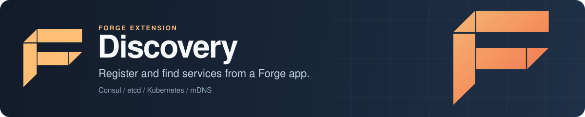

<p align="center">
  
</p>

# Forge Discovery: service registration and discovery for Go microservices

Forge Discovery is the service discovery extension for [Forge](https://github.com/xraph/forge), the Go backend framework. When your app starts it registers itself in a service registry (Consul, etcd, mDNS/Bonjour, an HTTP seed list or an in-memory registry), keeps its health status up to date, and deregisters on shutdown. You get a `Service` in the container for finding other services by name or tag, with round-robin or random load balancing, and an optional FARP manifest that tells an API gateway about your routes and OpenAPI or AsyncAPI schemas.

[](https://go.dev/dl/) [](https://github.com/xraph/forge/actions/workflows/go.yml) [](https://pkg.go.dev/github.com/xraph/forge/extensions/discovery) [](../../LICENSE)

[Documentation](https://www.xraph.com/docs/forge/extensions/discovery) · [Quick start](#quick-start) · [Features](#features) · [Backends](#backends) · [Finding services](#find-other-services) · [FARP](#publish-routes-to-a-gateway-with-farp) · [Configuration](#configuration) · [FAQ](#faq)

## Quick start

You need [Go 1.26 or later](https://go.dev/dl/). Add Forge and the extension to your module:

```bash
go get github.com/xraph/forge@latest
go get github.com/xraph/forge/extensions/discovery@latest
```

Save this as `main.go`. It registers an `orders` service in the in-memory registry and adds a route that looks services up:

```go
package main

import (
	"log"
	"net/http"

	"github.com/xraph/forge"
	"github.com/xraph/forge/extensions/discovery"
)

func main() {
	app := forge.NewApp(forge.AppConfig{
		Name:        "orders",
		Version:     "1.0.0",
		HTTPAddress: ":8080",
		Extensions: []forge.Extension{
			discovery.NewExtension(
				discovery.WithBackend("memory"),
				discovery.WithServiceName("orders"),
				discovery.WithServiceID("orders-1"),
				discovery.WithServiceTags("api", "v1"),
			),
		},
	})

	err := app.Router().GET("/instances/:service", func(ctx forge.Context) error {
		svc, err := forge.Inject[*discovery.Service](app.Container())
		if err != nil {
			return err
		}

		instances, err := svc.Discover(ctx.Context(), ctx.Param("service"))
		if err != nil {
			return err
		}

		return ctx.JSON(http.StatusOK, instances)
	})
	if err != nil {
		log.Fatal(err)
	}

	if err := app.Run(); err != nil {
		log.Fatal(err)
	}
}
```

Run it with `go mod tidy && go run .`, then ask for the instance you just registered:

```bash
curl http://localhost:8080/instances/orders
# [{"id":"orders-1","name":"orders","version":"1.0.0","address":"my-host.local",
#   "port":8080,"tags":["api","v1"],"metadata":{},"status":"passing","last_heartbeat":...}]
```

The memory registry lives inside one process. Use it for development and tests. Swap `WithBackend("memory")` for `WithConsul("127.0.0.1:8500", token)` or another backend from the table below and the rest of the code stays the same.

Always give each replica a stable instance ID, with `WithServiceID` or the `FORGE_INSTANCE_ID` environment variable. Without one, the extension makes up a new ID (`<name>-<unix nanoseconds>`) each time it builds the instance, and the health check loop, which re-registers every `health_check.interval`, adds a fresh entry to the registry on every tick. Shutdown then deregisters an ID that was never registered.

## Features

| You need | Forge Discovery gives you |
| --- | --- |
| Services that announce themselves | Registration on start and deregistration on stop, using the app's name, version and HTTP port when you don't set them |
| A registry that matches your platform | Consul, etcd, Kubernetes, mDNS/DNS-SD, HTTP seed polling and in-memory backends |
| Health in the registry | A loop that runs your app's health checks and re-registers with `passing` or `critical` |
| Client-side lookups | `Discover`, `DiscoverWithTags`, `DiscoverHealthy`, `ListServices` and `Watch` |
| Load balancing | `SelectInstance` and `GetServiceURL` with round-robin or random picks |
| Gateway integration | FARP endpoints and an optional push to a gateway, carrying your OpenAPI and AsyncAPI schemas |
| Containers and Kubernetes | Advertised address from `FORGE_ADVERTISE_ADDR` or `POD_IP`, identity from `FORGE_SERVICE_ID` and `FORGE_INSTANCE_ID` |

## Backends

| `backend` | Option | Registers this app | Notes |
| --- | --- | --- | --- |
| `memory` | `WithBackend("memory")` | yes, in process | Default. One process only |
| `consul` | `WithConsul(address, token)` | yes | ACL token, datacenter, namespace and TLS from `consul.*` |
| `etcd` | `WithEtcd(endpoints)` | yes | Keys under `etcd.key_prefix` (default `/services`). The `tls_*` keys aren't applied yet |
| `kubernetes` | `WithKubernetes(namespace, inCluster)` | no, Kubernetes owns that | `Discover` returns one instance per matching Kubernetes Service |
| `mdns` | `WithMDNS(domain)` | yes | Bonjour on macOS, Avahi on Linux, DNS-SD on Windows. Service type defaults to `_<name>._tcp` |
| `http` | `WithHTTPSeeds(urls...)` | no | Polls each seed's `/_farp/discovery` endpoint |
| `eureka` | `WithEureka(urls)` | | Not implemented. Startup fails with "eureka backend not yet implemented" |

The Consul backend attaches a 30-second TTL check to the registration, which the health loop keeps passing, and tells Consul to drop the instance after a minute in a critical state. The mDNS backend has its own options for multi-service browsing (`WithMDNSServiceTypes`), the watch interval, the browse timeout, TTL, network interface and IPv6.

## Find other services

The service is in the container as `*discovery.Service`, also under the names `discovery` and `discovery.Service`:

```go
svc, err := forge.Inject[*discovery.Service](app.Container())
if err != nil {
	return err
}

// Every instance, or only those with all of these tags.
all, err := svc.Discover(ctx, "payments")
v2, err := svc.DiscoverWithTags(ctx, "payments", []string{"v2"})

// Only instances whose status is passing.
healthy, err := svc.DiscoverHealthy(ctx, "payments")

// One healthy instance, picked round-robin, as a base URL.
url, err := svc.GetServiceURL(ctx, "payments", "http", discovery.LoadBalanceRoundRobin)
```

If you want the instance and not a URL, call `SelectInstance`. Two strategies work: `LoadBalanceRoundRobin` and `LoadBalanceRandom`. You'll also see `LoadBalanceLeastConnections` and `LoadBalanceWeightedRoundRobin` in the package, but they fall back to round-robin today.

To react when the instances of a service change, either pass a callback when you build the extension:

```go
discovery.NewExtension(
	discovery.WithBackend("consul"),
	discovery.WithWatch([]string{"payments"}, func(instances []*discovery.ServiceInstance) {
		log.Printf("payments now has %d instances", len(instances))
	}),
)
```

or call `svc.Watch(ctx, "payments", onChange)` yourself. Each `ServiceInstance` has `URL(scheme)`, `HasTag`, `HasAllTags`, `IsHealthy` and `GetMetadata` helpers.

## Where the address comes from

You can set `service.address` and `service.port` directly. When you don't, the extension works it out:

| Field | Taken from, in order |
| --- | --- |
| Name | `FORGE_SERVICE_ID`, `service.name`, the app's name |
| Version | `service.version`, the app's version |
| Port | `service.port`, then the port in the app's `HTTPAddress` |
| Address | `service.address`, `FORGE_ADVERTISE_ADDR`, `POD_IP`, the host in the app's `HTTPAddress`, the machine's hostname, then `localhost` |
| Instance ID | `FORGE_INSTANCE_ID`, `<name>-<hostname>` when `FORGE_SERVICE_ID` is set, `service.id`, a generated one |

A wildcard listen address such as `0.0.0.0` or `::` is never advertised. In a Kubernetes pod, expose `POD_IP` through the downward API and you get the pod's IP.

## Publish routes to a gateway with FARP

FARP is the Forge API gateway registration protocol, implemented in [xraph/farp](https://github.com/xraph/farp). Turn it on and the extension adds four routes to your app:

| Route | What it returns |
| --- | --- |
| `GET /_farp/manifest` | The service manifest: routes, endpoints, capabilities and schema references |
| `GET /_farp/health` | FARP health for this instance |
| `GET /_farp/schemas/:type` | The OpenAPI or AsyncAPI schema |
| `GET /_farp/discovery` | Instance ID, name, version, address, port, tags and metadata |

The manifest is built after every extension has started (in a `PhaseAfterStart` hook), so it sees all of your routes, including the ones other extensions add during their own start. Until then the first three answer 503. With `gateway_url` set, the extension also posts its registration to `<gateway_url>/_farp/v1/register` once the HTTP server is listening, retries with backoff until that works, and calls `/_farp/v1/deregister/<name>` on shutdown.

```go
discovery.NewExtension(
	discovery.WithBackend("mdns"),
	discovery.WithServiceName("users"),
	discovery.WithServiceID("users-1"),
	discovery.WithFARPEnabled(true),
	discovery.WithFARPGatewayURL("http://localhost:7903"),
	discovery.WithFARPPathRules(
		farp.PathRule{Pattern: "/internal/**", Action: farp.PathRuleExclude},
	),
)
```

Internal paths (`/_/*`, `/_farp/*` and similar) are left out of the published schemas unless you call `WithFARPExcludeInternalPaths(false)`. Path rules are checked in order and the first match wins. When `farp.schemas` is empty and `farp.auto_register` is on (the default), the extension publishes whichever of the OpenAPI and AsyncAPI specs your app has turned on.

## Configuration

The extension reads `extensions.discovery` from your config, falling back to `discovery`. Options you pass in code are applied on top of the file. Here's a Consul setup:

```yaml
extensions:
  discovery:
    enabled: true
    backend: consul
    service:
      name: orders
      id: orders-1
      version: 1.0.0
      port: 8080
      tags: [api, v1]
      metadata:
        team: checkout
      enable_auto_deregister: true
    health_check:
      enabled: true
      interval: 10s
      timeout: 5s
    watch:
      enabled: true
      services: [payments]
    consul:
      address: 127.0.0.1:8500
      token: ""
      datacenter: dc1
```

| Key | Default | What it does |
| --- | --- | --- |
| `enabled` | `true` | Turns the extension off without removing it. Must be a boolean |
| `backend` | `memory` | `memory`, `consul`, `etcd`, `kubernetes`, `mdns`, `http` or `eureka` |
| `service.name`, `id`, `version`, `address`, `port` | empty | This instance. See [where the address comes from](#where-the-address-comes-from) |
| `service.tags`, `service.metadata` | empty | Stored with the registration |
| `service.enable_auto_deregister` | `true` | Deregisters on shutdown when FARP is off |
| `health_check.enabled` | `true` | Runs the health loop |
| `health_check.interval`, `timeout` | `10s`, `5s` | How often to check, and how long a check may take |
| `watch.enabled`, `watch.services` | `false`, `[]` | Services to watch from start |
| `consul.address`, `token`, `datacenter`, `namespace` | `127.0.0.1:8500` | Consul agent and ACL settings |
| `consul.tls_enabled`, `tls_ca_file`, `tls_cert`, `tls_key` | off | Consul TLS |
| `etcd.endpoints`, `username`, `password`, `dial_timeout`, `key_prefix` | `127.0.0.1:2379`, `5s`, `/services` | etcd client |
| `kubernetes.namespace`, `in_cluster`, `kubeconfig_path`, `service_type`, `label_selector` | `default`, `true`, `ClusterIP` | Kubernetes API access and filtering |
| `mdns.domain`, `service_type`, `service_types`, `watch_interval`, `interface`, `ipv6`, `browse_timeout`, `ttl` | `local.`, `3s`, `120` | mDNS registration and browsing |
| `http.seeds`, `poll_interval`, `timeout` | `[]`, `10s`, `5s` | HTTP seed polling |
| `farp.enabled`, `auto_register`, `gateway_url` | `false`, `true`, empty | FARP endpoints and gateway push |
| `farp.schemas`, `endpoints`, `capabilities`, `path_rules` | | What the manifest publishes |
| `farp.exclude_internal_paths`, `collapse_service_tags` | `true`, `false` | Schema filtering and tag grouping |

The common settings have `With...` options in [config.go](config.go): `WithServiceName`, `WithServiceID`, `WithServiceAddress`, `WithServiceTags`, `WithServiceMetadata`, `WithHealthCheck`, `WithWatch`, `WithConsul`, `WithEtcd`, `WithKubernetes`, `WithMDNS`, `WithHTTPSeeds`, the `WithFARP...` family and more. `WithConfig` replaces the whole config.

A few keys are read but have no effect yet: `health_check.http`, `health_check.tcp`, `health_check.grpc` and `health_check.deregister_critical_service_after` (the loop always uses your app's health checks, and Consul's deregistration delay is fixed at one minute), `watch.tags`, and `farp.strategy`.

## Documentation

| Topic | Where |
| --- | --- |
| What the extension does | [Features](https://www.xraph.com/docs/forge/extensions/discovery/features) |
| Every config key | [Configuration](https://www.xraph.com/docs/forge/extensions/discovery/configuration) |
| Exported functions and types | [Functions](https://www.xraph.com/docs/forge/extensions/discovery/functions), [pkg.go.dev](https://pkg.go.dev/github.com/xraph/forge/extensions/discovery) |
| A FARP and mDNS config file | [examples/farp-mdns.yaml](examples/farp-mdns.yaml) |
| The FARP protocol | [xraph/farp](https://github.com/xraph/farp) |
| Extensions in general | [Forge extension system](../../docs/content/docs/forge/extensions-system.mdx) |

## FAQ

### How do I register a Go service with Consul?

Add `discovery.NewExtension(discovery.WithConsul("127.0.0.1:8500", token), discovery.WithServiceID("orders-1"))` to your Forge app. It registers on start with the app's name and HTTP port, reports health every ten seconds and deregisters on shutdown.

### Can Go services find each other without Consul or etcd?

Yes. On one machine or a local network, use the `mdns` backend, which needs no server. Across hosts without a registry, use the `http` backend with a list of seed URLs that run the extension with FARP on.

### Does Forge Discovery do client-side load balancing?

It does simple client-side picks. `SelectInstance` and `GetServiceURL` choose a healthy instance round-robin or at random. Connection counting and weights aren't implemented.

### Why does my service show up many times in the registry?

You haven't set an instance ID. Set `WithServiceID`, `service.id` or `FORGE_INSTANCE_ID`, and the health loop updates one entry.

## Contributing

The extension is its own Go module inside the Forge repository. Test it from its directory:

```bash
cd extensions/discovery
GOWORK=off go test -race ./...
GOWORK=off golangci-lint run ./...
```

[AGENTS.md](../../AGENTS.md) has the full build, lint and release rules for the repository, and [CONTRIBUTING.md](../../CONTRIBUTING.md) has the contribution guidelines.

## License

Forge Discovery is part of Forge and is available under the [Apache License 2.0](../../LICENSE).
