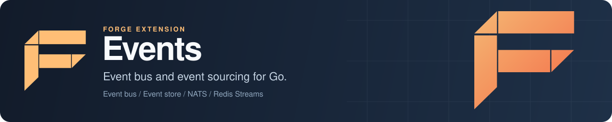

<p align="center">
  
</p>

# Forge Events: event bus and event sourcing for Go

Forge Events is the event-driven architecture extension for [Forge](https://github.com/xraph/forge), the Go backend framework. It gives your app a publish and subscribe event bus, an append-only event store for event sourcing with snapshots, and pluggable message brokers: in-memory, NATS, Redis Pub/Sub and Redis Streams with consumer groups and a dead-letter stream. You publish domain events such as `user.created` from your handlers, and subscribers in the same process or in other services react to them.

[](https://go.dev/dl/) [](https://github.com/xraph/forge/actions/workflows/go.yml) [](https://pkg.go.dev/github.com/xraph/forge/extensions/events) [](../../LICENSE)

[Documentation](https://www.xraph.com/docs/forge/extensions/events) · [Quick start](#quick-start) · [Features](#features) · [Publishing](#publish-events) · [Handlers](#subscribe-handlers) · [Brokers](#brokers) · [Event store](#event-store) · [Configuration](#configuration) · [FAQ](#faq)

## Quick start

You need [Go 1.26 or later](https://go.dev/dl/). The defaults use an in-memory broker and store, so there's nothing else to run.

```bash
go get github.com/xraph/forge@latest
go get github.com/xraph/forge/extensions/events@latest
```

This app publishes a `user.created` event from `POST /users`, and a named handler picks it up:

```go
package main

import (
	"context"
	"log"
	"net/http"

	"github.com/xraph/forge"
	"github.com/xraph/forge/extensions/events"
	"github.com/xraph/forge/extensions/events/core"
)

type signup struct {
	Email string `json:"email"`
}

func main() {
	app := forge.NewApp(forge.AppConfig{
		Name:        "accounts",
		HTTPAddress: ":8080",
		Extensions: []forge.Extension{
			events.NewExtension(), // in-memory broker and store
		},
	})

	// Handle user.created once the bus is running.
	err := app.RegisterHookFn(forge.PhaseAfterStart, "welcome-email",
		func(ctx context.Context, a forge.App) error {
			bus, err := events.GetEventBus(a.Container())
			if err != nil {
				return err
			}

			welcome := events.NewTypedEventHandler("welcome-email", []string{"user.created"},
				func(ctx context.Context, e *core.Event) error {
					log.Printf("send welcome email to %v (user %s)", e.Data, e.AggregateID)

					return nil
				})

			return bus.Subscribe("user.created", welcome)
		})
	if err != nil {
		log.Fatal(err)
	}

	err = app.Router().POST("/users", func(ctx forge.Context) error {
		var in signup
		if err := ctx.BindJSON(&in); err != nil {
			return err
		}

		bus, err := events.GetEventBus(app.Container())
		if err != nil {
			return err
		}

		event := core.NewEvent("user.created", "user-1", in).WithSource("accounts-api")
		if err := bus.Publish(ctx.Context(), event); err != nil {
			return err
		}

		return ctx.JSON(http.StatusCreated, map[string]string{"event_id": event.ID})
	})
	if err != nil {
		log.Fatal(err)
	}

	if err := app.Run(); err != nil {
		log.Fatal(err)
	}
}
```

Run it and create a user:

```bash
go mod tidy
go run .

# in another terminal
curl -X POST localhost:8080/users -H 'Content-Type: application/json' -d '{"email":"ada@example.com"}'
```

The response carries the event ID, and the app logs `send welcome email to {ada@example.com} (user user-1)`. The event is also in the store now, so `GetEventsByAggregate(ctx, "user-1", 0)` returns it.

## Features

| You need | Forge Events gives you |
| --- | --- |
| Decoupled modules in one service | An in-process event bus with named handlers per event type |
| Events between services | NATS and Redis Pub/Sub brokers, selected by name |
| At-least-once delivery that survives restarts | Redis Streams with consumer groups, acknowledgement after your handler succeeds, retries and a dead-letter stream |
| Event sourcing | An event store with per-aggregate history, time-range queries, soft deletes and snapshots |
| A durable event log | Any `core.EventStore` you lend the service with `WithEventStore` |
| Handler retries | `RetryPolicy` with exponential backoff, a delay cap and your own retry rule |
| Cross-cutting concerns | Handler middleware for logging, metrics and validation |
| Correlation across services | `CorrelationID`, `CausationID`, `Source` and free-form metadata on every event |

The extension registers four things in the container. Resolve them with the helpers or with `forge.Inject`:

| Service | Type | Alias | Helper |
| --- | --- | --- | --- |
| Event service | `*events.EventService` | `events` | `events.GetEventService(c)` |
| Event bus | `core.EventBus` | `eventBus` | `events.GetEventBus(c)` |
| Event store | `core.EventStore` | `eventStore` | `events.GetEventStore(c)` |
| Handler registry | `*core.HandlerRegistry` | `eventHandlerRegistry` | `events.GetHandlerRegistry(c)` |

Each helper has a `Must...` twin that panics, and `GetEventServiceFromApp(app)` saves you the `Container()` call. The extension's `Start` opens the store, connects every enabled broker and starts the bus, so if a broker can't be reached, the app doesn't start.

## Publish events

An event has a type, the ID of the aggregate it belongs to, and any data you want to carry:

```go
event := core.NewEvent("order.paid", order.ID, order).
	WithVersion(2).
	WithSource("billing").
	WithCorrelationID(requestID).
	WithMetadata("tenant", tenantID)

err := bus.Publish(ctx, event)
```

`NewEvent` fills in a UUID, a UTC timestamp and version 1. The event type doubles as the topic name on every broker.

`Publish` saves the event to the store first, then sends it to the default broker. If you leave `default_broker` empty, it sends to every registered broker instead. If any destination fails, you get an error, and a retry can deliver again to brokers that already succeeded.

`PublishTo(ctx, "nats", event)` sends to one named broker without saving. Use it to relay an event that's already in your store, for example from an outbox, so you don't write it twice.

## Subscribe handlers

`bus.Subscribe(eventType, handler)` subscribes a handler on every registered broker. A handler is anything with `Handle`, `CanHandle` and `Name` methods, and the package gives you a few ready-made ones:

| Constructor | What it is for |
| --- | --- |
| `events.NewTypedEventHandler(name, types, fn)` | A named handler for one or more event types, with middleware and retries |
| `events.NewDomainEventHandler(name, aggregateType, types, fn)` | A typed handler that only accepts events whose `aggregate_type` metadata matches |
| `events.NewReflectionEventHandler(name, target)` | Calls `Handle<Type>(ctx, event)` on `target`, so it only fits event types that are valid Go identifiers, such as `UserCreated` |
| `core.EventHandlerFunc(fn)` | A bare function. It subscribes anonymously, so you can't unsubscribe it by name and Redis Streams rejects it |

Give your handlers stable names. `bus.Unsubscribe(eventType, name)` removes a handler by name, and Redis Streams uses the name to build the consumer group, so the name is what lets a restarted service pick up where it stopped.

On the in-memory broker every matching handler runs in its own goroutine with a 30 second timeout. A handler error is logged and counted, and the event isn't redelivered, so put retries on the handler itself:

```go
handler := events.NewTypedEventHandler("charge-card", []string{"order.placed"}, chargeCard).
	WithRetryPolicy(events.NewRetryPolicy(3, 200*time.Millisecond).WithMaxDelay(5*time.Second)).
	WithMiddleware(events.LoggingMiddleware(logger), events.ValidationMiddleware())
```

`NewRetryPolicy(maxRetries, initialDelay)` doubles the delay on every attempt up to five minutes unless you cap it. By default it retries any error except context cancellation and deadline errors. `WithRetryableErrors` and `WithShouldRetryFunc` let you narrow that down.

## Brokers

You list brokers under `brokers`, each with a name, a type and its own `config` map. The bus subscribes handlers on all of them and publishes to the default one.

| Type | Delivery | `config` keys |
| --- | --- | --- |
| `memory` | In-process, lost on restart | none |
| `nats` | NATS core subjects, at most once | `url`, `name`, `username`, `password`, `token`, `max_reconnects`, `enable_compression` |
| `redis` | Redis Pub/Sub, at most once | `address` or `addresses`, `username`, `password`, `database`, `pool_size`, `master_name` (Sentinel) |
| `redis` with `enable_streams: true` | Redis Streams, at least once | the Redis keys plus `consumer_group`, `consumer_name`, `stream_max_len`, `stream_max_deliveries`, `stream_claim_idle`, `stream_poll_interval`, `stream_lease_duration`, `stream_ordering` |

The NATS broker defaults to `nats://localhost:4222`, and Redis defaults to `localhost:6379`. With more than one Redis address and no `master_name`, the broker uses a cluster client for Pub/Sub. Streams mode refuses Redis Cluster and needs a single server or Sentinel.

With Redis Streams, your handler acknowledges a message by returning `nil`. An error leaves it pending, and another attempt comes after `stream_claim_idle`. After `stream_max_deliveries` attempts (5 by default), the message moves to the `<topic>:forge:dead-letter` stream with its last error. Before you wire a handler that depends on that guarantee, check the broker with `core.RequireDurableBroker`:

```go
broker, err := bus.GetBroker("orders")
if err != nil {
	return err
}

durable, err := core.RequireDurableBroker(broker)
if err != nil {
	return err // memory, NATS and Redis Pub/Sub return core.ErrDurableDeliveryUnavailable
}

return durable.SubscribeDurable(ctx, "order.placed", handler)
```

Retention limits, recovery after a deleted stream and replica fencing are in the [Redis delivery modes guide](https://www.xraph.com/docs/forge/extensions/events/configuration).

## Event store

`Publish` writes every event to the store before it goes out, so the store doubles as your event log. The built-in store keeps everything in memory, which is fine for development and tests and gone on restart.

For a durable log, implement `core.EventStore` over your database and lend it to the service:

```go
ext := events.NewExtensionWithConfig(events.DefaultConfig(), events.WithEventStore(myStore))
```

A store you pass with `WithEventStore` is borrowed: the service checks its health at startup and never closes it. If you'd rather the service own the store and build a fresh one on every start, pass `WithEventStoreFactory(func(ctx context.Context, cfg events.StoreConfig) (core.EventStore, error) {...})` instead. The `stores` package also contains PostgreSQL and MongoDB stores, but neither implements the full `core.EventStore` interface yet, so you can't hand them to the service as they stand.

Reading history back for event sourcing:

```go
store, err := events.GetEventStore(app.Container())

history, err := store.GetEventsByAggregate(ctx, "order-123", 0)
last, err := store.GetLastEvent(ctx, "order-123")
paid, err := store.GetEventsByType(ctx, "order.paid", 100, 0)

err = store.CreateSnapshot(ctx, events.NewSnapshot("order-123", "order", state, last.Version))
snap, err := store.GetSnapshot(ctx, "order-123")
```

There's also `GetEvents` with an `EventCriteria` (types, aggregates, sources, time range, paging and sort), `GetEventsSince`, `GetEventsInRange`, per-type counts and soft deletes.

## Configuration

The extension reads `extensions.events` from your config file over the defaults, so you only write what you change:

```yaml
extensions:
  events:
    bus:
      default_broker: orders
    brokers:
      - name: orders
        type: redis
        enabled: true
        config:
          addresses: ["localhost:6379"]
          enable_streams: true
          consumer_group: billing
      - name: local
        type: memory
        enabled: true
```

When you replace the broker list, set `bus.default_broker` to one of your names as well. The default is `memory`, and startup fails if the default broker isn't enabled. You also need at least one enabled broker, unique names, and a type of `memory`, `nats` or `redis`.

| Key | Default | What it does |
| --- | --- | --- |
| `bus.default_broker` | `memory` | Where `Publish` sends. Empty means every broker |
| `bus.enable_metrics` | `true` | Records the two messaging duration histograms. See [Tracing and metrics](#tracing-and-metrics) |
| `bus.enable_tracing` | `true` | Starts a producer span per broker publish and a consumer span per handler run |
| `store.type` | `memory` | `memory` is built in. Anything else needs `WithEventStore` or `WithEventStoreFactory` |
| `store.database`, `store.table` | empty, `events` | Passed to a store factory through `StoreConfig` |
| `brokers[].name`, `type`, `enabled`, `config` | one `memory` broker | The brokers to connect |

`bus.max_retries`, `bus.retry_delay`, `bus.processing_timeout`, `bus.buffer_size`, `bus.worker_count`, `brokers[].priority` and the `metrics` section exist on the config structs, but the bus doesn't act on them today. Retries come from a handler's `RetryPolicy` (or from Redis Streams redelivery).

The bus has no worker pool, so `bus.buffer_size` and `bus.worker_count` are deprecated. Setting them still loads, and they do nothing. `GetStats` no longer returns `workers` or `workers_count`.

In code, build an `events.Config` (start from `events.DefaultConfig()`) and pass it to `events.NewExtensionWithConfig(cfg, opts...)`. That's also where the store options go. A config file section still binds over what you pass.

## Tracing and metrics

Tracing is on by default. Every broker a publish reaches gets its own producer span, named `publish <event type>`, and every handler run happens inside a consumer span named `process <event type>`. The consumer span is a child of the producer span, so one trace follows an event from the `Publish` call to each handler, across brokers and services. Handler errors and panics mark the consumer span as failed.

The producer puts the trace context into the event's `Metadata`: `traceparent`, `tracestate` when there is one, and `baggage` when the context has any. Your `*core.Event` and its map are never modified: the broker gets a copy. The values are plain strings, so they survive the JSON hop through NATS and Redis. An event from an older publisher, with no `traceparent` or a malformed one, starts a fresh trace instead of failing.

`messaging.system` is the broker's name, so two brokers show up as two systems.

With `bus.enable_metrics` on, the same spans feed two histograms, both in seconds:

- `messaging_client_operation_duration_seconds` for publishes
- `messaging_process_duration_seconds` for handler runs

Filter them by `messaging_system` to get one broker's numbers. Both carry `messaging_destination_name` (the event type), `messaging_operation_name`, `messaging_operation_type` and `error_type`.

If you register your own `core.MessageBroker`, it receives the bus's tracing wrapper in `Subscribe`, not the handler value you passed. The wrapper forwards `Name`, `CanHandle` and `LogicalName`, so identity checks keep working.

To turn spans off, set `bus.enable_tracing: false`. Trace context still passes through the event, so a service that doesn't trace doesn't break the trace of the services around it.

### Series that went away

These had their own timers and counters, and the histograms above replace them. The scrape names carry the `forge_` prefix twice, once from the app and once from the metric name:

| Removed | Use instead |
| --- | --- |
| `forge_forge_events_publish_duration` | `messaging_client_operation_duration_seconds` |
| `forge_forge_events_published_total`, `forge_forge_events_publish_success` | the `_count` of `messaging_client_operation_duration_seconds` with `error_type=""` |
| `forge_forge_events_broker_published`, `forge_forge_events_broker_publish_duration` | the same histogram, filtered by `messaging_system` |
| `forge_forge_events_nats_messages_published`, `forge_forge_events_nats_publish_duration` | the same histogram, filtered by `messaging_system` |
| `forge_forge_events_nats_messages_received`, `forge_forge_events_nats_receive_duration` | `messaging_process_duration_seconds` |
| `forge_forge_events_redis_messages_published`, `forge_forge_events_redis_publish_duration` | the same histogram, filtered by `messaging_system` |
| `forge_forge_events_redis_messages_received` | `messaging_process_duration_seconds` |

`publish_failures`, `publish_broker_errors`, the handler and receive error counters, and the subscription and connection series are still there.

## Schema validation

The `schema` subpackage has a schema registry (`schema.NewSchemaRegistry`) with versioned event schemas and an `EventSchemaValidator` that checks event data against them. The bus doesn't call it for you, so run it in a handler middleware or before you publish. The [features page](https://www.xraph.com/docs/forge/extensions/events/features) covers it.

## Documentation

| Topic | Where |
| --- | --- |
| Overview, what's registered and runtime notes | [Events extension docs](https://www.xraph.com/docs/forge/extensions/events) |
| Bus, brokers, store, snapshots, handlers and middleware | [Features](https://www.xraph.com/docs/forge/extensions/events/features) |
| YAML, Redis delivery modes, store ownership and unsubscribe retries | [Configuration](https://www.xraph.com/docs/forge/extensions/events/configuration) |
| Function reference | [Functions](https://www.xraph.com/docs/forge/extensions/events/functions) and [pkg.go.dev](https://pkg.go.dev/github.com/xraph/forge/extensions/events) |

## Examples

| Example | What you'll learn |
| --- | --- |
| [events-demo](examples/events-demo/) | Starting the extension, subscribing, publishing five events and reading store and bus stats |

It has its own `go.mod`. Run it with `GOWORK=off go run .` from its directory.

## FAQ

### How do I build an event-driven Go service with Forge?

Add `events.NewExtension()` to your app, subscribe named handlers from an after-start hook with `events.GetEventBus`, and publish `core.NewEvent(...)` from your handlers. The [quick start](#quick-start) is a complete program that needs nothing but Go.

### Does Forge Events support event sourcing?

Yes. Every published event is saved to the event store first, and you can read an aggregate's history back with `GetEventsByAggregate`, take snapshots with `CreateSnapshot`, and query by type or time range. The built-in store is in memory, so for anything you need to keep, pass your own `core.EventStore` with `WithEventStore`.

### Will a failed handler get the event again?

On the memory, NATS and Redis Pub/Sub brokers, no: the error is logged and the event is gone, so give the handler a `RetryPolicy`. On Redis Streams, yes. The message stays pending until the handler succeeds or runs out of attempts and moves to the dead-letter stream.

### Can I use NATS JetStream or Kafka as the broker?

Not through this extension today. The built-in broker types are `memory`, `nats` (core NATS, not JetStream) and `redis`. For Kafka, use the [Kafka extension](../kafka/) directly, or implement `core.MessageBroker` and register it with `bus.RegisterBroker` while the bus is stopped.

## Contributing

The extension is its own Go module inside the Forge repository, with `brokers`, `stores`, `schema` and `core` as subpackages. Test it from its directory:

```bash
cd extensions/events
GOWORK=off go build ./...
GOWORK=off go vet ./...
GOWORK=off go test -short -count=1 ./...
```

The Redis integration tests in `brokers` skip unless `FORGE_EVENTS_REDIS_TEST_ADDR` points at a Redis server. Run `golangci-lint run ./...` from the same directory before you open a pull request, and see [AGENTS.md](../../AGENTS.md) for the toolchain, lint rules and commit format.

## License

Forge Events is part of [Forge](https://github.com/xraph/forge) and is available under the [Apache License 2.0](../../LICENSE).
