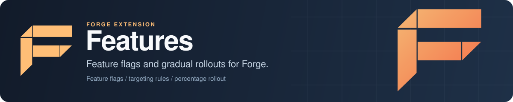

<p align="center">
  
</p>

# Forge Features: feature flags for Go services

Forge Features is the feature flag extension for [Forge](https://github.com/xraph/forge), the Go backend framework. You define boolean, string, number and JSON flags in Go, target them at users by ID, email, country, group or any custom attribute, and roll a feature out to a fixed percentage of users with stable hashing, so the same user gets the same answer on every request. Flags are evaluated in process by the local provider. Settings for LaunchDarkly, Unleash, Flagsmith and PostHog exist in the config, but those providers aren't wired up yet: see [Providers](#providers).

[](https://go.dev/dl/) [](https://github.com/xraph/forge/actions/workflows/go.yml) [](https://pkg.go.dev/github.com/xraph/forge/extensions/features) [](../../LICENSE)

[Documentation](https://www.xraph.com/docs/forge/extensions/features/features) · [Quick start](#quick-start) · [Features](#features) · [Evaluating flags](#evaluating-flags) · [Targeting and rollouts](#targeting-and-rollouts) · [Providers](#providers) · [Configuration](#configuration) · [FAQ](#faq)

## Quick start

You need [Go 1.26 or later](https://go.dev/dl/). Add Forge and the extension:

```bash
go get github.com/xraph/forge@latest
go get github.com/xraph/forge/extensions/features@latest
```

Save this as `main.go`. It defines two flags: a checkout switch that beta users always get and a quarter of everyone else gets, and a theme string that changes for one country.

```go
package main

import (
	"log"
	"net/http"

	"github.com/xraph/forge"
	"github.com/xraph/forge/extensions/features"
)

func main() {
	app := forge.NewApp(forge.AppConfig{
		Name:        "flags-demo",
		HTTPAddress: ":8080",
		Extensions: []forge.Extension{
			features.NewExtension(
				features.WithLocalFlags(map[string]features.FlagConfig{
					"new-checkout": {
						Key:     "new-checkout",
						Type:    "boolean",
						Enabled: true,
						Targeting: []features.TargetingRule{
							{Attribute: "group", Operator: "in", Values: []string{"beta"}, Value: true},
						},
						Rollout: &features.RolloutConfig{Percentage: 25},
					},
					"checkout-theme": {
						Key:   "checkout-theme",
						Type:  "string",
						Value: "classic",
						Targeting: []features.TargetingRule{
							{Attribute: "country", Operator: "equals", Values: []string{"DE"}, Value: "compact"},
						},
					},
				}),
			),
		},
	})

	err := app.Router().GET("/checkout", func(ctx forge.Context) error {
		flags, err := features.Get(app.Container())
		if err != nil {
			return err
		}

		user := features.NewUserContext(ctx.QueryDefault("user", "anonymous")).
			WithCountry(ctx.Query("country"))
		if ctx.Query("beta") == "true" {
			user = user.WithGroups([]string{"beta"})
		}

		return ctx.JSON(http.StatusOK, map[string]any{
			"user":         user.UserID,
			"new_checkout": flags.IsEnabled(ctx.Context(), "new-checkout", user),
			"theme":        flags.GetString(ctx.Context(), "checkout-theme", user, "classic"),
		})
	})
	if err != nil {
		log.Fatal(err)
	}

	if err := app.Run(); err != nil {
		log.Fatal(err)
	}
}
```

Run it and ask as a few different users:

```bash
go mod tidy
go run .

curl "http://localhost:8080/checkout?user=alice"
# {"new_checkout":false,"theme":"classic","user":"alice"}
curl "http://localhost:8080/checkout?user=bob&beta=true&country=DE"
# {"new_checkout":true,"theme":"compact","user":"bob"}
```

Bob is in the `beta` group, so the targeting rule turns the checkout on for him, and his country picks the compact theme. Alice falls through to the 25% rollout, and her user ID hashes outside it. Try a dozen user IDs and roughly a quarter of them come back `true`. Ask again as Alice and you'll get the same answer every time.

## Features

| You need | Forge Features gives you |
| --- | --- |
| On/off switches in code | Boolean flags read with `IsEnabled` and `IsEnabledWithDefault` |
| Config values that change per user | String, number and JSON flags through `GetString`, `GetInt`, `GetFloat` and `GetJSON` |
| A feature for specific people first | Targeting rules on `user_id`, `email`, `name`, `ip`, `country`, `group` or any custom attribute, with `equals`, `contains`, `in` and `not_in` |
| A gradual rollout | `RolloutConfig` with a percentage and a hashing attribute, stable per user |
| Safe behaviour when something is missing | Every getter takes a default, and an evaluation error logs a warning and returns that default |
| Fallbacks without defining a full flag | `WithDefaultFlags` for plain key-value defaults |
| One service your code can inject | A `*features.Service` in the Vessel container, also registered as `"features"` and `"features.Service"` |

## Evaluating flags

Get the service from the container with `features.Get(container)`, `features.GetFromApp(app)` or their `Must` versions, or take it as a constructor parameter:

```go
type Checkout struct {
	flags *features.Service
}

func NewCheckout(flags *features.Service) *Checkout {
	return &Checkout{flags: flags}
}

// After forge.NewApp:
err := forge.Provide(app.Container(), NewCheckout)
```

Every evaluation takes a `*features.UserContext`. Build one with `NewUserContext` and chain whatever you know about the caller:

```go
user := features.NewUserContext("user-42").
	WithEmail("ada@example.com").
	WithGroups([]string{"beta", "staff"}).
	WithAttribute("plan", "pro")

limit := flags.GetInt(ctx, "upload-limit-mb", user, 10)
ratio := flags.GetFloat(ctx, "sample-rate", user, 0.1)
layout := flags.GetJSON(ctx, "dashboard-layout", user, map[string]any{"columns": 2})

all, err := flags.GetAllFlags(ctx, user)
```

`WithName`, `WithIP` and `WithCountry` fill the other built-in fields. You can pass `nil` as the user context too, and then targeting and rollouts are skipped and you get the flag's base value.

| Method | Returns |
| --- | --- |
| `IsEnabled(ctx, key, user)` | `bool`, `false` when the flag is unknown |
| `IsEnabledWithDefault(ctx, key, user, def)` | `bool`, `def` when the flag is unknown |
| `GetString(ctx, key, user, def)` | `string` |
| `GetInt(ctx, key, user, def)` | `int` |
| `GetFloat(ctx, key, user, def)` | `float64` |
| `GetJSON(ctx, key, user, def)` | `any` |
| `GetAllFlags(ctx, user)` | `map[string]any` of every defined flag, evaluated for that user |
| `Refresh(ctx)` | re-reads flags from the provider (a no-op for the local provider) |

Types are matched exactly. `GetInt` only returns a value you stored as a Go `int` and `GetFloat` only one you stored as a `float64`, so if you store `50` in a flag and then read it with `GetFloat`, the type assertion fails quietly and you get your default back with no warning in the logs.

## Targeting and rollouts

For a defined flag, the local provider goes through these steps in order and stops at the first one that gives an answer:

1. Each targeting rule, in the order you listed them. If a rule matches the user and its `Value` has the type you asked for, that value wins.
2. For boolean flags with a `Rollout`, the user's bucket. A user inside the percentage gets `Enabled`, a user outside it gets the opposite.
3. The flag's own value: `Enabled` for booleans, `Value` for everything else.

A flag you never defined falls back to `WithDefaultFlags`, then to the default you passed to the getter.

| Rule attribute | Matches against |
| --- | --- |
| `user_id`, `email`, `name`, `ip`, `country` | The matching `UserContext` field |
| `group` | `Groups`, and only with the `in` operator |
| anything else | `Attributes[name]`, when it holds a string |

| Operator | True when |
| --- | --- |
| `equals`, `in` | The attribute equals one of `Values` |
| `not_in` | The attribute equals none of `Values` |
| `contains` | The attribute contains one of `Values` as a substring (case-sensitive) |

Rollouts hash the attribute named in `RolloutConfig.Attribute` (`user_id` when empty, or `email`, or a custom string attribute) with MD5 into one of 100 buckets. A user with an empty value for that attribute is always outside the rollout. `Percentage` of `0` or less puts nobody in, and `100` or more puts everybody in.

So a boolean flag with `Enabled: true` and `Percentage: 25` is on for about a quarter of your users. Flip it to `Enabled: false` and the same quarter now gets `false` while everyone else gets `true`, which is rarely what you meant.

## Providers

| `Provider` | Status |
| --- | --- |
| `local` | Works. Flags come from `WithLocalFlags` and live in memory for the life of the process |
| `launchdarkly` | Config and option exist (`WithLaunchDarkly`). Registration fails with "launchdarkly provider not yet available" |
| `unleash` | Same: `WithUnleash` exists, registration fails |
| `flagsmith` | Same: `WithFlagsmith` exists, registration fails |
| `posthog` | Same: `WithPostHog` exists, registration fails |

The `providers` package has client code for the four remote services, but the extension doesn't call it yet. Pick one today and registration fails, so your app won't start.

## Configuration

Configure the extension with options on `features.NewExtension`, or under `extensions.features` (falling back to `features`) in your config file. Your options win over the file and the file wins over the defaults. Flags can live in YAML under `local.flags`, `value` included. Write a number the way your getter expects it: `50` decodes as `int` and `50.0` as `float64`. `WithRequireConfig(true)` turns a missing section into a startup error.

| Option | Effect |
| --- | --- |
| `WithLocalFlags(map[string]FlagConfig)` | Sets the flag definitions and selects the `local` provider |
| `WithDefaultFlags(map[string]any)` | Fallback values for keys with no flag definition |
| `WithEnabled(bool)` | `false` skips registration entirely, and `features.Get` then returns an error |
| `WithProvider(string)` | Picks a provider by name |
| `WithRefreshInterval(time.Duration)` | How often the service calls the provider's `Refresh`. `0` turns the loop off |
| `WithCache(bool, time.Duration)` | Sets `EnableCache` and `CacheTTL`, which nothing reads yet |
| `WithLaunchDarkly`, `WithUnleash`, `WithFlagsmith`, `WithPostHog` | Fill provider settings and select that provider |
| `WithRequireConfig(bool)` | `true` makes `Register` fail when the config file has no `features` section |
| `WithConfig(features.Config)` | Replaces the whole config. `NewExtensionWithConfig(cfg)` does the same |

`DefaultConfig()` gives you `Enabled: true`, `Provider: "local"`, a 30-second refresh interval, and empty flag and default maps.

A `FlagConfig` has `Key`, `Name`, `Description`, `Type` (`boolean`, `string`, `number` or `json`), `Enabled`, `Value`, `Targeting` and `Rollout`. `Type` matters for `GetAllFlags`: it decides which getter is used for each flag, and anything other than the first three returns the raw `Value`.

## Documentation

| Topic | Where |
| --- | --- |
| Features and usage | [Features extension guide](https://www.xraph.com/docs/forge/extensions/features/features) |
| Configuration reference | [Features configuration](https://www.xraph.com/docs/forge/extensions/features/configuration) |
| Function reference | [Features functions](https://www.xraph.com/docs/forge/extensions/features/functions) |
| Go API | [pkg.go.dev](https://pkg.go.dev/github.com/xraph/forge/extensions/features) |
| Writing and loading extensions | [Forge extension system](../../docs/content/docs/forge/extensions-system.mdx) |

Where the docs pages and this README disagree about providers or YAML config, this README follows the code.

## FAQ

### How do I add feature flags to a Go API?

Add `features.NewExtension(features.WithLocalFlags(...))` to your Forge app's `Extensions`, then call `IsEnabled` or one of the typed getters with a `UserContext`. The [quick start](#quick-start) is a complete program.

### How do percentage rollouts stay consistent per user in Go?

The provider hashes the user's ID (or the attribute you name) with MD5 and takes the result modulo 100. The same ID always lands in the same bucket, so a user doesn't flicker between on and off as you call the flag again, and raising the percentage only adds users.

### Can I use LaunchDarkly, Unleash, Flagsmith or PostHog with Forge?

Not through this extension yet. The options exist, but choosing any of those providers makes startup fail until they're wired in. Use the `local` provider for now.

### Can I change flags without restarting?

Not through the public API. Local flags are fixed when you build the extension, and the service doesn't expose a way to edit them, so you restart with new definitions or keep values you need to change at runtime somewhere else.

### What happens if a flag is missing?

You get a default, never an error. A missing flag falls back to `WithDefaultFlags`, and then to the default you pass to the getter. `IsEnabled` uses `false`.

## Contributing

Features is its own Go module in the [Forge repository](https://github.com/xraph/forge). Test it from its directory the way CI does:

```bash
cd extensions/features
GOWORK=off go build ./...
GOWORK=off go vet ./...
GOWORK=off go test -short -count=1 ./...
golangci-lint run ./...
```

[AGENTS.md](../../AGENTS.md) has the pinned lint version and the repository conventions. Commits follow [Conventional Commits](https://www.conventionalcommits.org/), for example `feat(features): ...`.

## License

Forge Features is part of Forge and is available under the [Apache License 2.0](../../LICENSE).
