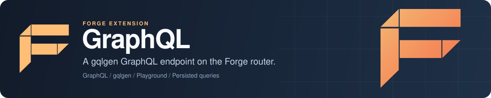

<p align="center">
  
</p>

# Forge GraphQL: a gqlgen GraphQL server for Go apps on Forge

Forge GraphQL is the GraphQL extension for [Forge](https://github.com/xraph/forge), the Go backend framework. It runs a [gqlgen](https://gqlgen.com/) server inside your app and mounts it on the Forge router, with a GraphQL Playground, query complexity limits, automatic persisted queries, file uploads, Apollo Federation's `_service` query, Forge metrics and slow query logging. It also ships a small DataLoader package for batching N+1 lookups in Golang resolvers.

[](https://go.dev/dl/) [](https://github.com/xraph/forge/actions/workflows/go.yml) [](https://pkg.go.dev/github.com/xraph/forge/extensions/graphql) [](../../LICENSE)

[Documentation](https://www.xraph.com/docs/forge/extensions/graphql) · [Quick start](#quick-start) · [Status](#what-the-extension-serves-today) · [Features](#features) · [DataLoader](#batch-lookups-with-dataloader) · [Configuration](#configuration) · [FAQ](#faq)

## Quick start

You need [Go 1.26 or later](https://go.dev/dl/). Add Forge and the extension to your module:

```bash
go get github.com/xraph/forge@latest
go get github.com/xraph/forge/extensions/graphql@latest
```

Save this as `main.go`:

```go
package main

import (
	"log"

	"github.com/xraph/forge"
	"github.com/xraph/forge/extensions/graphql"
)

func main() {
	app := forge.NewApp(forge.AppConfig{
		Name:        "graphql-demo",
		HTTPAddress: ":8080",
		Extensions: []forge.Extension{
			graphql.NewExtension(
				graphql.WithEndpoint("/graphql"),
				graphql.WithPlayground(true),
			),
		},
	})

	if err := app.Run(); err != nil {
		log.Fatal(err)
	}
}
```

Run it with `go mod tidy && go run .`, then send a query:

```bash
curl -X POST http://localhost:8080/graphql \
  -H 'Content-Type: application/json' \
  -d '{"query":"{ hello(name: \"Forge\") version }"}'
# {"data":{"hello":"Hello, Forge!","version":"2.0.0"}}
```

Open <http://localhost:8080/playground> in a browser for the GraphQL Playground. The endpoint answers `GET` as well as `POST`, so `curl -G localhost:8080/graphql --data-urlencode 'query={ version }'` works too.

## What the extension serves today

Read this before you build on the extension. The server runs the schema that is compiled into this module, [`schema/schema.graphql`](schema/schema.graphql), and nothing else:

```graphql
directive @auth(requires: String) on FIELD_DEFINITION

type Query {
  hello(name: String!): String!
  version: String!
}

type Mutation {
  echo(message: String!): String!
}
```

There isn't a way to hand it your own schema or resolvers yet. `RegisterType`, `RegisterQuery`, `RegisterMutation` and `RegisterSubscription` on the `GraphQL` interface only write a debug log line, `Use` does nothing, and `ExecuteQuery` returns an error response telling you to go through `HTTPHandler()`. The config keys `auto_generate_schema` and `schema_file` are accepted and ignored.

So what is it good for today? If you want to see gqlgen running inside a Forge app with the playground, persisted queries, complexity limits and metrics already wired, it shows you how, and the `dataloader` package is usable on its own in any resolver you write. If you need your own schema right now, run gqlgen in your own module and mount its `handler.Server` on a Forge route yourself, the same way [`extension.go`](extension.go) does.

## Features

| You need | Forge GraphQL gives you |
| --- | --- |
| A GraphQL endpoint on your existing router | `GET` and `POST` routes at `endpoint`, registered when the extension starts |
| A browser IDE while you develop | GraphQL Playground at `playground_endpoint`, switched off with `WithPlayground(false)` |
| Protection from expensive queries | gqlgen's fixed complexity limit, from `max_complexity` |
| Smaller requests from repeat clients | Automatic persisted queries with an LRU cache of `max_cache_size` entries |
| File uploads | gqlgen's multipart transport, capped at `max_upload_size` |
| Federation | Apollo Federation v2 code generated in, including the `_service { sdl }` query |
| Visibility | `graphql_operation_duration_seconds` and `graphql_operation_total`, debug logs per operation, error logs, and a warning for queries slower than `slow_query_threshold` |
| N+1 batching in your own resolvers | The [`dataloader`](dataloader/) package |

The server also registers gqlgen's WebSocket, GET, POST, OPTIONS and multipart transports. The schema has no subscriptions, so the WebSocket transport has nothing to stream yet.

## Batch lookups with DataLoader

The `dataloader` package works on its own, whether or not you use the extension. A `Loader` collects the keys that concurrent callers ask for during a short wait window, calls your batch function once with all of them, and caches the results:

```go
users := dataloader.NewLoader(dataloader.DefaultLoaderConfig(),
	func(ctx context.Context, keys []any) ([]any, []error) {
		// One query for every key collected in this window.
		values := make([]any, len(keys))
		for i, k := range keys {
			values[i] = fmt.Sprintf("user-%v", k)
		}

		return values, make([]error, len(keys))
	})

user, err := users.Load(ctx, 42)
```

Order matters. Your batch function has to return a value slice and an error slice that line up with `keys`, one entry per key, or the wrong caller gets the wrong user. `DefaultLoaderConfig()` waits 10ms before it dispatches. `Prime`, `Clear` and `ClearAll` manage the cache. One caveat: `LoadMany` calls `Load` for one key after another, so it waits a full window per key and doesn't batch. Call `Load` from concurrent resolvers if you want the batching.

## Configuration

The extension reads `extensions.graphql` from your config, falling back to `graphql`. Options you pass in code override the file.

```yaml
extensions:
  graphql:
    endpoint: /graphql
    playground_endpoint: /playground
    enable_playground: true
    max_complexity: 1000
    enable_query_cache: true
    max_cache_size: 1000
    max_upload_size: 10485760   # 10MB
    enable_metrics: true
    enable_logging: true
    log_slow_queries: true
    slow_query_threshold: 1s
```

These settings change what the server does:

| Key | Option | Default | What it does |
| --- | --- | --- | --- |
| `endpoint` | `WithEndpoint` | `/graphql` | Path of the GraphQL endpoint |
| `playground_endpoint` | none | `/playground` | Path of the playground |
| `enable_playground` | `WithPlayground` | `true` | Serves the playground |
| `max_complexity` | `WithMaxComplexity` | `1000` | Complexity limit, `0` turns it off |
| `enable_query_cache` | `WithQueryCache` | `true` | Turns on the persisted query cache |
| `max_cache_size` | none | `1000` | Entries in that cache |
| `max_upload_size` | none | `10485760` | Largest multipart upload, in bytes |
| `enable_metrics` | `WithMetrics` | `true` | Records the two operation metrics |
| `enable_logging` | none | `true` | Logs operations and GraphQL errors |
| `log_slow_queries` | none | `true` | Warns about slow operations |
| `slow_query_threshold` | none | `1s` | What counts as slow |

The slow query warning only runs when you have metrics or logging on.

`Config` has more fields, and some have options, but nothing reads them yet. `enable_introspection` (`WithIntrospection`) has no effect because gqlgen's default server always allows introspection, so you can't turn it off from config today. `max_depth` (`WithMaxDepth`), `query_timeout` (`WithTimeout`), `enable_dataloader` (`WithDataLoader`), `dataloader_batch_size`, `dataloader_wait`, `query_cache_ttl`, `enable_cors` and `allowed_origins` (`WithCORS`), `enable_tracing` (`WithTracing`), `auto_generate_schema` and `schema_file` are validated where there's a rule (`max_depth` has to be at least 1, `query_timeout` positive) and otherwise left alone.

`WithConfig` replaces the whole config, and `WithRequireConfig(true)` makes a missing config section an error at startup. In the container you'll find `*graphql.GraphQLService` and the `graphql.GraphQL` interface, both backed by one instance.

## Documentation

| Topic | Where |
| --- | --- |
| What the extension does | [Features](https://www.xraph.com/docs/forge/extensions/graphql/features) |
| Every config key | [Configuration](https://www.xraph.com/docs/forge/extensions/graphql/configuration) |
| Exported functions and types | [Functions](https://www.xraph.com/docs/forge/extensions/graphql/functions), [pkg.go.dev](https://pkg.go.dev/github.com/xraph/forge/extensions/graphql) |
| gqlgen itself | [gqlgen documentation](https://gqlgen.com/) |
| Extensions in general | [Forge extension system](../../docs/content/docs/forge/extensions-system.mdx) |

## FAQ

### How do I add a GraphQL endpoint to a Go app built on Forge?

Add `graphql.NewExtension()` to your app's `Extensions`. You get `/graphql` and `/playground` on the Forge router. Read [what the extension serves today](#what-the-extension-serves-today) first, because the schema is fixed for now.

### Can I use my own GraphQL schema with Forge GraphQL?

Not through the extension yet. The registration methods are placeholders. Generate your schema with gqlgen in your own module and register its handler on a Forge route.

### Does it support Apollo Federation?

The generated code includes Federation v2, and `{ _service { sdl } }` returns the module's schema. Entity resolvers aren't there, because the built-in schema has no entities.

### How do I fix the N+1 problem in Go GraphQL resolvers?

Use the `dataloader` package: create one `Loader` per request and call `Load` from each resolver, so lookups that happen together turn into one batch call.

## Contributing

The extension is its own Go module inside the Forge repository. Its go.mod has no `replace` for the Forge root, so it builds against the published Forge version its `require` line names, even inside this repository. Test it from its directory:

```bash
cd extensions/graphql
GOWORK=off go test -race ./...
GOWORK=off golangci-lint run ./...
```

After you edit [`schema/schema.graphql`](schema/schema.graphql), regenerate the code with `go run github.com/99designs/gqlgen generate` from the same directory. [AGENTS.md](../../AGENTS.md) has the full build, lint and release rules for the repository, and [CONTRIBUTING.md](../../CONTRIBUTING.md) has the contribution guidelines.

## License

Forge GraphQL is part of Forge and is available under the [Apache License 2.0](../../LICENSE).
