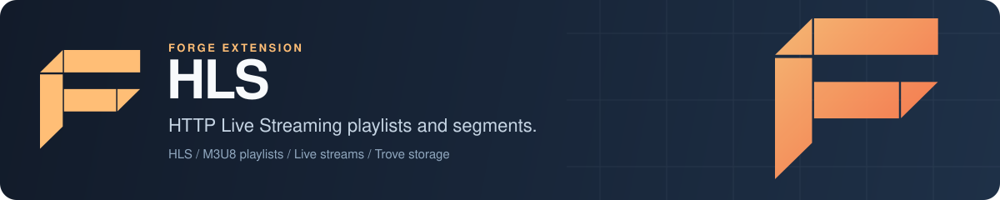

<p align="center">
  
</p>

# Forge HLS: HTTP Live Streaming server for Go

Forge HLS is the HTTP Live Streaming extension for [Forge](https://github.com/xraph/forge), the Go backend framework. You add it to your app and get a REST API for live streams: create a stream with adaptive bitrate variants, push MPEG-TS segments from your encoder, and serve master and media M3U8 playlists with a sliding DVR window. Segments and playlists are stored in a [Trove](https://github.com/xraph/trove) object store, so they can sit on local disk, S3, GCS or Azure. Some parts are not finished yet, segment delivery and VOD among them, so read [Status](#status) before you put a player in front of it.

[](https://go.dev/dl/) [](https://github.com/xraph/forge/actions/workflows/go.yml) [](https://pkg.go.dev/github.com/xraph/forge/extensions/hls) [](../../LICENSE)

[Documentation](https://www.xraph.com/docs/forge/extensions/hls) · [Quick start](#quick-start) · [Features](#features) · [HTTP API](#http-api) · [Go API](#use-it-from-go) · [Status](#status) · [Configuration](#configuration) · [FAQ](#faq)

## Quick start

You need [Go 1.26 or later](https://go.dev/dl/) and a Go module:

```bash
go get github.com/xraph/forge@latest
go get github.com/xraph/forge/extensions/hls@latest
go get github.com/xraph/trove@latest
```

Save this as `main.go`. The HLS extension looks up a `*trove.Trove` in the container when it registers, so you open one on a local directory and provide it before the app runs:

```go
package main

import (
	"context"
	"log"

	"github.com/xraph/forge"
	"github.com/xraph/forge/extensions/hls"
	"github.com/xraph/trove"
	"github.com/xraph/trove/drivers/localdriver"
)

func main() {
	app := forge.NewApp(forge.AppConfig{
		Name:        "video",
		HTTPAddress: ":8080",
		Extensions: []forge.Extension{
			hls.NewExtension(hls.WithBaseURL("http://localhost:8080/hls")),
		},
	})

	// HLS keeps playlists and segments in a Trove object store, resolved
	// from the container. Here that's a directory on local disk.
	drv := localdriver.New()
	if err := drv.Open(context.Background(), "local://./hls-data"); err != nil {
		log.Fatal(err)
	}

	store, err := trove.Open(drv)
	if err != nil {
		log.Fatal(err)
	}
	defer store.Close(context.Background())

	if err := forge.ProvideValue(app.Container(), store); err != nil {
		log.Fatal(err)
	}

	if err := app.Run(); err != nil {
		log.Fatal(err)
	}
}
```

Run it with `go mod tidy && go run .`, then drive it with curl (and `jq` to pick out the IDs):

```bash
# Create a live stream with one 720p variant.
STREAM=$(curl -s -X POST localhost:8080/hls/streams -H 'Content-Type: application/json' -d '{
  "Title": "Launch", "Type": "live", "TargetDuration": 6, "DVRWindowSize": 5,
  "TranscodeProfiles": [{"Name": "720p", "Width": 1280, "Height": 720, "Bitrate": 2800000,
    "FrameRate": 30, "VideoCodec": "h264", "AudioCodec": "aac"}]}')
ID=$(echo "$STREAM" | jq -r .ID)
VARIANT=$(echo "$STREAM" | jq -r '.Variants[0].ID')

# Go live, then push a segment. Data is the .ts file, base64 encoded.
curl -X POST localhost:8080/hls/streams/$ID/start
curl -X POST localhost:8080/hls/streams/$ID/ingest -H 'Content-Type: application/json' \
  -d "{\"VariantID\":\"$VARIANT\",\"SequenceNum\":0,\"Duration\":6.0,\"Data\":\"$(base64 < segment0.ts)\"}"

# Playlists.
curl localhost:8080/hls/$ID/master.m3u8
curl localhost:8080/hls/$ID/variants/$VARIANT/playlist.m3u8
```

The master playlist lists the variant with `BANDWIDTH=2800000,RESOLUTION=1280x720,CODECS="avc1.4d401f,mp4a.40.2"`, and the media playlist lists `segment_0.ts` with `#EXTINF:6.000`. Segment and playlist URLs are built from the base URL you set, so make it the address your players will use. The files land under `./hls-data`.

## Features

| You need | Forge HLS gives you |
| --- | --- |
| Live streams | Create, start, stop, list and delete streams of type `live`, `event` or `vod` |
| Adaptive bitrate | One variant per transcode profile, with bandwidth, resolution, codec strings and frame rate in the master playlist |
| Segment ingest | Push numbered MPEG-TS segments per variant, over HTTP or from Go with `IngestSegment` |
| A DVR window | The media playlist keeps the last `DVRWindowSize` segments and older ones are deleted from storage |
| Object storage | Any Trove backend, picked by name, with a bucket and key prefix |
| Ready-made profiles | `Profile360p`, `Profile480p`, `Profile720p`, `Profile1080p` and `DefaultProfiles()` |
| Stream stats | Per-stream counters from `/hls/streams/:id/stats` |
| CORS | `Access-Control-Allow-*` headers on playlist responses |
| A Raft-backed cluster mode | A distributed coordinator on top of the [consensus extension](../consensus/), see [Status](#status) |

## HTTP API

The extension registers these routes under the base path (`/hls` by default) when the app starts:

| Method and path | What it does |
| --- | --- |
| `POST /hls/streams` | Create a stream from `StreamOptions` JSON. Returns the `Stream` with its ID and variant IDs |
| `GET /hls/streams` | `{"streams": [...], "count": n}` |
| `GET /hls/streams/:streamID` | One stream |
| `DELETE /hls/streams/:streamID` | Delete a stream and its stored files |
| `POST /hls/streams/:streamID/start`, `/stop` | Mark a live stream active or stopped |
| `POST /hls/streams/:streamID/ingest` | Store one `Segment`: `VariantID`, `SequenceNum`, `Duration` and base64 `Data` |
| `GET /hls/streams/:streamID/stats` | `StreamStats` |
| `GET /hls/:streamID/master.m3u8` | Master playlist |
| `GET /hls/:streamID/variants/:variantID/playlist.m3u8` | Media playlist |
| `GET /hls/:streamID/variants/:variantID/segment_:segmentNum.ts` | Intended to serve a segment. See [Status](#status) |

The request and response types have no JSON tags, so the keys are the Go field names (`Title`, `VariantID`, `SequenceNum`). Go's decoder ignores case, so `title` works on the way in, but responses use the capitalised names. A segment is accepted only while the stream is active.

None of these routes check authentication. Put the management routes behind your own middleware or gateway before you expose the app.

## Use it from Go

The extension registers its manager as `hls.HLS` in the container, so you can skip the HTTP layer:

```go
svc, err := forge.Inject[hls.HLS](app.Container())

stream, err := svc.CreateStream(ctx, hls.StreamOptions{
	Title:             "Launch",
	Type:              hls.StreamTypeLive,
	TargetDuration:    6,
	DVRWindowSize:     5,
	TranscodeProfiles: []hls.TranscodeProfile{hls.Profile360p, hls.Profile720p},
})

err = svc.StartLiveStream(ctx, stream.ID)

err = svc.IngestSegment(ctx, stream.ID, &hls.Segment{
	VariantID:   stream.Variants[0].ID,
	SequenceNum: 0,
	Duration:    6.0,
	Data:        tsBytes,
})

master, err := svc.GetMasterPlaylist(ctx, stream.ID)
fmt.Println(master.Content)
```

`GetMediaPlaylist`, `GetSegment` (an `io.ReadCloser` from storage), `GetStreamStats` and `GetActiveViewers` round it out. Resolve the service after the app has registered its extensions, for example in a `forge.OnStarted` hook.

## Status

Some of this extension is still scaffolding, and you should know which parts before you rely on it.

Segment delivery is broken. The router registers `segment_:segmentNum.ts` as a literal path, so a real segment URL such as `.../segment_0.ts` gets a 404 and your players cannot fetch segments. Until the route is fixed, serve segments from your own handler that calls `GetSegment`, or let your CDN read them straight from the Trove bucket.

VOD does not produce output yet. `CreateVOD` only creates the stream record, and `CreateVODFromFile` starts FFmpeg transcode jobs but never segments or stores the results. `TranscodeVideo` reads from a placeholder path. If you push segments you have already encoded to a live stream, that path works end to end up to the segment route.

Stream records live in memory. Metadata is written to storage, but nothing reads it back, so streams are gone after a restart even though their files remain.

Many config fields are stored and never read: `RequireAuth`, `MaxViewersPerStream`, `MaxBandwidthPerStream`, `MaxSegmentSize`, `EnableCaching`, `CacheTTL`, `SegmentRetention` and the distributed `RedirectToLeader`, `RedirectToOwner` and `EnableFailover` flags. The cleanup routine trims each stream to the DVR window every `CleanupInterval`. With `WithDistributed(true)` the extension starts a coordinator on the consensus extension, but the routes do not redirect to a leader or owner.

## Configuration

You can configure the extension in code with options, or in YAML under `extensions.hls` (the extension also reads a top-level `hls` key).

| Option | Sets | Default |
| --- | --- | --- |
| `WithBasePath(string)` | `BasePath` for the routes | `/hls` |
| `WithBaseURL(string)` | `BaseURL` used in playlist URLs | `http://localhost:8080/hls` |
| `WithStorageBackend(string)` | A named Trove from the container. Empty or `default` uses the unnamed one | `default` |
| `WithStorageBucket(string)`, `WithStoragePrefix(string)` | Bucket (created on start) and key prefix | `hls`, `hls` |
| `WithTargetDuration(int)`, `WithDVRWindow(int)` | Seconds per segment, segments kept | `6`, `10` |
| `WithTranscoding(bool, ...TranscodeProfile)` | Transcoding switch and default profiles | on, `DefaultProfiles()` |
| `WithFFmpegPaths(ffmpeg, ffprobe)` | Binaries for transcoding | `ffmpeg`, `ffprobe` |
| `WithCORS(bool, ...string)` | CORS headers. Only the first origin is sent | on, `*` |
| `WithLimits(maxStreams, maxViewers, maxBandwidth)` | `MaxStreams` is enforced on create | `100`, `10000`, `104857600` |
| `WithCleanup(retention, interval)` | Turns on cleanup and sets its interval | on, `24h`, `1h` |
| `WithDistributed(bool)`, `WithNodeID(string)`, `WithClusterID(string)`, `WithFailover(bool)` | Cluster mode | off |
| `WithAuth(bool)`, `WithCaching(bool, ttl)` | Stored only, see [Status](#status) | off, on and `5m` |
| `WithRequireConfig(bool)`, `WithConfig(hls.Config)` | Require YAML, or replace the whole config | |

The YAML keys are the snake_case names from the struct tags, such as `base_url`, `storage_bucket`, `target_duration` and `dvr_window_size`. The file overrides `DefaultConfig()`, your options override the file, and anything you leave out of the YAML keeps its default.

```yaml
extensions:
  hls:
    base_url: https://video.example.com/hls
    storage_bucket: media
    target_duration: 4
    dvr_window_size: 30
```

Forge reads `config.yaml` only when `EnableConfigAutoDiscovery` is on. `forge.DefaultAppConfig()` turns it on, but an `AppConfig` literal like the one in the quick start leaves it off.

If you use Trove's own Forge extension to provide the store, list it before HLS in `Extensions`, because HLS resolves the store while it registers and does not declare the dependency.

## Documentation

| Topic | Where |
| --- | --- |
| Overview | [HLS docs](https://www.xraph.com/docs/forge/extensions/hls) |
| Features and usage | [HLS features](https://www.xraph.com/docs/forge/extensions/hls/features) |
| Configuration reference | [HLS configuration](https://www.xraph.com/docs/forge/extensions/hls/configuration) |
| Function reference | [HLS functions](https://www.xraph.com/docs/forge/extensions/hls/functions) |
| Go API | [pkg.go.dev](https://pkg.go.dev/github.com/xraph/forge/extensions/hls) |
| Object storage | [Trove](https://github.com/xraph/trove) and its [docs](https://www.xraph.com/docs/trove) |

## Examples

These live in this module, so run them from this directory with `GOWORK=off go run ./examples/<name>`:

| Example | What it shows |
| --- | --- |
| [basic](examples/basic/) | A local Trove store, the extension with transcoding on, and a demo live stream |
| [vod](examples/vod/) | The VOD entry points (they do not produce playable output yet) |
| [distributed](examples/distributed/) | Cluster mode with the consensus extension |
| [player.html](examples/player.html) | A browser test page for a playlist URL |

## FAQ

### How do I serve HLS video from a Go server?

Encode your stream into MPEG-TS segments (FFmpeg or a hardware encoder), push them to the ingest endpoint, and point players at the master playlist. Read [Status](#status) first: segment URLs return 404 today, so you need a small handler of your own until that route is fixed.

### Does Forge HLS transcode video with FFmpeg?

It has an FFmpeg transcoder and segmenter, but the VOD path that would use them does not store any output yet. For live streams, send segments you have already encoded with your own FFmpeg command or hardware encoder.

### Where are HLS segments stored?

In a Trove object store under `<prefix>/<streamID>/<variantID>/` in the bucket you configure (`hls` by default). Pick local disk, S3, GCS or Azure through the Trove driver you open.

### Does it support low-latency HLS or fMP4?

No. Playlists are HLS version 3 with MPEG-TS segments.

## Contributing

HLS is its own Go module inside the [Forge repository](https://github.com/xraph/forge). It replaces the root and consensus modules with local paths. Build, vet and test it from its directory the way CI does:

```bash
cd extensions/hls
GOWORK=off go build ./...
GOWORK=off go vet ./...
GOWORK=off go test -short -count=1 ./...
golangci-lint run ./...
```

Forge's [AGENTS.md](../../AGENTS.md) has the pinned lint version and the rest of the repository conventions. Commits follow [Conventional Commits](https://www.conventionalcommits.org/), for example `fix(hls): ...`.

## License

Forge HLS is part of Forge and is available under the [Apache License 2.0](../../LICENSE).
