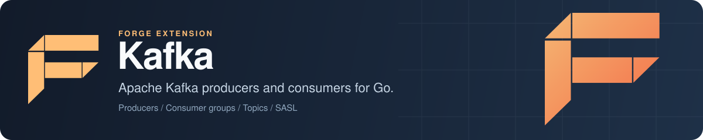

<p align="center">
  
</p>

# Forge Kafka: Apache Kafka producer and consumer for Go

Forge Kafka is the Apache Kafka extension for [Forge](https://github.com/xraph/forge), the Go backend framework. You add it to your app and get a Kafka client in the container, with sync and async producers, partition consumers, consumer groups, topic administration, TLS and SASL (PLAIN, SCRAM-SHA-256, SCRAM-SHA-512) authentication. It is built on [IBM Sarama](https://github.com/IBM/sarama), and you can reach the raw Sarama client, producers and consumers whenever you need something the wrapper does not cover.

[](https://go.dev/dl/) [](https://github.com/xraph/forge/actions/workflows/go.yml) [](https://pkg.go.dev/github.com/xraph/forge/extensions/kafka) [](../../LICENSE)

[Documentation](https://www.xraph.com/docs/forge/extensions/kafka) · [Quick start](#quick-start) · [Features](#features) · [Producing](#produce-messages) · [Consuming](#consume-messages) · [Topics](#manage-topics) · [Security](#tls-and-sasl) · [Configuration](#configuration) · [FAQ](#faq)

## Quick start

You need [Go 1.26 or later](https://go.dev/dl/) and a Kafka broker. Add the extension to your module:

```bash
go get github.com/xraph/forge@latest
go get github.com/xraph/forge/extensions/kafka@latest
go get github.com/IBM/sarama
```

This app publishes the body of every `POST /orders` to an `orders` topic and logs each message it reads back:

```go
package main

import (
	"context"
	"io"
	"log"
	"net/http"

	"github.com/IBM/sarama"
	"github.com/xraph/forge"
	"github.com/xraph/forge/extensions/kafka"
)

func main() {
	app := forge.NewApp(forge.AppConfig{
		Name:        "orders",
		HTTPAddress: ":8080",
		Extensions: []forge.Extension{
			kafka.NewExtension(
				kafka.WithBrokers("localhost:9092"),
				kafka.WithClientID("orders"),
			),
		},
	})

	// Start reading the topic once every extension is up.
	err := app.RegisterHookFn(forge.PhaseAfterStart, "consume-orders",
		func(ctx context.Context, a forge.App) error {
			k, err := forge.Inject[*kafka.KafkaService](a.Container())
			if err != nil {
				return err
			}

			return k.Consume(ctx, []string{"orders"}, func(msg *sarama.ConsumerMessage) error {
				log.Printf("partition %d offset %d: %s", msg.Partition, msg.Offset, msg.Value)

				return nil
			})
		})
	if err != nil {
		log.Fatal(err)
	}

	// POST a body and it lands on the "orders" topic.
	err = app.Router().POST("/orders", func(ctx forge.Context) error {
		k, err := forge.Inject[*kafka.KafkaService](app.Container())
		if err != nil {
			return err
		}

		body, err := io.ReadAll(ctx.Request().Body)
		if err != nil {
			return err
		}

		if err := k.SendMessage("orders", nil, body); err != nil {
			return err
		}

		return ctx.JSON(http.StatusAccepted, map[string]string{"status": "queued"})
	})
	if err != nil {
		log.Fatal(err)
	}

	if err := app.Run(); err != nil {
		log.Fatal(err)
	}
}
```

If you don't have a broker running, start a single-node one with Docker and create the topic:

```bash
docker run -d --name kafka -p 9092:9092 apache/kafka:latest
docker exec kafka /opt/kafka/bin/kafka-topics.sh \
  --bootstrap-server localhost:9092 --create --topic orders
```

Then run the app and post something:

```bash
go mod tidy
go run .

# in another terminal
curl -X POST localhost:8080/orders -d '{"id": 42}'
```

The app's log shows the message coming back from the `orders` topic. If no broker answers on `localhost:9092`, the after-start hook can't create the client, so `app.Run()` returns that error and nothing listens on port 8080.

## Features

| You need | Forge Kafka gives you |
| --- | --- |
| To publish events from handlers | `SendMessage` (waits for the broker), `SendMessageAsync` (fire and forget) and `SendMessages` for a batch |
| To read a topic | `Consume` across every partition, or `ConsumePartition` from an offset you choose |
| Load-balanced consumers with commits | `JoinConsumerGroup` with your own Sarama `ConsumerGroupHandler` |
| Topic setup from code | `CreateTopic`, `DeleteTopic`, `ListTopics`, `DescribeTopic`, `GetPartitions`, `GetOffset` |
| Secure clusters | TLS with client certificates and a custom CA, SASL PLAIN and SCRAM |
| Throughput tuning | gzip, snappy, lz4 and zstd compression, flush batching, acks and fetch sizes |
| Visibility | Forge metrics per topic and client counters from `GetStats` |
| Anything Sarama can do | `GetClient`, `GetProducer`, `GetAsyncProducer`, `GetConsumer`, `GetConsumerGroup` |

The extension registers one service, `*kafka.KafkaService`, by type and under the alias `kafka`. It implements the `kafka.Kafka` interface, so you can pass it to code that only needs the interface. Resolve it wherever you have a container:

```go
k, err := forge.Inject[*kafka.KafkaService](app.Container())

// The same service, by its alias:
k, err = forge.Resolve[*kafka.KafkaService](app.Container(), "kafka")
```

The service is built the first time something resolves it. That's when the client connects, creates the producers and consumer you enabled, and pings the brokers, so the first `Inject` is where a connection error shows up. When the app stops, the container closes every producer, consumer and consumer group, then the client.

## Produce messages

When you call `SendMessage`, it goes through Sarama's sync producer and returns once the broker acknowledges the write (`producer_acks` decides how many replicas have to acknowledge it), so a failed write comes back to you as an error in the handler that sent it.

```go
err := k.SendMessage("orders", []byte("customer-17"), payload)
```

`SendMessageAsync` drops the message on the async producer's input channel and returns. Delivery errors don't come back to you: the extension logs them and counts them in `GetStats().Errors`.

```go
err := k.SendMessageAsync("clicks", nil, payload)
```

`SendMessages` sends a batch through the sync producer. Each `ProducerMessage` carries its own topic, key, value and partition:

```go
err := k.SendMessages([]*kafka.ProducerMessage{
	{Topic: "orders", Key: []byte("customer-17"), Value: first},
	{Topic: "orders", Key: []byte("customer-17"), Value: second},
})
```

Mind you, `SendMessages` only copies `Topic`, `Key`, `Value` and `Partition` across to Sarama today. `Headers` and `Timestamp` on `ProducerMessage` are ignored, so if you need record headers, build a `sarama.ProducerMessage` yourself and send it through `k.GetProducer()`.

Sarama's default partitioner hashes the key. If you give related events the same key, they land on one partition and you read them back in the order you sent them.

## Consume messages

You have two ways to read a topic, and they behave differently.

`Consume` and `ConsumePartition` read partitions directly, with no consumer group and no committed offsets. `Consume` finds every partition of each topic and starts reading from the newest offset, so it only sees messages produced after it starts. `ConsumePartition` lets you pick the offset, including `sarama.OffsetOldest`:

```go
err := k.ConsumePartition(ctx, "orders", 0, sarama.OffsetOldest,
	func(msg *sarama.ConsumerMessage) error {
		return process(msg.Value)
	})
```

Both return as soon as the partition readers are running. Each partition gets its own goroutine. If your handler returns an error, the extension logs it with the topic, partition and offset and moves on to the next message, so nothing is retried and you decide what a failed message means for your service. Call `k.StopConsume()` or cancel the context to stop reading.

`JoinConsumerGroup` is the one you want when several instances of a service share a topic, or when a restart should pick up where it left off. You write a Sarama `ConsumerGroupHandler`, and you mark messages as processed yourself:

```go
type orderHandler struct{}

func (orderHandler) Setup(sarama.ConsumerGroupSession) error   { return nil }
func (orderHandler) Cleanup(sarama.ConsumerGroupSession) error { return nil }

func (orderHandler) ConsumeClaim(s sarama.ConsumerGroupSession, c sarama.ConsumerGroupClaim) error {
	for msg := range c.Messages() {
		if err := process(msg.Value); err != nil {
			return err
		}

		s.MarkMessage(msg, "")
	}

	return nil
}

err := k.JoinConsumerGroup(ctx, "order-workers", []string{"orders"}, orderHandler{})
```

The call returns once the group's consume loop is running in the background. A new group with no committed offsets starts from `consumer_offsets` (`newest` or `oldest`), and partitions are assigned with `consumer_group_rebalance` (`range`, `roundrobin` or `sticky`). One client joins one group at a time. Call `k.LeaveConsumerGroup(ctx)` to leave it before joining another.

## Manage topics

```go
err := k.CreateTopic("orders", kafka.TopicConfig{
	NumPartitions:     6,
	ReplicationFactor: 3,
})

topics, err := k.ListTopics()
meta, err := k.DescribeTopic("orders")         // partitions, leaders, replicas
parts, err := k.GetPartitions("orders")
next, err := k.GetOffset("orders", 0, sarama.OffsetNewest)
err = k.DeleteTopic("orders")
```

`CreateTopic` and `DeleteTopic` send the admin request to the first broker in the client's list. `TopicConfig.ConfigEntries` passes topic settings such as `retention.ms` straight through.

## TLS and SASL

```go
kafka.NewExtension(
	kafka.WithBrokers("broker-1:9093", "broker-2:9093"),
	kafka.WithTLS("/etc/kafka/client.pem", "/etc/kafka/client-key.pem", "/etc/kafka/ca.pem", false),
	kafka.WithSASL("SCRAM-SHA-512", "orders-service", os.Getenv("KAFKA_PASSWORD")),
)
```

`WithTLS` takes a client certificate, its key, a CA file and a skip-verify flag. With verification on, the config check requires both the certificate and the key, so a TLS-only setup without a client certificate doesn't pass validation today. `WithSASL` accepts `PLAIN`, `SCRAM-SHA-256` or `SCRAM-SHA-512`, and needs a username and password.

## Configuration

Configure the extension in code. Pass options to `NewExtension`, or start from `kafka.DefaultConfig()`, change the fields you need and hand the struct to `WithConfig` (or `NewExtensionWithConfig`):

```go
cfg := kafka.DefaultConfig()
cfg.Brokers = []string{"broker-1:9092", "broker-2:9092"}
cfg.ClientID = "orders"
cfg.ProducerCompression = "lz4"
cfg.ProducerAcks = "all"
cfg.ConsumerOffsets = "oldest"
cfg.ConsumerGroupRebalance = "sticky"

ext := kafka.NewExtension(kafka.WithConfig(cfg))
```

The options cover the common fields: `WithBrokers`, `WithClientID`, `WithVersion`, `WithTLS`, `WithSASL`, `WithProducer`, `WithConsumer`, `WithConsumerGroup`, `WithCompression`, `WithIdempotent`, `WithMetrics`, `WithTracing`, `WithRequireConfig` and `WithConfig`.

The extension also reads `extensions.kafka` from your config file, falling back to a top-level `kafka` key, and `WithRequireConfig(true)` turns a missing section into a startup error. The file overrides the defaults and your options override the file, so `brokers` or `sasl_mechanism` in YAML takes effect with a plain `kafka.NewExtension()`.

These are the fields of `kafka.Config`, with their YAML names:

| Key | Default | What it does |
| --- | --- | --- |
| `brokers` | `["localhost:9092"]` | Seed brokers |
| `client_id` | `forge-kafka-client` | Client ID sent to the brokers |
| `version` | `3.0.0` | Kafka protocol version Sarama speaks |
| `dial_timeout`, `read_timeout`, `write_timeout` | `30s` each | Network timeouts |
| `producer_enabled` | `true` | Create the sync and async producers |
| `producer_compression` | `snappy` | `none`, `gzip`, `snappy`, `lz4` or `zstd` |
| `producer_acks` | `local` | `none`, `local` (leader only) or `all` |
| `producer_flush_messages`, `producer_flush_frequency` | `10`, `100ms` | Batch triggers for the producers |
| `producer_retry_max` | `3` | Send retries |
| `producer_max_message_bytes` | `1000000` | Largest message the producer accepts |
| `producer_idempotent` | `false` | Idempotent producer (see the [FAQ](#can-i-turn-on-the-idempotent-producer) first) |
| `consumer_enabled` | `true` | Create the partition consumer |
| `consumer_offsets` | `newest` | Where a new consumer group starts: `newest` or `oldest` |
| `consumer_isolation` | `read_uncommitted` | `read_uncommitted` or `read_committed` |
| `consumer_max_wait`, `consumer_fetch_min`, `consumer_fetch_max` | `500ms`, `1`, `1MiB` | Fetch tuning |
| `consumer_group_rebalance` | `range` | `range`, `roundrobin` or `sticky` |
| `consumer_group_session`, `consumer_group_heartbeat` | `10s`, `3s` | Group session timeout and heartbeat |
| `metadata_retry_max`, `metadata_retry_backoff`, `metadata_refresh_freq` | `3`, `250ms`, `10m` | Metadata refresh |
| `enable_tls`, `tls_cert_file`, `tls_key_file`, `tls_ca_file`, `tls_skip_verify` | off | TLS |
| `enable_sasl`, `sasl_mechanism`, `sasl_username`, `sasl_password` | off, `PLAIN` | SASL |
| `enable_metrics` | `true` | Record the metrics below |
| `enable_logging` | `true` | Log failed and successful sync sends |

Unknown values for compression, acks, offsets, isolation or rebalance fail validation when the extension registers, so a typo stops the app at startup. `WithTracing` and `consumer_group_id` are stored on the config but nothing reads them yet: the group ID you pass to `JoinConsumerGroup` is the one that counts.

With `enable_metrics` on, the extension records `kafka.messages.sent` and `kafka.messages.received` counters and `kafka.bytes.sent` and `kafka.bytes.received` gauges (the size of the last message), each labelled by `topic`. `GetStats()` returns running totals for the client: messages and bytes in both directions, error count and the last error.

## Documentation

| Topic | Where |
| --- | --- |
| Overview and what the extension registers | [Kafka extension docs](https://www.xraph.com/docs/forge/extensions/kafka) |
| Producers, consumers, groups and admin | [Features](https://www.xraph.com/docs/forge/extensions/kafka/features) |
| Every config field and option | [Configuration](https://www.xraph.com/docs/forge/extensions/kafka/configuration) |
| Method reference | [Functions](https://www.xraph.com/docs/forge/extensions/kafka/functions) and [pkg.go.dev](https://pkg.go.dev/github.com/xraph/forge/extensions/kafka) |
| How extensions load config and join the lifecycle | [Forge extension system](../../docs/content/docs/forge/extensions-system.mdx) |

## FAQ

### How do I use Kafka in a Go web app built with Forge?

Add `kafka.NewExtension(...)` to `forge.AppConfig.Extensions`, then resolve `*kafka.KafkaService` with `forge.Inject` from a handler or a lifecycle hook, as in the [quick start](#quick-start). The client is shared, so you don't open a connection per request.

### Does Consume commit offsets?

No. `Consume` and `ConsumePartition` read partitions without a consumer group and never commit, and `Consume` always starts at the newest offset. If a restarted service should continue where it stopped, or several instances should split a topic, use `JoinConsumerGroup` and call `MarkMessage` in your handler.

### Can I turn on the idempotent producer?

Not yet. Sarama requires `Net.MaxOpenRequests` to be 1 for an idempotent producer, and the extension leaves it at Sarama's default of 5, so `WithIdempotent(true)` makes client creation fail. Keep it off for now.

### What happens if Kafka is down when my app starts?

The app itself starts, because the client is only created when something first resolves `*kafka.KafkaService`. That `forge.Inject` call returns the connection error. If you resolve it in an after-start hook, as the quick start does, the hook's error stops `app.Run()`, which is usually what you want.

### Which Kafka versions does it support?

Whatever Sarama supports. Set `version` to your broker's version (it defaults to `3.0.0`) so Sarama uses the right protocol features.

## Contributing

The extension is its own Go module inside the Forge repository. Test it from its directory:

```bash
cd extensions/kafka
GOWORK=off go build ./...
GOWORK=off go vet ./...
GOWORK=off go test -short -count=1 ./...
```

The tests don't need a broker. Run `golangci-lint run ./...` from the same directory before you open a pull request, and see [AGENTS.md](../../AGENTS.md) for the toolchain, lint rules and commit format.

## License

Forge Kafka is part of [Forge](https://github.com/xraph/forge) and is available under the [Apache License 2.0](../../LICENSE).
