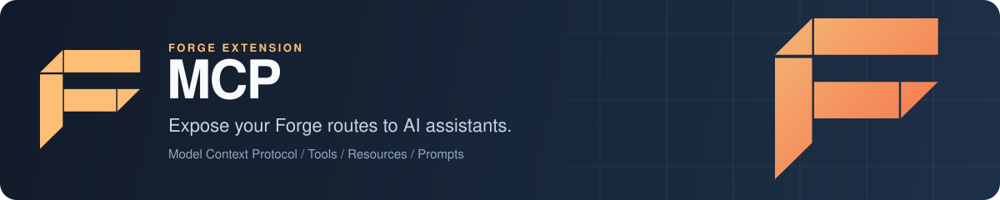

<p align="center">
  
</p>

# Forge MCP: Model Context Protocol tools from your Go API

Forge MCP is the Model Context Protocol extension for [Forge](https://github.com/xraph/forge), the Go backend framework. You add it to your app and every HTTP route you register shows up as an MCP-style tool, with a name, a description from the route summary and a JSON Schema for its path parameters, query and body. You can also publish MCP resources and prompts with your own Go readers and generators. The endpoints are plain JSON over HTTP, and calling a route-backed tool does not run your handler yet, so read [Status](#status) before you connect an AI agent to it.

[](https://go.dev/dl/) [](https://github.com/xraph/forge/actions/workflows/go.yml) [](https://pkg.go.dev/github.com/xraph/forge/extensions/mcp) [](../../LICENSE)

[Documentation](https://www.xraph.com/docs/forge/extensions/mcp) · [Quick start](#quick-start) · [Features](#features) · [Endpoints](#endpoints) · [Resources and prompts](#resources-and-prompts) · [Status](#status) · [Configuration](#configuration) · [FAQ](#faq)

## Quick start

You need [Go 1.26 or later](https://go.dev/dl/) and a Go module:

```bash
go get github.com/xraph/forge@latest
go get github.com/xraph/forge/extensions/mcp@latest
```

Save this as `main.go`:

```go
package main

import (
	"log"
	"net/http"

	"github.com/xraph/forge"
	"github.com/xraph/forge/extensions/mcp"
)

func main() {
	app := forge.NewApp(forge.AppConfig{
		Name:        "orders-api",
		Version:     "1.0.0",
		HTTPAddress: ":8080",
		Extensions: []forge.Extension{
			mcp.NewExtension(
				mcp.WithExcludePatterns([]string{"/_/*"}),
			),
		},
	})

	r := app.Router()

	err := r.GET("/orders/:id", func(ctx forge.Context) error {
		return ctx.JSON(http.StatusOK, map[string]string{"id": ctx.Param("id")})
	}, forge.WithSummary("Fetch one order by ID"))
	if err != nil {
		log.Fatal(err)
	}

	err = r.POST("/orders", func(ctx forge.Context) error {
		return ctx.JSON(http.StatusCreated, map[string]string{"status": "created"})
	}, forge.WithSummary("Create an order"))
	if err != nil {
		log.Fatal(err)
	}

	if err := app.Run(); err != nil {
		log.Fatal(err)
	}
}
```

Run it and list the tools:

```bash
go mod tidy
go run .

# in another terminal
curl http://localhost:8080/_/mcp/info
curl http://localhost:8080/_/mcp/tools
```

`/_/mcp/info` returns the server name and version (the app's, unless you set your own) and its capabilities. `/_/mcp/tools` returns two tools, sorted by name:

```json
{"tools":[
  {"name":"create_orders","description":"Create an order","inputSchema":{"type":"object","properties":{"body":{"type":"object","description":"Request body"},"query":{"type":"object","description":"Query parameters (optional)","additionalProperties":true}}}},
  {"name":"get_orders_id","description":"Fetch one order by ID","inputSchema":{"type":"object","properties":{"id":{"type":"string","description":"Path parameter: id"},"query":{"type":"object","description":"Query parameters (optional)","additionalProperties":true}},"required":["id"]}}
]}
```

The exclude pattern keeps Forge's own `/_/health`, `/_/metrics` and friends out of the list. The MCP endpoints under the base path are always skipped.

## Features

| You need | Forge MCP gives you |
| --- | --- |
| A tool catalogue for an AI assistant | Every route becomes a tool at startup, named from its method and path, described by its `WithSummary` text |
| Input schemas | A JSON Schema per tool with required path parameters, a `query` object, and a `body` object for POST, PUT and PATCH |
| Control over what's exposed | `ExcludePatterns` and `IncludePatterns` with exact paths or `/prefix/*` globs, plus a `ToolPrefix` for names |
| MCP resources | `RegisterResource` and `RegisterResourceReader`, served from `/resources` and `/resources/read` |
| MCP prompts | `RegisterPrompt` and `RegisterPromptGenerator`, served from `/prompts` and `/prompts/:name` |
| Deterministic output | Tool lists are sorted by name, and query strings and prompt arguments are built in sorted key order |
| Metrics | `mcp_tools_total` and `mcp_tool_calls_total{status}` through Forge's metrics |

## Endpoints

With the default base path `/_/mcp`:

| Method and path | What it does |
| --- | --- |
| `GET /_/mcp/info` | Server name, version and capabilities |
| `GET /_/mcp/tools` | `{"tools": [...]}` |
| `POST /_/mcp/tools/:name` | Calls a tool. Body: `{"name": "...", "arguments": {...}}`. See [Status](#status) |
| `GET /_/mcp/resources` | Lists resources, when `EnableResources` is on |
| `POST /_/mcp/resources/read` | Reads one. Body: `{"uri": "..."}` |
| `GET /_/mcp/prompts` | Lists prompts, when `EnablePrompts` is on |
| `POST /_/mcp/prompts/:name` | Renders one. Body: `{"arguments": {...}}` |

Tool names are the HTTP verb mapped to a word (`GET` becomes `get`, `POST` becomes `create`, `PUT` becomes `update`, `PATCH` becomes `patch`, `DELETE` becomes `delete`), then the path with slashes turned into underscores and the `:` or `{}` around parameters dropped. So `DELETE /users/:id` is `delete_users_id`, and with `WithToolPrefix("shop_")` it's `shop_delete_users_id`. A name longer than `MaxToolNameLength` (64) is skipped with a warning in the log.

## Resources and prompts

Resources and prompts are the parts you fill in yourself. Turn them on, then register them from a start hook, once the MCP service exists:

```go
app := forge.NewApp(forge.AppConfig{
	Name: "orders-api",
	Extensions: []forge.Extension{
		mcp.NewExtension(mcp.WithResources(true), mcp.WithPrompts(true)),
	},
})

err := forge.OnStarted(app, "mcp-content", func(ctx context.Context, a forge.App) error {
	svc, err := forge.Inject[*mcp.MCPService](a.Container())
	if err != nil {
		return err
	}

	srv := svc.Server()

	if err := srv.RegisterResource(&mcp.Resource{
		URI:      "orders://schema",
		Name:     "Order schema",
		MimeType: "application/json",
	}); err != nil {
		return err
	}

	if err := srv.RegisterResourceReader("orders://schema",
		func(ctx context.Context, r *mcp.Resource) (mcp.Content, error) {
			return mcp.Content{Type: "text", MimeType: r.MimeType, Text: `{"id":"string","total":"number"}`}, nil
		}); err != nil {
		return err
	}

	if err := srv.RegisterPrompt(&mcp.Prompt{
		Name:        "summarize_order",
		Description: "Summarize an order for a support agent",
		Arguments:   []mcp.PromptArgument{{Name: "id", Required: true}},
	}); err != nil {
		return err
	}

	return srv.RegisterPromptGenerator("summarize_order",
		func(ctx context.Context, p *mcp.Prompt, args map[string]any) ([]mcp.PromptMessage, error) {
			return []mcp.PromptMessage{{
				Role:    "user",
				Content: []mcp.Content{{Type: "text", Text: fmt.Sprintf("Summarize order %v in two lines.", args["id"])}},
			}}, nil
		})
})
```

Then `POST /_/mcp/resources/read` with `{"uri":"orders://schema"}` runs your reader, and `POST /_/mcp/prompts/summarize_order` with `{"arguments":{"id":"42"}}` runs your generator. A resource without a reader returns its name, URI and description as text. A prompt without a generator returns one user message built from its name, arguments and description.

## Status

You should know three things before you build on this extension.

Calling a route-backed tool does not call your route. `POST /_/mcp/tools/get_orders_id` with `{"arguments":{"id":"42"}}` substitutes the path parameters and query, then returns the text `Tool executed: GET /orders/42` as the tool result. Your handler never runs. Tools you add by hand with `Server().RegisterTool` are listed but cannot be called at all, because they have no route behind them.

The transport is plain JSON over HTTP. There is no JSON-RPC 2.0 framing, no `initialize` handshake, and no stdio or Streamable HTTP transport, so an MCP client such as Claude Desktop cannot connect to these endpoints directly. You would need a small adapter in between.

`WithAuth` and `WithRateLimit` set config fields and validation checks them (auth needs at least one token), but the extension does not apply them to its endpoints. `AuthMiddleware(cfg, logger)` and `RateLimitMiddleware(cfg, logger, metrics)` are exported as `forge.PureMiddleware` for you to wire up, or you can put the base path behind your gateway's auth. Until then, treat `/_/mcp` as public.

## Configuration

You can configure the extension in code with options, or in YAML under `extensions.mcp` (the extension also reads a top-level `mcp` key).

| Option | Sets | Default |
| --- | --- | --- |
| `WithEnabled(bool)` | `Enabled`. When false the extension registers nothing | `true` |
| `WithBasePath(string)` | `BasePath` | `/_/mcp` |
| `WithServerInfo(name, version)` | `ServerName`, `ServerVersion` | the app's name and version |
| `WithAutoExposeRoutes(bool)` | `AutoExposeRoutes` | `true` |
| `WithToolPrefix(string)` | `ToolPrefix` | empty |
| `WithExcludePatterns([]string)` | `ExcludePatterns`, checked first | none |
| `WithIncludePatterns([]string)` | `IncludePatterns`. When set, only matching routes are exposed | none |
| `WithResources(bool)`, `WithPrompts(bool)` | `EnableResources`, `EnablePrompts` | `false` |
| `WithAuth(header, tokens)` | `RequireAuth`, `AuthHeader`, `AuthTokens` (see [Status](#status)) | off, `Authorization` |
| `WithRateLimit(int)` | `RateLimitPerMinute` (see [Status](#status)) | `0`, unlimited |
| `WithRequireConfig(bool)` | Fail at startup if no YAML config is found | `false` |
| `WithConfig(mcp.Config)` | Replaces the whole config | |

`MaxToolNameLength` (64), `SchemaCache` (true) and `EnableMetrics` (true) have no option of their own; set them through `WithConfig`. `NewExtensionWithConfig(cfg)` is the same as `NewExtension(WithConfig(cfg))`.

`mcp.Config` has no YAML tags, so the keys are the Go field names, spelled exactly. `ToolPrefix` works and `tool_prefix` is silently ignored:

```yaml
extensions:
  mcp:
    ToolPrefix: shop_
    ExcludePatterns: ["/_/*", "/internal/*"]
    EnablePrompts: true
```

Options you set in code win over the file, and the file wins over `DefaultConfig()`, so `BasePath: /mcp` or `Enabled: false` in YAML takes effect with a plain `mcp.NewExtension()`. Fields you leave out keep their defaults. One edge case: an option set to exactly its default value looks the same as no option at all, so the file wins for that field.

Forge reads `config.yaml` only when `EnableConfigAutoDiscovery` is on. `forge.DefaultAppConfig()` turns it on, but an `AppConfig` literal like the one in the quick start leaves it off.

## Documentation

| Topic | Where |
| --- | --- |
| Overview | [MCP docs](https://www.xraph.com/docs/forge/extensions/mcp) |
| Features and usage | [MCP features](https://www.xraph.com/docs/forge/extensions/mcp/features) |
| Configuration reference | [MCP configuration](https://www.xraph.com/docs/forge/extensions/mcp/configuration) |
| Function reference | [MCP functions](https://www.xraph.com/docs/forge/extensions/mcp/functions) |
| Go API | [pkg.go.dev](https://pkg.go.dev/github.com/xraph/forge/extensions/mcp) |
| The protocol itself | [Model Context Protocol specification](https://modelcontextprotocol.io/) |

## Examples

The [MCP server example](examples/mcp-server/) is a user-management API with OpenAPI turned on and the MCP extension exposing its routes. It has its own `go.mod`, so run it from its directory with `GOWORK=off go run .`, then query `/_/mcp/tools` on port 8087.

## FAQ

### How do I expose a Go REST API to an AI assistant with MCP?

Add `mcp.NewExtension()` to your Forge app and give your routes a `forge.WithSummary`. The tool list at `/_/mcp/tools` then describes every route with a name and input schema. Read [Status](#status) first: tool calls do not run your handlers yet, and the transport is not the JSON-RPC one MCP clients speak.

### Can Claude Desktop or another MCP client connect to Forge MCP?

Not directly. The endpoints are JSON over HTTP without the JSON-RPC 2.0 framing or the stdio and Streamable HTTP transports the protocol defines, so you would need an adapter.

### How do I hide internal routes from the MCP tool list?

Use `WithExcludePatterns([]string{"/_/*", "/internal/*"})`. A pattern is an exact path or a prefix ending in `/*`. If you'd rather list what's allowed, use `WithIncludePatterns` and only matching routes become tools.

### Does Forge MCP require authentication?

Not by default, and the auth settings are not enforced on the endpoints today. Wire `mcp.AuthMiddleware` yourself or protect the base path at your gateway.

## Contributing

MCP is its own Go module inside the [Forge repository](https://github.com/xraph/forge). Build, vet and test it from its directory the way CI does:

```bash
cd extensions/mcp
GOWORK=off go build ./...
GOWORK=off go vet ./...
GOWORK=off go test -short -count=1 ./...
golangci-lint run ./...
```

Forge's [AGENTS.md](../../AGENTS.md) has the pinned lint version and the rest of the repository conventions. Commits follow [Conventional Commits](https://www.conventionalcommits.org/), for example `fix(mcp): ...`.

## License

Forge MCP is part of Forge and is available under the [Apache License 2.0](../../LICENSE).
