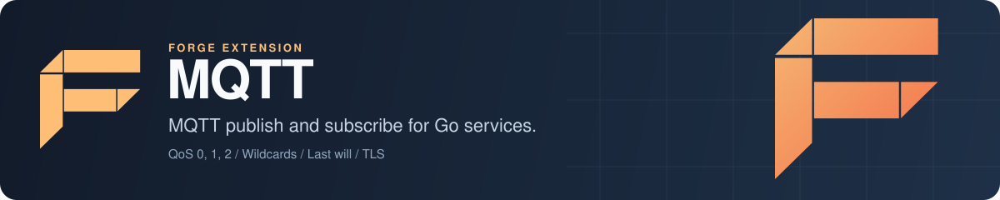

<p align="center">
  
</p>

# Forge MQTT: MQTT publish and subscribe client for Go

Forge MQTT is the MQTT extension for [Forge](https://github.com/xraph/forge), the Go backend framework. It connects your app to an MQTT broker such as Mosquitto, EMQX or HiveMQ when the app starts, and gives you one shared client for publishing and subscribing with QoS 0, 1 and 2, retained messages, topic wildcards, a last will message, TLS and username and password auth. It fits IoT backends, device telemetry and anything else that already speaks MQTT. Under the hood it is the [Eclipse Paho Go client](https://github.com/eclipse/paho.mqtt.golang), and you can reach the Paho client directly when you need to.

[](https://go.dev/dl/) [](https://github.com/xraph/forge/actions/workflows/go.yml) [](https://pkg.go.dev/github.com/xraph/forge/extensions/mqtt) [](../../LICENSE)

[Documentation](https://www.xraph.com/docs/forge/extensions/mqtt) · [Quick start](#quick-start) · [Features](#features) · [Publishing](#publish-messages) · [Subscribing](#subscribe-to-topics) · [Connection](#connections-and-reconnects) · [Configuration](#configuration) · [FAQ](#faq)

## Quick start

You need [Go 1.26 or later](https://go.dev/dl/) and an MQTT broker. Add the extension:

```bash
go get github.com/xraph/forge@latest
go get github.com/xraph/forge/extensions/mqtt@latest
go get github.com/eclipse/paho.mqtt.golang
```

This app subscribes to `sensors/+/temperature`, logs every reading it receives, and publishes the body of `POST /readings` to `sensors/demo/temperature`:

```go
package main

import (
	"context"
	"io"
	"log"
	"net/http"

	paho "github.com/eclipse/paho.mqtt.golang"
	"github.com/xraph/forge"
	"github.com/xraph/forge/extensions/mqtt"
)

func main() {
	app := forge.NewApp(forge.AppConfig{
		Name:        "sensors",
		HTTPAddress: ":8080",
		Extensions: []forge.Extension{
			mqtt.NewExtension(
				mqtt.WithBroker("tcp://localhost:1883"),
				mqtt.WithClientID("sensors-api"),
			),
		},
	})

	// The extension connects during startup, so subscribe once it's up.
	err := app.RegisterHookFn(forge.PhaseAfterStart, "subscribe-readings",
		func(ctx context.Context, a forge.App) error {
			m, err := forge.Inject[mqtt.MQTT](a.Container())
			if err != nil {
				return err
			}

			return m.Subscribe("sensors/+/temperature", 1, func(_ paho.Client, msg paho.Message) {
				log.Printf("%s: %s", msg.Topic(), msg.Payload())
			})
		})
	if err != nil {
		log.Fatal(err)
	}

	// POST a reading and it's published to sensors/demo/temperature.
	err = app.Router().POST("/readings", func(ctx forge.Context) error {
		m, err := forge.Inject[mqtt.MQTT](app.Container())
		if err != nil {
			return err
		}

		body, err := io.ReadAll(ctx.Request().Body)
		if err != nil {
			return err
		}

		if err := m.Publish("sensors/demo/temperature", 1, false, body); err != nil {
			return err
		}

		return ctx.JSON(http.StatusAccepted, map[string]string{"status": "published"})
	})
	if err != nil {
		log.Fatal(err)
	}

	if err := app.Run(); err != nil {
		log.Fatal(err)
	}
}
```

No broker yet? Mosquitto runs in Docker with one command:

```bash
docker run -d --name mosquitto -p 1883:1883 eclipse-mosquitto:2 mosquitto -c /mosquitto-no-auth.conf
```

Run the app and post a reading:

```bash
go mod tidy
go run .

# in another terminal
curl -X POST localhost:8080/readings -d '21.5'
```

You'll see `sensors/demo/temperature: 21.5` in the app's log. Publish from any other MQTT client (`mosquitto_pub -t sensors/kitchen/temperature -m 19`) and that shows up too, because the `+` wildcard matches any single topic level.

## Features

| You need | Forge MQTT gives you |
| --- | --- |
| To publish from handlers and jobs | `Publish` (waits for the broker) and `PublishAsync`, with `[]byte`, string or JSON payloads |
| To react to device messages | `Subscribe` and `SubscribeMultiple` with `+` and `#` wildcards, and `Unsubscribe` |
| Delivery guarantees | QoS 0, 1 or 2 per message and per subscription, plus retained messages |
| To know when a device drops off | A last will and testament message set at connect time |
| Connections that heal | Automatic reconnect with a capped backoff, and a persistent session when you want one |
| Secure brokers | TLS with client certificates and a custom CA, username and password |
| In-flight messages that survive a restart | A file-backed Paho message store |
| Visibility | Forge metrics, `GetStats` counters and `GetSubscriptions` |

The extension registers `*mqtt.MQTTService` by type and under the alias `mqtt`, and the `mqtt.MQTT` interface backed by the same instance. Resolve either one:

```go
m, err := forge.Inject[mqtt.MQTT](app.Container())
svc, err := forge.Inject[*mqtt.MQTTService](app.Container())
```

The extension's `Start` connects to the broker and waits up to `connect_timeout` for the broker to accept. If the broker does not accept in time, the app does not start and `app.Run()` returns the connection error. On shutdown it disconnects with a 250 ms quiesce period so in-flight work can finish.

## Publish messages

```go
// Wait for the broker to acknowledge (for QoS 1 and 2).
err := m.Publish("devices/42/commands", 1, false, []byte("reboot"))

// Strings go out as-is. Anything else is JSON-encoded.
err = m.Publish("devices/42/state", 1, true, map[string]any{"online": true, "fw": "1.4.2"})

// Hand it to Paho and return straight away.
err = m.PublishAsync("telemetry/42", 0, false, reading)
```

The arguments are the topic, the QoS, the retained flag and the payload. Set `retained` to `true` and the broker keeps the last message on that topic, so a client that subscribes later gets the current value right away. That is the usual way to publish device state.

`Publish` blocks until Paho finishes the publish and returns its error. `PublishAsync` returns once the message is queued, and if delivery fails later, the extension logs the failure and you do not get an error back. Both return an error when the client isn't connected, so a publish during a reconnect fails fast.

## Subscribe to topics

Handlers are Paho message handlers, `func(paho.Client, paho.Message)`:

```go
err := m.Subscribe("devices/+/state", 1, func(_ paho.Client, msg paho.Message) {
	log.Printf("%s is now %s", msg.Topic(), msg.Payload())
})

// Several filters, each with its own QoS, one handler.
err = m.SubscribeMultiple(map[string]byte{
	"devices/+/state": 1,
	"alerts/#":        2,
}, handleDeviceEvent)

err = m.Unsubscribe("alerts/#")
```

`+` matches one topic level and `#` matches everything below a level. Paho calls your handler on its own goroutine, and with `order_matters` on (the default) messages reach your handlers one at a time, in the order they arrived. A slow handler holds up the next message, so if your handler does real work, hand it off to a worker and return.

`GetSubscriptions()` lists the topic filters and QoS the client has subscribed to, which helps when you are debugging a filter that never matches.

`AddRoute(topic, handler)` registers a Paho route on the connected client without sending a SUBSCRIBE packet. Use it for messages that arrive on a persistent session you subscribed to in an earlier run.

## Connections and reconnects

With `auto_reconnect` on (the default), Paho reconnects after a dropped connection, backing off up to `max_reconnect_delay`. `IsConnected()` tells you the current state, `Reconnect()` forces a connect attempt, and `GetStats().Reconnects` counts the attempts.

Pay attention to `clean_session`. It defaults to `true`, which means the broker throws your subscriptions away when the connection drops, and the extension does not subscribe again after an automatic reconnect. If your service has to keep receiving through a network blip, turn clean sessions off and keep the client ID stable, so the broker holds the session and its subscriptions for you:

```go
mqtt.NewExtension(
	mqtt.WithBroker("ssl://broker.example.com:8883"),
	mqtt.WithClientID("sensors-api-1"),
	mqtt.WithCleanSession(false),
)
```

Every instance of your service needs its own client ID. Two clients with the same ID keep disconnecting each other, and you'll see `mqtt connection lost` in the logs over and over.

A last will tells everyone else when your service disappears without a clean disconnect. The broker publishes it for you:

```go
mqtt.WithWill("services/sensors-api/status", "offline", 1, true)
```

## TLS and authentication

```go
mqtt.NewExtension(
	mqtt.WithBroker("ssl://broker.example.com:8883"),
	mqtt.WithCredentials("sensors-api", os.Getenv("MQTT_PASSWORD")),
	mqtt.WithTLS("/etc/mqtt/client.pem", "/etc/mqtt/client-key.pem", "/etc/mqtt/ca.pem", false),
)
```

`WithTLS` takes a client certificate, its key, a CA file and a skip-verify flag. With verification on, validation requires both the certificate and the key, so connecting over TLS with only a CA file (no client certificate) does not pass validation today. Use the `ssl://` or `tls://` scheme in the broker URL for TLS, and `ws://` or `wss://` if your broker only accepts WebSockets.

## Configuration

Configure the extension in code, with options or with a whole `mqtt.Config` built from `mqtt.DefaultConfig()`:

```go
cfg := mqtt.DefaultConfig()
cfg.Broker = "tcp://mosquitto:1883"
cfg.ClientID = "sensors-api-1"
cfg.CleanSession = false
cfg.DefaultQoS = 1
cfg.MessageStore = "file"
cfg.StoreDirectory = "/var/lib/sensors/mqtt"

ext := mqtt.NewExtension(mqtt.WithConfig(cfg))
```

The options are `WithBroker`, `WithClientID`, `WithCredentials`, `WithTLS`, `WithQoS`, `WithCleanSession`, `WithKeepAlive`, `WithAutoReconnect`, `WithWill`, `WithMetrics`, `WithTracing`, `WithRequireConfig` and `WithConfig`. `WithQoS` sets `default_qos`, which nothing reads yet, so pass the QoS you want on each `Publish` and `Subscribe`. `NewExtensionWithConfig(cfg)` does the same as `NewExtension(WithConfig(cfg))`.

The extension also reads `extensions.mqtt` from your config file, falling back to a top-level `mqtt` key. The file overrides the defaults and your options override the file, so a `broker`, `client_id` or `clean_session: false` in YAML takes effect with a plain `mqtt.NewExtension()`.

These are the fields of `mqtt.Config`, with their YAML names:

| Key | Default | What it does |
| --- | --- | --- |
| `broker` | `tcp://localhost:1883` | Broker URL (`tcp`, `ssl`, `tls`, `ws` or `wss`) |
| `client_id` | `forge-mqtt-client` | Client ID, unique per connection |
| `username`, `password` | empty | Broker credentials |
| `clean_session` | `true` | Start a fresh session on every connect |
| `connect_timeout` | `30s` | How long `Connect` waits |
| `keep_alive`, `ping_timeout` | `60s`, `10s` | Keepalive interval and ping timeout |
| `auto_reconnect`, `max_reconnect_delay` | `true`, `10m` | Reconnect after a drop, and the backoff cap |
| `resume_subs` | `true` | Paho's resume of stored subscribe packets on a persistent session |
| `write_timeout` | `30s` | Timeout for a blocked write |
| `default_qos` | `1` | Validated (0 to 2) but not applied: you pass QoS on each call |
| `message_channel_depth` | `100` | Paho's internal message buffer |
| `order_matters` | `true` | Deliver messages to handlers one at a time, in order |
| `message_store`, `store_directory` | `memory`, empty | `memory` or `file` (a file store needs a directory) |
| `will_enabled`, `will_topic`, `will_payload`, `will_qos`, `will_retained` | off | Last will and testament |
| `enable_tls`, `tls_cert_file`, `tls_key_file`, `tls_ca_file`, `tls_skip_verify` | off | TLS |
| `enable_metrics` | `true` | Record the metrics below |
| `enable_logging` | `true` | Log connects, drops, reconnects and publishes |

`max_reconnect_attempts` and `enable_tracing` exist on the struct, but nothing reads them yet.

With `enable_metrics` on, the extension records `mqtt.messages.published` and `mqtt.messages.received` counters labelled by `topic`, `mqtt.connections` labelled `status=connected` or `status=disconnected`, and `mqtt.reconnects`. `GetStats()` gives you the connection state, connect time, message counts, the time of the last message, the subscription count and reconnects.

## Documentation

| Topic | Where |
| --- | --- |
| Overview and what the extension registers | [MQTT extension docs](https://www.xraph.com/docs/forge/extensions/mqtt) |
| Publishing, subscribing, QoS, sessions and TLS | [Features](https://www.xraph.com/docs/forge/extensions/mqtt/features) |
| Every config field and option | [Configuration](https://www.xraph.com/docs/forge/extensions/mqtt/configuration) |
| Method reference | [Functions](https://www.xraph.com/docs/forge/extensions/mqtt/functions) and [pkg.go.dev](https://pkg.go.dev/github.com/xraph/forge/extensions/mqtt) |
| How extensions load config and join the lifecycle | [Forge extension system](../../docs/content/docs/forge/extensions-system.mdx) |

## FAQ

### How do I use MQTT in a Go service?

Add `mqtt.NewExtension(mqtt.WithBroker(...), mqtt.WithClientID(...))` to your Forge app's extensions, resolve `mqtt.MQTT` with `forge.Inject`, and call `Subscribe` from an after-start hook and `Publish` wherever you need it. The [quick start](#quick-start) is a complete program.

### Do my subscriptions survive a reconnect?

Not with the default clean session. The broker drops them when the connection goes, and the extension doesn't resubscribe. Use `WithCleanSession(false)` with a stable, unique client ID and the broker keeps them. See [connections and reconnects](#connections-and-reconnects).

### Which QoS should I use?

QoS 0 for telemetry you can afford to lose, QoS 1 for most commands and events (your handler may see a duplicate, so make it idempotent), and QoS 2 only when a duplicate would do damage, since it costs an extra round trip per message.

### Can I set connection callbacks like OnConnect?

Not through this extension yet. `SetOnConnectHandler`, `SetConnectionLostHandler` and `SetReconnectingHandler` are on the interface, but the client is already connected by the time you can call them, so they only log a warning. The extension's own handlers keep `GetStats()` and the metrics up to date, and you can read those.

### Does it support MQTT 5?

No. Paho's `paho.mqtt.golang` speaks MQTT 3.1 and 3.1.1, and so does this extension.

## Contributing

The extension is its own Go module inside the Forge repository. Test it from its directory:

```bash
cd extensions/mqtt
GOWORK=off go build ./...
GOWORK=off go vet ./...
GOWORK=off go test -short -count=1 ./...
```

The tests don't need a broker. Run `golangci-lint run ./...` from the same directory before you open a pull request, and see [AGENTS.md](../../AGENTS.md) for the toolchain, lint rules and commit format.

## License

Forge MQTT is part of [Forge](https://github.com/xraph/forge) and is available under the [Apache License 2.0](../../LICENSE).
