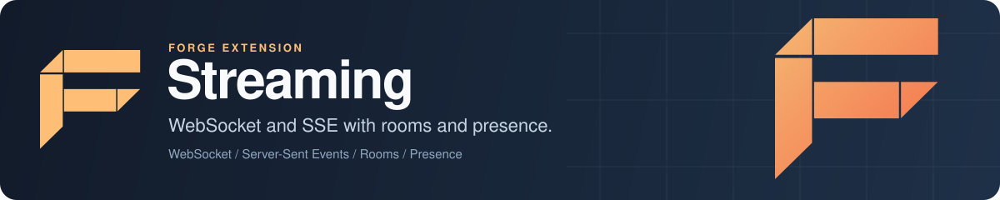

<p align="center">
  
</p>

# Forge Streaming: WebSocket and SSE real-time messaging for Go

Forge Streaming is the real-time messaging extension for [Forge](https://github.com/xraph/forge), the Go backend framework. It gives your app ready-made WebSocket and Server-Sent Events (SSE) endpoints and a `Manager` that handles chat rooms, pub/sub channels, presence, typing indicators, message history and gap-free replay after a reconnect. You can run it on one node with the local backend, or across several with Redis. Whatever your clients send goes through size limits, per-user rate limiting and room authorization before you or anyone else sees it broadcast.

[](https://go.dev/dl/) [](https://github.com/xraph/forge/actions/workflows/go.yml) [](https://pkg.go.dev/github.com/xraph/forge/extensions/streaming) [](../../LICENSE)

[Documentation](https://www.xraph.com/docs/forge/extensions/streaming) · [Quick start](#quick-start) · [Features](#features) · [Wire protocol](#wire-protocol) · [Rooms and identity](#rooms-and-identity) · [Backends](#backends) · [Configuration](#configuration) · [FAQ](#faq)

## Quick start

You need [Go 1.26 or later](https://go.dev/dl/) and a Go module:

```bash
go get github.com/xraph/forge@latest
go get github.com/xraph/forge/extensions/streaming@latest
```

Save this as `main.go`:

```go
package main

import (
	"context"
	"log"
	"net/http"

	"github.com/xraph/forge"
	"github.com/xraph/forge/extensions/streaming"
)

func main() {
	stream := streaming.NewExtension(streaming.WithLocalBackend())

	app := forge.NewApp(forge.AppConfig{
		Name:        "live-updates",
		HTTPAddress: ":8080",
		Extensions:  []forge.Extension{stream},
	})

	// The extension builds its manager when the app registers it, so mount
	// the built-in handlers from a start hook: WebSocket on /ws, SSE on
	// /events, plus POST /events/subscribe and /events/unsubscribe.
	err := forge.OnStarted(app, "streaming-routes", func(_ context.Context, a forge.App) error {
		return stream.RegisterRoutes(a.Router(), "/ws", "/events")
	})
	if err != nil {
		log.Fatal(err)
	}

	// Send a message to every open WebSocket and SSE connection.
	err = app.Router().POST("/announce", func(ctx forge.Context) error {
		msg := streaming.NewEventMessage("announcement", ctx.Query("text"))

		if err := stream.Manager().Broadcast(ctx.Context(), msg); err != nil {
			return err
		}

		return ctx.JSON(http.StatusAccepted, map[string]string{"status": "sent"})
	})
	if err != nil {
		log.Fatal(err)
	}

	if err := app.Run(); err != nil {
		log.Fatal(err)
	}
}
```

Run it, open an SSE stream in one terminal and send from another:

```bash
go mod tidy
go run .

curl -N http://localhost:8080/events
curl -X POST 'http://localhost:8080/announce?text=deploy+finished'
```

The stream first prints a `connected` event with your connection and session IDs, then the announcement:

```text
event: connected
data: {"conn_id":"a5ef...","resumed":false,"session_id":"389f..."}

event: message
data: {"id":"","type":"message","event":"announcement","user_id":"","data":"deploy finished","timestamp":"..."}
```

If you connect a WebSocket client to `ws://localhost:8080/ws`, it gets the same JSON as a text frame. Call `RegisterRoutes`, `RegisterHook` and `RegisterCodec` from a start hook like this one. The extension creates its logger, hook registry and manager during registration, so if you call them before the app starts you get a nil pointer panic.

## Features

| You need | Forge Streaming gives you |
| --- | --- |
| WebSocket and SSE endpoints | `RegisterRoutes(router, wsPath, ssePath)`, built on Forge's core router streaming |
| Chat rooms | Create, join, leave, archive and search rooms, member roles, invites, mute and ban |
| Pub/sub channels | Channel subscriptions per connection, broadcast to subscribers |
| Presence and typing indicators | Online, away, busy and offline status that tracks every tab a user has open, and typing state with a timeout |
| Message history and replay | Per-room sequence numbers, history queries, and replay of missed messages from an SSE `Last-Event-ID` |
| Protection on the inbound path | Message size cap (64 KB), per-user rate limit (100 messages a second), room and send authorization, and identity stamped by the server |
| Backpressure | A bounded send queue per connection, so one slow client cannot stall a broadcast |
| Multiple nodes | A Redis backend with a cross-node coordinator, plus load balancer strategies |
| Graceful shutdown | Connections are drained (15 seconds by default) before the manager stops |
| Extension points | Connection, message, room, presence and error hooks, pluggable codecs, and an AsyncAPI spec from `AsyncAPISpec()` |

## Wire protocol

Every frame is a JSON `streaming.Message`:

| Field | Meaning |
| --- | --- |
| `type` | Transport kind: `message`, `join`, `leave`, `typing`, `presence`, `system` or `error` |
| `event` | Your domain event name, such as `order.created`. Build these with `streaming.NewEventMessage` |
| `room_id`, `channel_id` | Where the message goes |
| `user_id`, `id`, `timestamp` | Set by the server on inbound messages. Whatever the client sends is overwritten |
| `data` | The payload |
| `sequence` | Position within the room, assigned when a room message is saved |

A WebSocket client sends one of these:

```json
{"type": "join", "room_id": "lobby"}
{"type": "message", "room_id": "lobby", "data": {"text": "hi"}}
{"type": "typing", "room_id": "lobby", "data": true}
{"type": "presence", "data": "away"}
{"type": "leave", "room_id": "lobby"}
```

When you send a room message, the server saves it to history (if history is on) and broadcasts it to the room. A message with a `channel_id` goes to that channel's subscribers. When the server rejects one of your frames, it sends back a `type: "error"` frame whose `data` has a stable `code` (`rate_limited`, `message_too_large`, `send_denied`, `room_access_denied`, `muted`, `banned`, `feature_disabled` and a few more) and, for rate limits, `retry_after_ms`.

The SSE endpoint takes query parameters: `rooms=a,b` and `channels=x,y` to join on connect, `session_id` to resume a session, and `last_event_id` (or the standard `Last-Event-ID` header, which `EventSource` sends for you) to replay what you missed. If the server cannot honour your cursor, the stream sends a `resync_required` event so your client knows to reload. A browser `EventSource` can't send frames, so it changes subscriptions with `POST {ssePath}/subscribe` and `/unsubscribe`, passing `{"conn_id": "...", "rooms": [...], "channels": [...]}`.

## Rooms and identity

Rooms must exist before anyone joins them, so you create them from your own code:

```go
err := stream.Manager().CreateRoom(ctx, streaming.NewLocalRoom(streaming.RoomOptions{
	ID:    "lobby",
	Name:  "Lobby",
	Owner: "system",
}))
```

`RoomOptions` also takes `Private`, `MaxMembers`, `Description` and `Metadata`. The default room authorizer lets anyone into a public room and only members into a private one. From the server you can push into a room with `Manager().BroadcastToRoom`, read history with `GetHistory(ctx, roomID, streaming.HistoryQuery{Limit: 50})`, and reach one user on every device with `SendToUser`.

Joining a room needs a user. The built-in handlers read the caller's ID from the `user_id` value on the Forge context, and a connection without one is anonymous: it can receive broadcasts, but `JoinRoom` refuses it and the SSE subscribe endpoints answer 404. Put middleware on the group or the routes that authenticates the caller and calls `ctx.Set("user_id", ...)`, and the built-in handlers pick it up. If you'd rather own the handler, call `router.WebSocket` yourself, wrap the connection with `streaming.NewConnection(conn)`, call `SetUserID`, then `Manager().Register` it and pass every inbound message through `Manager().ProcessInbound` before you act on it.

## Hooks and codecs

Hooks let you reject connections, transform or drop messages, and watch room and presence changes as they happen. A hook implements `Name()` plus any of `ConnectionHook`, `MessageHook`, `RawMessageHook`, `RoomHook`, `PresenceHook` or `ErrorHook`:

```go
type auditHook struct{ log forge.Logger }

func (h auditHook) Name() string { return "audit" }

func (h auditHook) OnConnect(ctx context.Context, conn streaming.Connection) error {
	h.log.Info("stream connected", forge.F("conn_id", conn.ID()))
	return nil // return an error to refuse the connection
}

func (h auditHook) OnDisconnect(ctx context.Context, conn streaming.Connection) {}
```

Register it with `stream.RegisterHook(auditHook{log: app.Logger()})` from a start hook. JSON is the default codec. Binary and text codecs are built in, and `RegisterCodec` adds your own for a content type that clients ask for with `?content_type=` or an `X-Content-Type` header.

## Backends

| Backend | Option | Status |
| --- | --- | --- |
| `local` | `WithLocalBackend()` | In-memory stores on one node. The default |
| `redis` | `WithRedisBackend(url)` | Redis stores for rooms, channels, history, presence and typing, plus a coordinator that relays messages between nodes. Turns distributed mode on |
| `nats` | `WithNATSBackend(urls...)` | Not implemented. Registration fails with a backend error |

With more than one node, give each a stable `WithNodeID` (one is generated otherwise) and consider `WithLoadBalancer("consistent_hash")` or `"sticky"`. `least_connections` is also available, and `round_robin` currently uses least connections too. `WithSessionResumption(ttl)` keeps a disconnected session's rooms and channels for the TTL so a client that comes back with the same `session_id` gets them restored. Sessions are kept in memory on the node.

## Configuration

You can configure the extension in code with options, or in YAML under `extensions.streaming` (the extension also reads a top-level `streaming` key).

| Option | Sets |
| --- | --- |
| `WithLocalBackend()`, `WithRedisBackend(url)`, `WithNATSBackend(urls...)` | Backend, URLs and distributed mode |
| `WithBackend(string)`, `WithBackendURLs(...string)`, `WithAuthentication(user, pass)` | The same, field by field |
| `WithFeatures(rooms, channels, presence, typing, history)` | Feature switches, all on by default |
| `WithConnectionLimits(perUser, roomsPerUser, channelsPerUser)` | `5`, `50`, `100` by default |
| `WithMessageLimits(maxSize, maxPerSecond)` | `65536` bytes, `100` a second |
| `WithTimeouts(ping, pong, write)` | `30s`, `10s`, `10s` |
| `WithBufferSizes(read, write)` | `4096`, `4096` |
| `WithMessageRetention(d)`, `WithPresenceTimeout(d)`, `WithTypingTimeout(d)` | `720h`, `5m`, `3s` |
| `WithNodeID(string)`, `WithLoadBalancer(strategy)`, `WithSessionResumption(ttl)` | Multi-node settings |
| `WithTLS(cert, key, ca)` | TLS for the backend connection |
| `WithRequireConfig(bool)`, `WithConfig(streaming.Config)` | Require YAML, or replace the whole config |

A few settings have no option and go through `WithConfig` or YAML: `max_anonymous_connections` (1000), `max_total_connections` (0, unbounded), `drain_timeout` (15s) and `max_messages_per_room` (100000).

Two of these are only reported, never enforced: `message_retention` (`WithMessageRetention`) and `max_messages_per_room` show up on the dashboard, but nothing trims history by age or count, so room history grows until you delete it.

```yaml
extensions:
  streaming:
    backend_urls: ["localhost:6379"]   # host:port, not a redis:// URL
    node_id: api-1
    max_total_connections: 20000
    enable_session_resumption: true
```

The YAML keys are the snake_case names from the struct tags. The file overrides `DefaultConfig()` and your options override the file, so `backend: redis` or `max_message_size` works there too. Fields you leave out keep their defaults.

Forge reads `config.yaml` only when `EnableConfigAutoDiscovery` is on. `forge.DefaultAppConfig()` turns it on, but an `AppConfig` literal like the one in the quick start leaves it off.

## Observability

Counters and gauges go through Forge's metrics under `streaming.`: `connections.active`, `connections.total`, `messages.broadcast`, `messages.room_broadcast`, `messages.rate_limited`, `messages.oversize`, `rooms.joins`, `rooms.joins_denied`, `sendqueue.dropped`, `sessions.resumed`, `replay.messages` and more. `Manager().GetStats(ctx)` returns a snapshot, and the extension's health check fails when the manager is unhealthy.

If you run the [Forge dashboard](../dashboard/), the extension implements `RegisterContractContributor`, which serves the streaming pages of the dashboard contract.

## Documentation

| Topic | Where |
| --- | --- |
| Overview | [Streaming docs](https://www.xraph.com/docs/forge/extensions/streaming) |
| Features and usage | [Streaming features](https://www.xraph.com/docs/forge/extensions/streaming/features) |
| Configuration reference | [Streaming configuration](https://www.xraph.com/docs/forge/extensions/streaming/configuration) |
| Function reference | [Streaming functions](https://www.xraph.com/docs/forge/extensions/streaming/functions) |
| Go API | [pkg.go.dev](https://pkg.go.dev/github.com/xraph/forge/extensions/streaming) |
| Core router streaming | [Forge streaming guide](../../docs/content/docs/forge/%28streaming%29/streaming.mdx) |

## Examples

The [chat example](examples/chat/) serves a single-page chat UI on `/` with WebSocket and SSE routes and a small REST API for rooms, history and members. It's part of this module, so `GOWORK=off go run ./examples/chat` from this directory starts it on port 8080. Treat it as a sketch: its create-room endpoint doesn't create a room yet, and nothing in front of its routes sets `user_id`, so its connections arrive anonymous. Add middleware as shown in [Rooms and identity](#rooms-and-identity) if you want to try rooms with it.

## FAQ

### How do I add WebSockets to a Go app built on Forge?

Add `streaming.NewExtension()` to your app and call `RegisterRoutes(router, "/ws", "/events")` from a start hook. You get a WebSocket endpoint and an SSE endpoint that share one connection manager. The [quick start](#quick-start) is a complete program.

### Should I use WebSocket or Server-Sent Events?

Use SSE when the browser only listens: it reconnects on its own and replays missed room messages from `Last-Event-ID`. Use WebSocket when clients also send, for chat, typing indicators or presence updates. Both transports receive the same broadcasts.

### Can I scale Forge Streaming across several servers?

Yes, with the Redis backend. `WithRedisBackend("localhost:6379")` stores rooms, history and presence in Redis and relays broadcasts between nodes. Pass a plain `host:port`: the backend hands the string to go-redis as an address, so a `redis://` URL fails on every call, and only the first address is used. The NATS backend is not implemented yet.

### How do clients catch up after a dropped connection?

Over SSE, room messages carry a sequence number as the event ID. When the browser reconnects with `Last-Event-ID`, the server replays what that connection's rooms missed, or sends `resync_required` when it cannot. Over WebSocket, reconnect with the same `session_id` and turn on `WithSessionResumption` to get your rooms and channels back.

### How do I authenticate WebSocket connections?

Put middleware on the routes (or their group) that checks the caller's token and calls `ctx.Set("user_id", id)`. The built-in WebSocket and SSE handlers read that value, so the connection joins rooms as that user. [Rooms and identity](#rooms-and-identity) has the details, and the alternative of writing your own handler. Keep in mind that a WebSocket client has to answer the server's JSON ping: one that only listens is closed after about 40 seconds with the default timings.

## Contributing

Streaming is its own Go module inside the [Forge repository](https://github.com/xraph/forge). Build, vet and test it from its directory the way CI does:

```bash
cd extensions/streaming
GOWORK=off go build ./...
GOWORK=off go vet ./...
GOWORK=off go test -short -count=1 ./...
golangci-lint run ./...
```

Forge's [AGENTS.md](../../AGENTS.md) has the pinned lint version and the rest of the repository conventions. Commits follow [Conventional Commits](https://www.conventionalcommits.org/), for example `fix(streaming): ...`.

## License

Forge Streaming is part of Forge and is available under the [Apache License 2.0](../../LICENSE).
