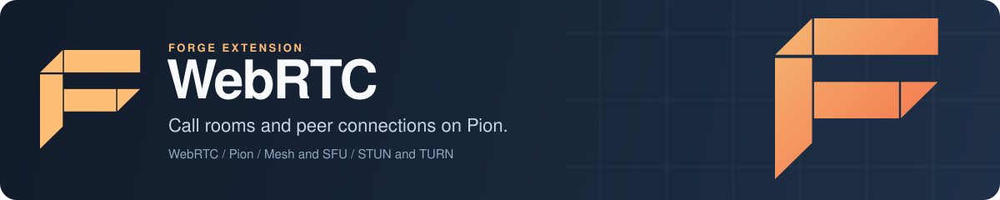

<p align="center">
  
</p>

# Forge WebRTC: WebRTC call rooms and peer connections for Go

Forge WebRTC is the WebRTC extension for [Forge](https://github.com/xraph/forge), the Go backend framework. It builds on [Pion WebRTC v4](https://github.com/pion/webrtc) and the [Forge Streaming](../streaming/) extension to give you call rooms with mesh and SFU topologies, server-side peer connections with SDP offer and answer handling, ICE candidates, data channels, and STUN and TURN server configuration. It is early software. You can create rooms and negotiate real peer connections with it today, but the built-in signaling endpoint, SFU media forwarding and recording are unfinished, so read [Status](#status) before you design a product around it.

[](https://go.dev/dl/) [](https://github.com/xraph/forge/actions/workflows/go.yml) [](https://pkg.go.dev/github.com/xraph/forge/extensions/webrtc) [](../../LICENSE)

[Documentation](https://www.xraph.com/docs/forge/extensions/webrtc) · [Quick start](#quick-start) · [Features](#features) · [Call rooms](#call-rooms) · [Peer connections](#peer-connections) · [Status](#status) · [Configuration](#configuration) · [FAQ](#faq)

## Quick start

You need [Go 1.26 or later](https://go.dev/dl/) and a Go module:

```bash
go get github.com/xraph/forge@latest
go get github.com/xraph/forge/extensions/streaming@latest
go get github.com/xraph/forge/extensions/webrtc@latest
```

Save this as `main.go`. It creates a call room at startup and answers a browser's SDP offer over plain HTTP:

```go
package main

import (
	"context"
	"log"
	"net/http"

	"github.com/xraph/forge"
	"github.com/xraph/forge/extensions/streaming"
	"github.com/xraph/forge/extensions/webrtc"
)

func main() {
	stream := streaming.NewExtension(streaming.WithLocalBackend())

	rtc, err := webrtc.New(stream, webrtc.DefaultConfig())
	if err != nil {
		log.Fatal(err)
	}

	app := forge.NewApp(forge.AppConfig{
		Name:        "calls",
		HTTPAddress: ":8080",
		Extensions:  []forge.Extension{stream, rtc},
	})

	err = forge.OnStarted(app, "create-call", func(ctx context.Context, _ forge.App) error {
		_, err := rtc.CreateCallRoom(ctx, "standup", streaming.RoomOptions{
			ID:   "standup",
			Name: "Daily standup",
		})

		return err
	})
	if err != nil {
		log.Fatal(err)
	}

	r := app.Router()

	// STUN and TURN servers, shaped for the browser's RTCPeerConnection.
	err = r.GET("/ice-servers", func(ctx forge.Context) error {
		cfg := rtc.GetConfig()

		servers := []map[string]any{}
		for _, s := range cfg.GetICEServers() {
			servers = append(servers, map[string]any{
				"urls":       s.URLs,
				"username":   s.Username,
				"credential": s.Credential,
			})
		}

		return ctx.JSON(http.StatusOK, servers)
	})
	if err != nil {
		log.Fatal(err)
	}

	// The browser posts its offer, the server joins the call and answers.
	err = r.POST("/calls/:room/join", func(ctx forge.Context) error {
		var offer webrtc.SessionDescription
		if err := ctx.Bind(&offer); err != nil {
			return err
		}

		peer, err := rtc.JoinCall(ctx.Context(), ctx.Param("room"), ctx.Query("user"), &webrtc.JoinOptions{})
		if err != nil {
			return err
		}

		if err := peer.SetRemoteDescription(ctx.Context(), &offer); err != nil {
			return err
		}

		answer, err := peer.CreateAnswer(ctx.Context())
		if err != nil {
			return err
		}

		return ctx.JSON(http.StatusOK, map[string]string{
			"type": string(answer.Type),
			"sdp":  answer.SDP,
		})
	})
	if err != nil {
		log.Fatal(err)
	}

	if err := app.Run(); err != nil {
		log.Fatal(err)
	}
}
```

Run it with `go mod tidy && go run .`, then `curl http://localhost:8080/ice-servers` shows the two Google STUN servers from `DefaultConfig()`. From a page served on the same origin, a browser can open a data channel to the server like this:

```js
const pc = new RTCPeerConnection({ iceServers: await (await fetch("/ice-servers")).json() });
pc.createDataChannel("chat");
await pc.setLocalDescription(await pc.createOffer());

// There is no trickle ICE endpoint, so send the offer once gathering is done.
await new Promise((done) => {
  if (pc.iceGatheringState === "complete") return done();
  pc.onicegatheringstatechange = () => pc.iceGatheringState === "complete" && done();
});

const res = await fetch("/calls/standup/join?user=ada", {
  method: "POST",
  headers: { "Content-Type": "application/json" },
  body: JSON.stringify(pc.localDescription),
});
await pc.setRemoteDescription(await res.json());
```

The server waits for its own ICE gathering (up to five seconds) before it returns the answer, so the answer already carries its candidates. Each user can join a room once. A second join with the same `user` fails until that user leaves with `rtc.LeaveCall`.

## Features

| You need | Forge WebRTC gives you |
| --- | --- |
| Call rooms | `CreateCallRoom`, `GetCallRoom`, `GetCallRooms`, `DeleteCallRoom`, each backed by a streaming room |
| Participants | `JoinCall` and `LeaveCall` per user, `GetPeers`, `GetParticipants`, mute and unmute, video on and off |
| Server-side peers | A Pion peer connection per participant with `CreateOffer`, `CreateAnswer`, `SetRemoteDescription`, `AddICECandidate`, tracks and stats |
| Events | `OnICECandidate`, `OnTrack`, `OnConnectionStateChange` and `OnDataChannel` callbacks |
| NAT traversal | STUN and TURN servers from config, returned by `GetICEServers()` |
| Topologies | Mesh (the default) and SFU, picked with `WithTopology` or `WithSFU` |
| Signaling helpers | A `SignalingManager` that sends `webrtc.offer`, `webrtc.answer` and `webrtc.ice_candidate` messages to a streaming room |
| Lifecycle | Depends on the streaming extension, closes every room on stop, and reports unhealthy when streaming is |

## Call rooms

A call room pairs a streaming room with WebRTC peers. You need a room ID in the options, and the topology comes from the extension's config:

```go
room, err := rtc.CreateCallRoom(ctx, "support-42", streaming.RoomOptions{
	ID:         "support-42",
	Name:       "Support call",
	MaxMembers: 4,
})

peer, err := room.JoinCall(ctx, "agent-7", &webrtc.JoinOptions{
	AudioEnabled: true,
	VideoEnabled: true,
	DisplayName:  "Agent 7",
})

err = room.MuteUser(ctx, "agent-7")
```

`AudioEnabled` and `VideoEnabled` add a local audio or video track to the server's peer for that user. `rtc.JoinCall(ctx, roomID, userID, opts)` and `rtc.LeaveCall(ctx, roomID, userID)` do the same through the extension and also update the `webrtc.calls.*` and `webrtc.peers.active` metrics. `DeleteCallRoom` closes every peer in the room.

## Peer connections

`JoinCall` returns a `webrtc.PeerConnection`, a thin interface over a Pion `*webrtc.PeerConnection` created with your ICE servers:

```go
peer.OnICECandidate(func(c *webrtc.ICECandidate) {
	// send c to the client over your signaling channel
})

peer.OnConnectionStateChange(func(state webrtc.ConnectionState) {
	log.Printf("peer %s is %s", peer.UserID(), state)
})

stats, err := peer.GetStats(ctx)
```

`SessionDescription` and `ICECandidate` have no JSON tags, so they marshal with Go field names (`Type`, `SDP`). Decoding is case-insensitive, which is why the quick start can bind a browser's lowercase `{type, sdp}` straight into a `SessionDescription`, but you should shape what you send back to a browser yourself, as the quick start does, because the browser expects lowercase keys.

## Status

Here is what is unfinished today, so you can plan around it.

`RegisterRoutes(router)` mounts a WebSocket at `/webrtc/signal/{roomID}`, but its read loop drops every message it receives, and the handler asserts `ctx.Get("user_id").(string)`. Nothing sets that value on WebSocket routes today (the streaming README explains why), so a connection to it panics. Do your own signaling instead, over HTTP as in the quick start or over your own WebSocket handler.

The SFU topology creates an SFU router and SFU call rooms, but RTP packets are not forwarded between publishers and subscribers yet, so if you pick SFU expecting group calls you will get rooms where nobody hears anybody. Mesh rooms give every participant their own server-side peer. `TopologyMCU` is declared and rejected by `CreateCallRoom`.

`StartScreenShare`, `StopScreenShare` and `GetQuality` on a call room return `webrtc.ErrNotImplemented`. The extension never constructs a recorder or quality monitor, so `GetRecorder()` and `GetQualityMonitor()` return nil. `NewQualityMonitor` and `NewRecorder` exist if you want to wire them yourself.

Several config fields are stored and never read: `MediaConfig` (codecs, bitrates, resolution), `SignalingEnabled`, `SignalingTimeout`, `RequireAuth`, `AllowGuests`, `RecordingEnabled`, `RecordingPath` and `MetricsEnabled`. Pion negotiates codecs with its defaults.

## Configuration

You configure the extension in code. It does not read `extensions.webrtc` from your config file. Start from `webrtc.DefaultConfig()` and pass options to `webrtc.New`:

```go
rtc, err := webrtc.New(stream, webrtc.DefaultConfig(),
	webrtc.WithSTUNServers("stun:stun.example.com:3478"),
	webrtc.WithTURNServer(webrtc.TURNConfig{
		URLs:       []string{"turn:turn.example.com:3478"},
		Username:   "calls",
		Credential: os.Getenv("TURN_PASSWORD"),
	}),
)
```

| Option | Sets |
| --- | --- |
| `WithTopology(webrtc.Topology)` | `TopologyMesh` (default) or `TopologySFU` |
| `WithSFU(webrtc.SFUConfig)` | SFU topology plus its settings (workers, bandwidth, simulcast, quality layers) |
| `WithSTUNServers(...string)` | Replaces the STUN list |
| `WithTURNServer(webrtc.TURNConfig)` | Adds a TURN server with URLs and credentials |
| `WithAudioCodecs(...string)`, `WithVideoCodecs(...string)` | `MediaConfig` codec lists (not applied yet) |
| `WithRecording(path)` | `RecordingEnabled` and `RecordingPath` (not applied yet) |
| `WithQualityMonitoring(webrtc.QualityConfig)` | Quality thresholds (not applied yet) |

`New` validates the result and returns an error when there are no STUN or TURN servers, when the topology is SFU without an `SFUConfig`, or when `MaxVideoBitrate` is below `MinVideoBitrate`. You also need the streaming extension registered in the same app, since WebRTC lists it as a dependency and sends its signaling through it.

## Documentation

| Topic | Where |
| --- | --- |
| Overview | [WebRTC docs](https://www.xraph.com/docs/forge/extensions/webrtc) |
| Features and usage | [WebRTC features](https://www.xraph.com/docs/forge/extensions/webrtc/features) |
| Configuration reference | [WebRTC configuration](https://www.xraph.com/docs/forge/extensions/webrtc/configuration) |
| Function reference | [WebRTC functions](https://www.xraph.com/docs/forge/extensions/webrtc/functions) |
| Go API | [pkg.go.dev](https://pkg.go.dev/github.com/xraph/forge/extensions/webrtc) |
| The streaming extension it builds on | [Forge Streaming](../streaming/) |
| The WebRTC stack underneath | [Pion WebRTC](https://github.com/pion/webrtc) |

## Examples

The [basic example](examples/basic/) wires auth, streaming and WebRTC with an SFU config and REST routes for creating, joining and leaving calls. It compiles with the module, but it relies on `RegisterRoutes` and recording, so read [Status](#status) before you copy from it.

## FAQ

### How do I build a WebRTC server in Go with Forge?

Register `streaming.NewExtension()` and `webrtc.New(stream, webrtc.DefaultConfig())` in one Forge app, create a call room, and exchange SDP with the browser through `JoinCall`, `SetRemoteDescription` and `CreateAnswer`. The [quick start](#quick-start) does it over HTTP.

### Does Forge WebRTC include a TURN server?

No. It passes the TURN servers you configure to Pion and to your clients through `GetICEServers()`. You run the TURN server yourself, coturn for example, or use a hosted one.

### Is the SFU mode ready for group calls?

Not yet. SFU rooms and the router exist, but media is not forwarded between participants. For now each participant you add gets a peer connection to the server, and any forwarding is up to you.

### Which WebRTC library does it use?

[Pion WebRTC v4](https://github.com/pion/webrtc), a pure Go implementation, so you do not need cgo or a browser engine on the server.

## Contributing

WebRTC is its own Go module inside the [Forge repository](https://github.com/xraph/forge). It replaces the root, streaming and auth modules with local paths. Build, vet and test it from its directory the way CI does:

```bash
cd extensions/webrtc
GOWORK=off go build ./...
GOWORK=off go vet ./...
GOWORK=off go test -short -count=1 ./...
golangci-lint run ./...
```

`-short` skips the integration tests, which nothing in CI runs. Forge's [AGENTS.md](../../AGENTS.md) has the pinned lint version and the rest of the repository conventions. Commits follow [Conventional Commits](https://www.conventionalcommits.org/), for example `fix(webrtc): ...`.

## License

Forge WebRTC is part of Forge and is available under the [Apache License 2.0](../../LICENSE).
